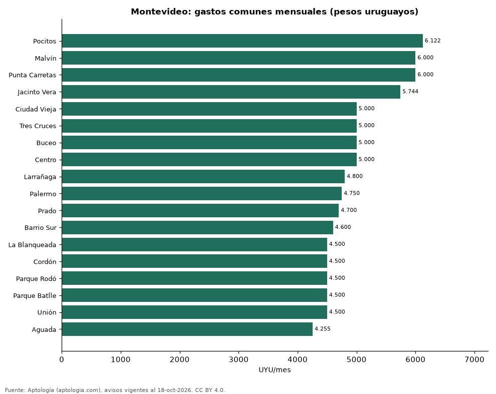

# Gastos comunes en Montevideo por barrio: cuánto suman al alquiler (octubre 2026)

**En Montevideo los gastos comunes de un apartamento en alquiler son en la mediana 5.000 pesos uruguayos (USD 124) al mes, el 15,7 % del alquiler. El barrio con los gastos comunes más altos es Pocitos (6.122 pesos uruguayos (USD 152)) y el de los más bajos, Aguada (4.255 pesos uruguayos (USD 106)).**

*Resumen: analizamos 2.656 avisos de alquiler en pesos uruguayos que declaran gastos comunes, en 18 barrios con 30 avisos o más.*

**Actualizado:** 18 de octubre de 2026 (datos del 18 de octubre de 2026) · **Próxima actualización:** mensual.

## Resumen

| Indicador | Valor |
|---|---|
| Gastos comunes (mediana) | 5.000 pesos uruguayos (USD 124) |
| Sobre el alquiler | 15,7 % |
| Más altos | Pocitos: 6.122 pesos uruguayos (USD 152) |
| Más bajos | Aguada: 4.255 pesos uruguayos (USD 106) |

## Gastos comunes por barrio

| Barrio | Gastos comunes (mediana) | Alquiler (mediana) | Gastos comunes / alquiler | Avisos |
|---|---|---|---|---|
| Pocitos | 6.122 pesos uruguayos (USD 152) | 36.500 pesos uruguayos (USD 908) | 16,7 % | 318 |
| Malvín | 6.000 pesos uruguayos (USD 149) | 36.000 pesos uruguayos (USD 895) | 17,1 % | 151 |
| Punta Carretas | 6.000 pesos uruguayos (USD 149) | 39.000 pesos uruguayos (USD 970) | 15,6 % | 120 |
| Jacinto Vera | 5.744 pesos uruguayos (USD 143) | 32.000 pesos uruguayos (USD 796) | 18,7 % | 32 |
| Ciudad Vieja | 5.000 pesos uruguayos (USD 124) | 28.000 pesos uruguayos (USD 696) | 16,6 % | 92 |
| Tres Cruces | 5.000 pesos uruguayos (USD 124) | 30.000 pesos uruguayos (USD 746) | 16,2 % | 203 |
| Buceo | 5.000 pesos uruguayos (USD 124) | 32.000 pesos uruguayos (USD 796) | 14,6 % | 79 |
| Centro | 5.000 pesos uruguayos (USD 124) | 29.000 pesos uruguayos (USD 721) | 17,1 % | 276 |
| Larrañaga | 4.800 pesos uruguayos (USD 119) | 28.500 pesos uruguayos (USD 709) | 16,7 % | 32 |
| Palermo | 4.750 pesos uruguayos (USD 118) | 29.200 pesos uruguayos (USD 726) | 15,7 % | 70 |
| Prado | 4.700 pesos uruguayos (USD 117) | 29.000 pesos uruguayos (USD 721) | 16,2 % | 43 |
| Barrio Sur | 4.600 pesos uruguayos (USD 114) | 30.000 pesos uruguayos (USD 746) | 14,7 % | 64 |
| La Blanqueada | 4.500 pesos uruguayos (USD 112) | 29.900 pesos uruguayos (USD 744) | 15,4 % | 227 |
| Cordón | 4.500 pesos uruguayos (USD 112) | 29.900 pesos uruguayos (USD 744) | 15,0 % | 357 |
| Parque Rodó | 4.500 pesos uruguayos (USD 112) | 32.000 pesos uruguayos (USD 796) | 12,9 % | 72 |
| Parque Batlle | 4.500 pesos uruguayos (USD 112) | 29.800 pesos uruguayos (USD 741) | 15,4 % | 84 |
| Unión | 4.500 pesos uruguayos (USD 112) | 27.250 pesos uruguayos (USD 678) | 15,2 % | 54 |
| Aguada | 4.255 pesos uruguayos (USD 106) | 26.000 pesos uruguayos (USD 647) | 15,7 % | 74 |

Medianas de avisos en pesos uruguayos (los avisos en dólares se excluyen).

## Preguntas frecuentes

**¿Cuánto son los gastos comunes en Montevideo?**
5.000 pesos uruguayos (USD 124) al mes en la mediana, el 15,7 % del alquiler (octubre de 2026).

**¿Dónde son más caros los gastos comunes?**
En Pocitos: 6.122 pesos uruguayos (USD 152) al mes en la mediana.

## Metodología

- **Fuente:** exportes nocturnos de la base de datos de Aptología (aptologia.com) del 18 de octubre de 2026: avisos vigentes de vivienda en portales inmobiliarios de 13 países, recogidos por Aptología y vistos en línea entre el 11 y el 18 de octubre de 2026. Corte: 18 de octubre de 2026.
- **Depuración:** se eliminan duplicados exactos (misma ciudad, zona, tipo, precio, moneda, área, habitaciones y baños) y los precios fuera del percentil 1–99 de cada país, operación, moneda y tipo; el precio por m² usa solo avisos con área declarada entre 12 y 2.000 m² y también se recorta al P1–P99.
- **Qué se mide:** precios pedidos (publicados), no precios de cierre. En arriendo, el canon mensual sin administración, gastos comunes ni condominio.
- **Muestra mínima:** cada cifra publicada se apoya en al menos 30 avisos; las celdas con menos se omiten.
- **Monedas:** nunca se mezclan avisos de monedas distintas sin convertirlos. Conversión a dólares con la tasa de mercado de ExchangeRate-API (open.er-api.com, actualización del 18 Oct 2026): 1 USD = 3.182,80 COP, 1 USD = 18,47 M.N, 1 USD = 5,09 BRL, 1 USD = 3,44 PEN, 1 USD = 982,44 CLP, 1 USD = 1.514,57 ARS, 1 USD = 40,20 UYU, 1 USD = 5.705,37 PYG, 1 USD = 61,27 DOP, 1 USD = 0,89 EUR, 1 USD = 11,72 BOB; la UF chilena a 41.178,64 CLP (mindicador,cl. 18-oct-2026). Los avisos publicados en dólares se usan tal cual.
- **Moneda:** solo avisos de alquiler en pesos uruguayos (la mayoría); los avisos en dólares se excluyen y nada se promedia entre monedas.
- **Gastos comunes:** valor mensual declarado en el aviso; se descartan valores nulos o mayores que el alquiler.
- **Limitaciones:** la cobertura depende de los portales que recorre Aptología en cada país y es mayor en las ciudades grandes y en los segmentos medio-alto y alto; el área es la que declara el aviso, sin verificar; los nombres de zona vienen de los portales.
- **Privacidad:** solo se publican agregados; no se publica ningún dato personal, enlace a avisos ni nombre de anunciante.
- **Datos abiertos:** [datos.csv](datos.csv), licencia CC BY 4.0.

## Cómo citar

Pinzón Pineda, D. M. (2026). *Gastos comunes en Montevideo por barrio: cuánto suman al alquiler (octubre 2026)*. Aptología (aptologia.com). https://github.com/elbroker/aptologia-datos/tree/main/estudios/gastos-comunes-montevideo-por-barrio-2026. Datos: datos.csv, licencia CC BY 4.0.
