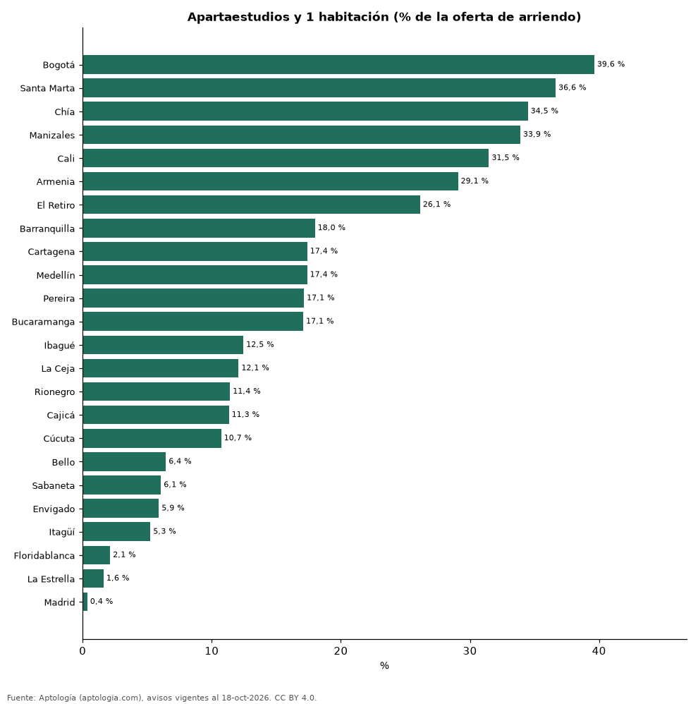

# Cuántas habitaciones tienen los apartamentos en arriendo en cada ciudad de Colombia (octubre 2026)

**En Bogotá el 39,6 % de los apartamentos en arriendo es apartaestudio o de 1 habitación, la mayor proporción de 24 ciudades; en Madrid es apenas el 0,4 %.** Donde más pesan los de 3 habitaciones o más es Floridablanca (81,3 %). En todo el país: 20,3 % de 1, 32,3 % de 2 y 47,4 % de 3 o más.

*Resumen: clasificamos 73.169 apartamentos y apartaestudios en arriendo por número de habitaciones en 24 ciudades con 200 avisos o más.*

**Actualizado:** 18 de octubre de 2026 (datos del 18 de octubre de 2026) · **Próxima actualización:** mensual.

## Resumen

| Indicador | Valor |
|---|---|
| 1 habitación o apartaestudio (Colombia) | 20,3 % |
| 2 habitaciones | 32,3 % |
| 3 o más | 47,4 % |
| Más oferta pequeña | Bogotá: 39,6 % |

## Oferta de arriendo por habitaciones

| Ciudad | Apartaestudio o 1 hab. | 2 habitaciones | 3 o más | Avisos |
|---|---|---|---|---|
| Bogotá | 39,6 % | 28,0 % | 32,3 % | 16.165 |
| Santa Marta | 36,6 % | 36,9 % | 26,4 % | 726 |
| Chía | 34,5 % | 40,2 % | 25,3 % | 580 |
| Manizales | 33,9 % | 30,5 % | 35,6 % | 413 |
| Cali | 31,5 % | 30,3 % | 38,3 % | 2.091 |
| Armenia | 29,1 % | 32,8 % | 38,1 % | 454 |
| El Retiro | 26,1 % | 58,3 % | 15,5 % | 593 |
| Barranquilla | 18,0 % | 34,0 % | 48,0 % | 4.241 |
| Cartagena | 17,4 % | 47,4 % | 35,2 % | 2.075 |
| Medellín | 17,4 % | 29,4 % | 53,2 % | 22.450 |
| Pereira | 17,1 % | 30,1 % | 52,8 % | 1.779 |
| Bucaramanga | 17,1 % | 21,9 % | 61,0 % | 515 |
| Ibagué | 12,5 % | 23,5 % | 64,0 % | 289 |
| La Ceja | 12,1 % | 40,9 % | 47,0 % | 389 |
| Rionegro | 11,4 % | 52,3 % | 36,3 % | 3.345 |
| Cajicá | 11,3 % | 50,7 % | 37,9 % | 406 |
| Cúcuta | 10,7 % | 24,7 % | 64,6 % | 438 |
| Bello | 6,4 % | 26,7 % | 66,9 % | 1.148 |
| Sabaneta | 6,1 % | 32,5 % | 61,5 % | 4.006 |
| Envigado | 5,9 % | 33,6 % | 60,5 % | 7.518 |
| Itagüí | 5,3 % | 31,6 % | 63,1 % | 933 |
| Floridablanca | 2,1 % | 16,5 % | 81,3 % | 375 |
| La Estrella | 1,6 % | 51,2 % | 47,2 % | 492 |
| Madrid | 0,4 % | 21,8 % | 77,8 % | 275 |

Porcentaje de los avisos en arriendo con número de habitaciones; los apartaestudios cuentan como 1.

## Preguntas frecuentes

**¿Qué tipo de apartamento se arrienda más en Colombia?**
El de 3 o más habitaciones, con el 47,4 % de la oferta.

**¿Dónde hay más apartaestudios en arriendo?**
En Bogotá: 39,6 % de los avisos.

## Metodología

- **Fuente:** exportes nocturnos de la base de datos de Aptología (aptologia.com) del 18 de octubre de 2026: avisos vigentes de vivienda en portales inmobiliarios de 13 países, recogidos por Aptología y vistos en línea entre el 11 y el 18 de octubre de 2026. Corte: 18 de octubre de 2026.
- **Depuración:** se eliminan duplicados exactos (misma ciudad, zona, tipo, precio, moneda, área, habitaciones y baños) y los precios fuera del percentil 1–99 de cada país, operación, moneda y tipo; el precio por m² usa solo avisos con área declarada entre 12 y 2.000 m² y también se recorta al P1–P99.
- **Qué se mide:** precios pedidos (publicados), no precios de cierre. En arriendo, el canon mensual sin administración, gastos comunes ni condominio.
- **Muestra mínima:** cada cifra publicada se apoya en al menos 30 avisos; las celdas con menos se omiten.
- **Colombia:** Precios en pesos colombianos, sin conversión de moneda.
- **Limitaciones:** la cobertura depende de los portales que recorre Aptología en cada país y es mayor en las ciudades grandes y en los segmentos medio-alto y alto; el área es la que declara el aviso, sin verificar; los nombres de zona vienen de los portales.
- **Privacidad:** solo se publican agregados; no se publica ningún dato personal, enlace a avisos ni nombre de anunciante.
- **Datos abiertos:** [datos.csv](datos.csv), licencia CC BY 4.0.

## Cómo citar

Pinzón Pineda, D. M. (2026). *Cuántas habitaciones tienen los apartamentos en arriendo en cada ciudad de Colombia (octubre 2026)*. Aptología (aptologia.com). https://github.com/elbroker/aptologia-datos/tree/main/estudios/habitaciones-de-la-oferta-de-arriendo-ciudades-colombia-2026. Datos: datos.csv, licencia CC BY 4.0.
