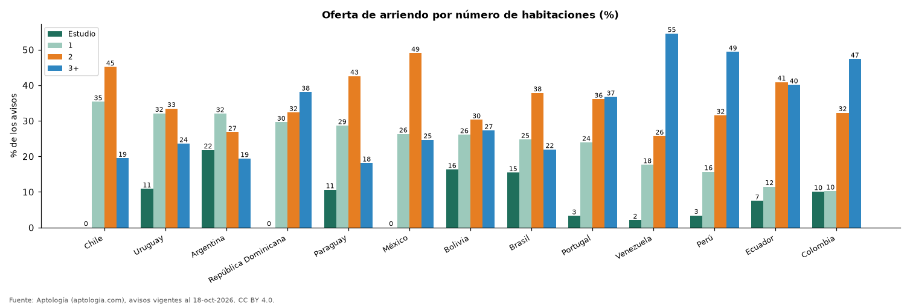

# Qué se arrienda en Latinoamérica: reparto de la oferta de apartamentos por número de habitaciones (octubre 2026)

**En Argentina el 53,8 % de los apartamentos en arriendo son estudios o de 1 habitación; en Ecuador apenas el 19,0 %.** En Colombia los de 3 o más habitaciones son el 47,4 % de la oferta.

*Resumen: clasificamos 136.163 apartamentos en arriendo de 13 países.*

**Actualizado:** 18 de octubre de 2026 (datos del 18 de octubre de 2026) · **Próxima actualización:** mensual.

## Resumen

| Indicador | Valor |
|---|---|
| Más oferta pequeña | Argentina: 53,8 % |
| Menos oferta pequeña | Ecuador: 19,0 % |
| Colombia, 3 o más hab. | 47,4 % |

## Reparto por país

| País | Estudio | 1 hab. | 2 hab. | 3 o más | Avisos |
|---|---|---|---|---|---|
| Chile | 0,0 % | 35,4 % | 45,1 % | 19,5 % | 8.592 |
| Uruguay | 10,9 % | 32,1 % | 33,4 % | 23,6 % | 7.212 |
| Argentina | 21,8 % | 32,0 % | 26,8 % | 19,4 % | 5.979 |
| República Dominicana | 0,0 % | 29,6 % | 32,3 % | 38,1 % | 4.186 |
| Paraguay | 10,6 % | 28,7 % | 42,6 % | 18,1 % | 5.032 |
| México | 0,0 % | 26,3 % | 49,1 % | 24,7 % | 8.953 |
| Bolivia | 16,3 % | 26,1 % | 30,3 % | 27,3 % | 1.750 |
| Brasil | 15,5 % | 24,8 % | 37,8 % | 21,9 % | 12.864 |
| Portugal | 3,3 % | 23,9 % | 36,1 % | 36,7 % | 610 |
| Venezuela | 2,1 % | 17,7 % | 25,7 % | 54,5 % | 385 |
| Perú | 3,4 % | 15,7 % | 31,5 % | 49,4 % | 4.405 |
| Ecuador | 7,5 % | 11,5 % | 40,9 % | 40,1 % | 3.026 |
| Colombia | 10,1 % | 10,2 % | 32,3 % | 47,4 % | 73.169 |

Estudio incluye apartaestudio, monoambiente, kitnet, suite o minidepartamento, según el país.

## Preguntas frecuentes

**¿Es difícil encontrar apartaestudios en arriendo en Colombia?**
Estudios y apartamentos de 1 habitación suman el 20,3 % de la oferta de arriendo en Colombia.

**¿En qué país hay más estudios y monoambientes en arriendo?**
En Argentina, donde son el 53,8 % junto con los de 1 habitación.

## Metodología

- **Fuente:** exportes nocturnos de la base de datos de Aptología (aptologia.com) del 18 de octubre de 2026: avisos vigentes de vivienda en portales inmobiliarios de 13 países, recogidos por Aptología y vistos en línea entre el 11 y el 18 de octubre de 2026. Corte: 18 de octubre de 2026.
- **Depuración:** se eliminan duplicados exactos (misma ciudad, zona, tipo, precio, moneda, área, habitaciones y baños) y los precios fuera del percentil 1–99 de cada país, operación, moneda y tipo; el precio por m² usa solo avisos con área declarada entre 12 y 2.000 m² y también se recorta al P1–P99.
- **Qué se mide:** precios pedidos (publicados), no precios de cierre. En arriendo, el canon mensual sin administración, gastos comunes ni condominio.
- **Muestra mínima:** cada cifra publicada se apoya en al menos 30 avisos; las celdas con menos se omiten.
- **Limitaciones:** la cobertura depende de los portales que recorre Aptología en cada país y es mayor en las ciudades grandes y en los segmentos medio-alto y alto; el área es la que declara el aviso, sin verificar; los nombres de zona vienen de los portales.
- **Privacidad:** solo se publican agregados; no se publica ningún dato personal, enlace a avisos ni nombre de anunciante.
- **Datos abiertos:** [datos.csv](datos.csv), licencia CC BY 4.0.

## Cómo citar

Pinzón Pineda, D. M. (2026). *Qué se arrienda en Latinoamérica: reparto de la oferta de apartamentos por número de habitaciones (octubre 2026)*. Aptología (aptologia.com). https://github.com/elbroker/aptologia-datos/tree/main/estudios/habitaciones-oferta-de-arriendo-por-pais-latinoamerica-2026. Datos: datos.csv, licencia CC BY 4.0.
