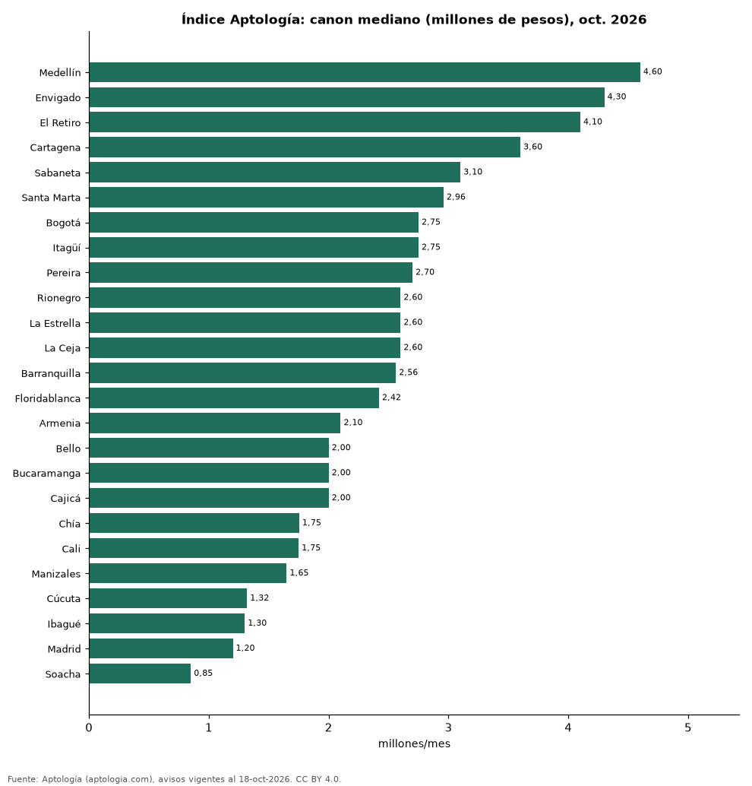

# Índice Aptología del arriendo, octubre de 2026: canon mediano de apartamentos en 25 ciudades de Colombia

**El Índice Aptología del arriendo de octubre de 2026 marca un canon mediano nacional de 3.420.362 pesos al mes para un apartamento en Colombia (promedio de 25 ciudades ponderado por avisos).** La ciudad más cara es Medellín (4.600.000 pesos) y la más barata Soacha (850.000 pesos); Bogotá marca 2.750.000 pesos.

*Resumen: usamos la última foto comparable de octubre de 25 ciudades con 300 avisos o más (103.172 avisos).*

**Actualizado:** 18 de octubre de 2026 (datos del 18 de octubre de 2026) · **Próxima actualización:** mensual.

## Resumen

| Indicador | Valor |
|---|---|
| Índice nacional (octubre 2026) | 3.420.362 pesos |
| Más cara | Medellín: 4.600.000 pesos |
| Más barata | Soacha: 850.000 pesos |
| Bogotá | 2.750.000 pesos |

## Ciudades

| Ciudad | Canon mediano | P25–P75 | Avisos | Foto del |
|---|---|---|---|---|
| Medellín | 4.600.000 pesos | 3.350.000 pesos – 6.650.000 pesos | 32.263 | 2026-10-18 |
| Envigado | 4.300.000 pesos | 3.600.000 pesos – 5.150.000 pesos | 9.797 | 2026-10-17 |
| El Retiro | 4.100.000 pesos | 3.300.000 pesos – 5.000.000 pesos | 679 | 2026-10-17 |
| Cartagena | 3.600.000 pesos | 2.500.000 pesos – 5.240.250 pesos | 2.468 | 2026-10-17 |
| Sabaneta | 3.100.000 pesos | 2.600.000 pesos – 3.500.000 pesos | 5.385 | 2026-10-18 |
| Santa Marta | 2.958.500 pesos | 2.200.000 pesos – 4.500.000 pesos | 818 | 2026-10-17 |
| Bogotá | 2.750.000 pesos | 1.700.000 pesos – 5.800.000 pesos | 28.097 | 2026-10-18 |
| Itagüí | 2.750.000 pesos | 2.300.000 pesos – 3.200.000 pesos | 1.185 | 2026-10-17 |
| Pereira | 2.700.000 pesos | 2.000.000 pesos – 3.800.000 pesos | 2.080 | 2026-10-17 |
| Rionegro | 2.600.000 pesos | 1.800.000 pesos – 3.100.000 pesos | 4.702 | 2026-10-17 |
| La Estrella | 2.600.000 pesos | 2.300.000 pesos – 2.850.000 pesos | 645 | 2026-10-17 |
| La Ceja | 2.600.000 pesos | 2.049.432 pesos – 3.000.000 pesos | 451 | 2026-10-17 |
| Barranquilla | 2.561.500 pesos | 1.700.000 pesos – 3.800.000 pesos | 5.654 | 2026-10-17 |
| Floridablanca | 2.420.000 pesos | 1.800.000 pesos – 2.900.000 pesos | 433 | 2026-10-17 |
| Armenia | 2.100.000 pesos | 1.500.000 pesos – 2.792.500 pesos | 512 | 2026-10-17 |
| Bello | 2.000.000 pesos | 1.750.000 pesos – 2.500.000 pesos | 1.505 | 2026-10-17 |
| Bucaramanga | 2.000.000 pesos | 1.400.000 pesos – 3.000.000 pesos | 617 | 2026-10-17 |
| Cajicá | 2.000.000 pesos | 1.680.000 pesos – 2.862.500 pesos | 420 | 2026-10-17 |
| Chía | 1.754.250 pesos | 1.450.000 pesos – 2.500.000 pesos | 620 | 2026-10-17 |
| Cali | 1.750.000 pesos | 1.200.000 pesos – 3.300.000 pesos | 2.772 | 2026-10-17 |
| Manizales | 1.650.000 pesos | 1.221.635 pesos – 2.700.000 pesos | 549 | 2026-10-17 |
| Cúcuta | 1.319.000 pesos | 1.000.000 pesos – 1.828.500 pesos | 524 | 2026-10-17 |
| Ibagué | 1.300.000 pesos | 987.300 pesos – 1.675.000 pesos | 359 | 2026-10-17 |
| Madrid | 1.200.000 pesos | 1.000.000 pesos – 1.257.000 pesos | 333 | 2026-10-17 |
| Soacha | 850.000 pesos | 750.000 pesos – 950.000 pesos | 304 | 2026-10-17 |

Apartamentos en arriendo, todos los tamaños; mediana del canon pedido.

## Preguntas frecuentes

**¿Cuánto cuesta en promedio arrendar un apartamento en Colombia?**
El Índice Aptología de octubre de 2026 da un canon mediano de 3.420.362 pesos al mes.

**¿Es comparable con meses anteriores?**
Todavía no: la serie de cada ciudad solo es comparable desde el 15 de octubre de 2026; este es el primer punto del índice.

## Metodología

- **Fuente:** exportes nocturnos de la base de datos de Aptología (aptologia.com) del 18 de octubre de 2026: avisos vigentes de vivienda en portales inmobiliarios de 13 países, recogidos por Aptología y vistos en línea entre el 11 y el 18 de octubre de 2026. Corte: 18 de octubre de 2026.
- **Depuración:** se eliminan duplicados exactos (misma ciudad, zona, tipo, precio, moneda, área, habitaciones y baños) y los precios fuera del percentil 1–99 de cada país, operación, moneda y tipo; el precio por m² usa solo avisos con área declarada entre 12 y 2.000 m² y también se recorta al P1–P99.
- **Qué se mide:** precios pedidos (publicados), no precios de cierre. En arriendo, el canon mensual sin administración, gastos comunes ni condominio.
- **Muestra mínima:** cada cifra publicada se apoya en al menos 30 avisos; las celdas con menos se omiten.
- **Colombia:** Precios en pesos colombianos, sin conversión de moneda.
- **Índice:** tabla indice_ciudad_mes (última foto comparable del mes por ciudad, ciudades con 300 avisos o más); índice nacional = promedio de medianas ponderado por avisos. **No es una tendencia:** la serie solo es comparable desde el 15-oct-2026 (indice_serie_desde).
- **Limitaciones:** la cobertura depende de los portales que recorre Aptología en cada país y es mayor en las ciudades grandes y en los segmentos medio-alto y alto; el área es la que declara el aviso, sin verificar; los nombres de zona vienen de los portales.
- **Privacidad:** solo se publican agregados; no se publica ningún dato personal, enlace a avisos ni nombre de anunciante.
- **Datos abiertos:** [datos.csv](datos.csv), licencia CC BY 4.0.

## Cómo citar

Pinzón Pineda, D. M. (2026). *Índice Aptología del arriendo, octubre de 2026: canon mediano de apartamentos en 25 ciudades de Colombia*. Aptología (aptologia.com). https://github.com/elbroker/aptologia-datos/tree/main/estudios/indice-aptologia-del-arriendo-ciudades-colombia-octubre-2026. Datos: datos.csv, licencia CC BY 4.0.
