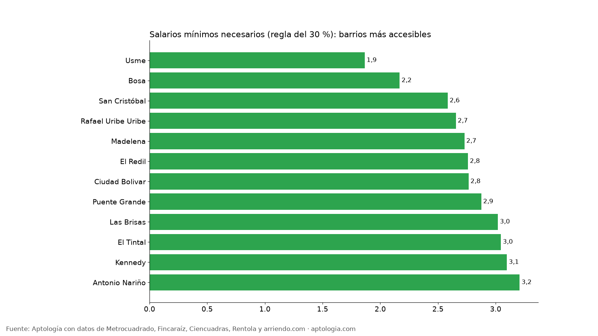
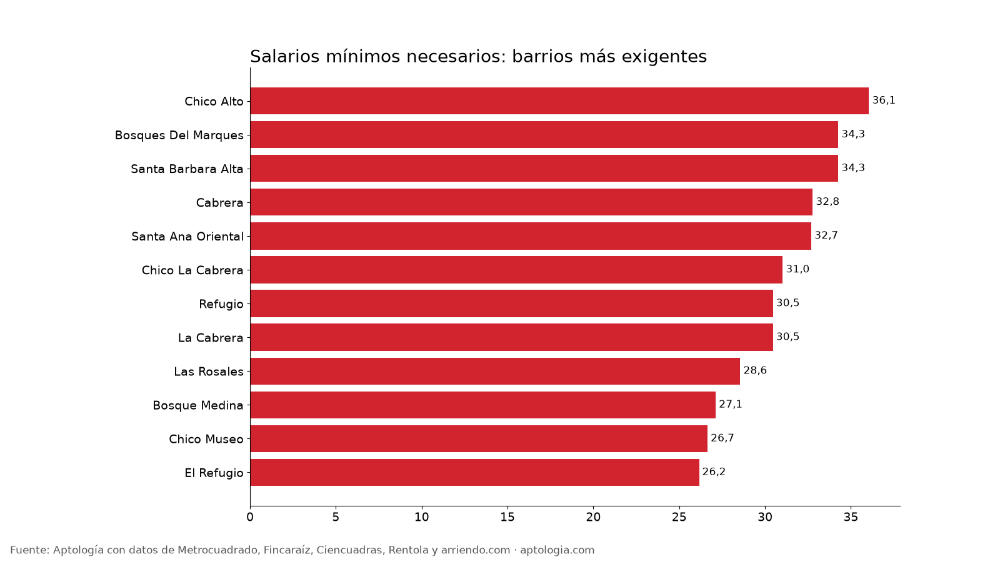

# ¿Cuánto hay que ganar para arrendar en Bogotá? Ingreso necesario por barrio en salarios mínimos (2026)

**Para arrendar un apartamento mediano de 2 habitaciones en Bogotá sin gastar más del 30 % del ingreso en vivienda, un hogar necesita ganar $7.000.000 al mes: 4,0 salarios mínimos de 2026.** Con 2 salarios mínimos ($3.501.810) solo alcanza el 2,0 % de los apartamentos en arriendo; en Usme bastan 1,9 salarios y en Chico Alto se necesitan 36,1.

*Resumen: calculamos el ingreso necesario con la regla del 30 % para 21.044 apartamentos en arriendo únicos en Bogotá, con el salario mínimo de 2026 ($1.750.905).*

**Actualizado:** 13 de octubre de 2026 · **Próxima actualización:** mensual.

## Ingreso necesario según habitaciones

| Habitaciones | Avisos | Total mensual mediano (canon + adm.) | Ingreso necesario (30 %) | Salarios mínimos |
|---|---|---|---|---|
| 1 | 6.020 | $2.324.642 | $7.748.805 | 4,4 |
| 2 | 7.844 | $2.100.000 | $7.000.000 | 4,0 |
| 3 | 6.084 | $5.955.700 | $19.852.333 | 11,3 |
| 4 o más | 1.094 | $16.111.145 | $53.703.815 | 30,7 |

## ¿Qué parte de la oferta alcanza con tu ingreso?

| Ingreso del hogar | En pesos | % de apartamentos que alcanzas |
|---|---|---|
| 1 salario mínimo | $1.750.905 | 0,0 % |
| 2 salarios | $3.501.810 | 2,0 % |
| 3 salarios | $5.252.715 | 13,9 % |
| 4 salarios | $7.003.620 | 36,0 % |
| 6 salarios | $10.505.430 | 54,0 % |

## Ingreso necesario por barrio

| Barrio | Estrato mediano | Canon mediano | Total mensual mediano | Ingreso necesario | Salarios mínimos | Avisos |
|---|---|---|---|---|---|---|
| Usme | 3 | $850.000 | $980.000 | $3.266.667 | 1,9 | 93 |
| Bosa | 2 | $1.000.000 | $1.139.074 | $3.796.915 | 2,2 | 159 |
| San Cristóbal | — | $1.168.400 | $1.358.056 | $4.526.852 | 2,6 | 60 |
| Rafael Uribe Uribe | 2 | $1.200.000 | $1.394.785 | $4.649.283 | 2,7 | 77 |
| Madelena | 3 | $1.369.600 | $1.433.800 | $4.779.333 | 2,7 | 35 |
| El Redil | 4 | $1.275.000 | $1.450.000 | $4.833.333 | 2,8 | 164 |
| Ciudad Bolivar | 2 | $1.250.000 | $1.452.901 | $4.843.003 | 2,8 | 132 |
| Puente Grande | 3 | $1.310.000 | $1.510.672 | $5.035.574 | 2,9 | 28 |
| Las Brisas | 3 | $1.417.000 | $1.586.667 | $5.288.889 | 3,0 | 32 |
| El Tintal | 3 | $1.450.000 | $1.600.000 | $5.333.333 | 3,0 | 41 |
| Kennedy | 3 | $1.400.000 | $1.627.249 | $5.424.164 | 3,1 | 447 |
| Antonio Nariño | 3 | $1.450.000 | $1.685.365 | $5.617.884 | 3,2 | 67 |
| Fontibon | 3 | $1.500.000 | $1.700.000 | $5.666.667 | 3,2 | 162 |
| Siete De Agosto | 3 | $1.500.000 | $1.700.000 | $5.666.667 | 3,2 | 37 |
| Mirandela | 3 | $1.500.000 | $1.725.500 | $5.751.667 | 3,3 | 52 |
| Engativá | 3 | $1.550.000 | $1.743.481 | $5.811.604 | 3,3 | 373 |
| Fontibón | — | $1.500.000 | $1.743.481 | $5.811.604 | 3,3 | 596 |
| Lagos De Torca | 3 | $1.650.000 | $1.800.000 | $6.000.000 | 3,4 | 125 |
| Paloquemao | 3 | $1.600.000 | $1.811.769 | $6.039.231 | 3,4 | 27 |
| Casa Blanca | 3 | $1.650.000 | $1.813.333 | $6.044.444 | 3,5 | 34 |
| Castilla | 3 | $1.600.000 | $1.813.333 | $6.044.444 | 3,5 | 52 |
| Los Mártires | — | $1.576.990 | $1.832.968 | $6.109.894 | 3,5 | 142 |
| Puente Aranda | 3 | $1.600.000 | $1.859.713 | $6.199.044 | 3,5 | 252 |
| Colombia | 4 | $1.600.000 | $1.859.713 | $6.199.044 | 3,5 | 37 |
| La Veracruz | 3 | $1.700.000 | $1.915.000 | $6.383.333 | 3,6 | 33 |
| Hayuelos | 3 | $1.700.000 | $1.915.333 | $6.384.444 | 3,6 | 46 |
| Suba | 4 | $1.650.000 | $1.917.829 | $6.392.764 | 3,7 | 728 |
| Barrios Unidos | 3 | $1.742.442 | $1.933.915 | $6.446.382 | 3,7 | 382 |
| Usaquén | 3 | $1.700.000 | $1.975.945 | $6.586.484 | 3,8 | 529 |
| Torca | 4 | $1.775.000 | $2.000.000 | $6.666.667 | 3,8 | 44 |
| Bogotá | 3 | $1.800.000 | $2.000.000 | $6.666.667 | 3,8 | 71 |
| Alameda | 4 | $1.850.000 | $2.000.000 | $6.666.667 | 3,8 | 47 |
| Teusaquillo | 4 | $1.750.000 | $2.032.340 | $6.774.467 | 3,9 | 291 |
| Santa Fé | — | $1.756.000 | $2.041.035 | $6.803.451 | 3,9 | 220 |
| Upzs La Candelaria | — | $1.800.000 | $2.092.177 | $6.973.925 | 4,0 | 35 |
| Santa Fe | 3 | $1.900.000 | $2.100.000 | $7.000.000 | 4,0 | 31 |
| San Jose De Usaquen | 4 | $1.950.000 | $2.201.312 | $7.337.708 | 4,2 | 45 |
| Montevideo | 4 | $2.000.000 | $2.201.312 | $7.337.708 | 4,2 | 52 |
| San Jose De Bavaria | 4 | $1.980.000 | $2.201.312 | $7.337.708 | 4,2 | 55 |
| Chapinero Chapinero Central | 3 | $1.832.756 | $2.235.275 | $7.450.917 | 4,3 | 27 |
| A.S.D. | 4 | $2.000.000 | $2.283.333 | $7.611.111 | 4,3 | 30 |
| El Plan | 4 | $2.099.000 | $2.295.383 | $7.651.278 | 4,4 | 28 |
| Santa Cecilia | 4 | $2.075.000 | $2.300.000 | $7.666.667 | 4,4 | 25 |
| Las Nieves | 3 | $1.977.800 | $2.320.000 | $7.733.333 | 4,4 | 97 |
| Chapinero Central | 3 | $2.064.800 | $2.322.361 | $7.741.203 | 4,4 | 126 |
| Chapinero | 4 | $2.100.000 | $2.388.000 | $7.960.000 | 4,5 | 561 |
| Prado Veraniego | 3 | $2.100.000 | $2.480.000 | $8.266.667 | 4,7 | 29 |
| La Candelaria | 3 | $2.000.000 | $2.493.333 | $8.311.111 | 4,7 | 54 |
| Modelia | 4 | $2.200.000 | $2.548.888 | $8.496.293 | 4,9 | 45 |
| La Salle | 4 | $2.600.000 | $2.600.000 | $8.666.667 | 4,9 | 33 |
| Polo Club | 4 | $2.400.000 | $2.720.000 | $9.066.667 | 5,2 | 31 |
| Marly | 4 | $2.375.500 | $2.750.000 | $9.166.667 | 5,2 | 26 |
| Colina Campestre | 4 | $2.400.000 | $2.799.000 | $9.330.000 | 5,3 | 165 |
| Centro Internacional | 4 | $2.600.000 | $2.873.232 | $9.577.439 | 5,5 | 116 |
| Niza | 4 | $2.500.000 | $2.899.939 | $9.666.464 | 5,5 | 27 |
| Cedritos | 4 | $2.650.000 | $3.000.000 | $10.000.000 | 5,7 | 344 |
| Santa Teresa | 4 | $2.750.000 | $3.050.000 | $10.166.667 | 5,8 | 33 |
| Quinta Paredes | 4 | $2.950.000 | $3.056.575 | $10.188.583 | 5,8 | 40 |
| Samper | 4 | $2.750.000 | $3.114.090 | $10.380.301 | 5,9 | 32 |
| Mazuren | 4 | $2.800.000 | $3.186.110 | $10.620.366 | 6,1 | 35 |
| La Castellana | 4 | $2.800.000 | $3.230.522 | $10.768.407 | 6,2 | 48 |
| Pardo Rubio | 4 | $2.981.400 | $3.309.200 | $11.030.667 | 6,3 | 39 |
| Los Cedritos | 4 | $2.853.000 | $3.356.000 | $11.186.667 | 6,4 | 25 |
| La Macarena | 4 | $3.000.000 | $3.385.000 | $11.283.333 | 6,4 | 52 |
| La Felicidad | 4 | $3.100.000 | $3.500.000 | $11.666.667 | 6,7 | 73 |
| San Martin | 4 | $3.300.000 | $3.600.000 | $12.000.000 | 6,9 | 33 |
| Nicolas De Federman | 4 | $3.350.000 | $3.707.473 | $12.358.244 | 7,1 | 49 |
| La Soledad | 4 | $3.200.000 | $3.720.000 | $12.400.000 | 7,1 | 25 |
| Chapinero Alto | 4 | $3.250.000 | $3.747.500 | $12.491.667 | 7,1 | 134 |
| Ciudad Salitre | 4 | $3.400.000 | $3.823.332 | $12.744.439 | 7,3 | 113 |
| Belmira | 4 | $3.650.000 | $3.927.524 | $13.091.748 | 7,5 | 28 |
| Lisboa | 5 | $3.650.000 | $4.042.570 | $13.475.234 | 7,7 | 34 |
| Alhambra | 5 | $3.500.000 | $4.054.000 | $13.513.333 | 7,7 | 25 |
| Puente Largo | 5 | $3.500.000 | $4.076.305 | $13.587.684 | 7,8 | 27 |
| Pasadena | 5 | $3.600.000 | $4.100.000 | $13.666.667 | 7,8 | 43 |
| Chico Norte Iii | 6 | $4.550.000 | $4.726.000 | $15.753.333 | 9,0 | 45 |
| Santa Barbara Oriental | 5 | $4.000.150 | $4.780.500 | $15.935.000 | 9,1 | 74 |
| Altos De Bella Suiza | 5 | $4.000.000 | $4.800.000 | $16.000.000 | 9,1 | 25 |
| Quinta Camacho | 4 | $4.170.500 | $4.831.000 | $16.103.333 | 9,2 | 38 |
| La Calleja | 5 | $4.783.500 | $5.229.310 | $17.431.034 | 10,0 | 59 |
| Santa Barbara | 6 | $4.600.000 | $5.240.964 | $17.469.880 | 10,0 | 381 |
| Bella Suiza | 5 | $4.500.000 | $5.240.964 | $17.469.880 | 10,0 | 134 |
| Santa Barbara Occidental | 5 | $4.607.500 | $5.375.000 | $17.916.667 | 10,2 | 140 |
| Santa Barbara Central | 6 | $4.900.000 | $5.514.000 | $18.380.000 | 10,5 | 165 |
| Usaquen | 6 | $5.100.000 | $6.021.379 | $20.071.264 | 11,5 | 114 |
| Antiguo Country | 5 | $5.500.000 | $6.181.000 | $20.603.333 | 11,8 | 137 |
| Emaus | 6 | $5.825.000 | $6.295.000 | $20.983.333 | 12,0 | 26 |
| Rincon Del Chico | 6 | $5.500.000 | $6.300.000 | $21.000.000 | 12,0 | 53 |
| Chico Norte Et. Iii | 6 | $5.500.000 | $6.359.247 | $21.197.489 | 12,1 | 68 |
| San Patricio | 6 | $5.600.000 | $6.500.000 | $21.666.667 | 12,4 | 201 |
| Santa Paula | 6 | $5.575.000 | $6.595.000 | $21.983.333 | 12,6 | 132 |
| Chico Navarra | 6 | $6.350.000 | $6.800.000 | $22.666.667 | 12,9 | 114 |
| Santa Bibiana | 6 | $6.500.000 | $7.000.000 | $23.333.333 | 13,3 | 75 |
| Chicó Navarra | 6 | $6.400.000 | $7.252.414 | $24.174.713 | 13,8 | 66 |
| Molinos Norte | 6 | $6.418.500 | $7.307.000 | $24.356.667 | 13,9 | 36 |
| Chico Norte | 6 | $6.500.000 | $7.364.000 | $24.546.667 | 14,0 | 666 |
| Chicó Norte | 6 | $6.500.000 | $7.553.448 | $25.178.161 | 14,4 | 55 |
| Chico | 6 | $7.000.000 | $8.000.000 | $26.666.667 | 15,2 | 325 |
| El Chico | 6 | $7.941.500 | $8.633.000 | $28.776.667 | 16,4 | 138 |
| Parque Del Virrey | 6 | $7.500.000 | $8.642.259 | $28.807.529 | 16,5 | 46 |
| Chico Norte Et. Ii | 6 | $7.750.000 | $9.006.034 | $30.020.115 | 17,1 | 46 |
| Chico Virrey | 6 | $8.000.000 | $9.296.552 | $30.988.506 | 17,7 | 51 |
| El Virrey | 6 | $8.500.000 | $9.500.000 | $31.666.667 | 18,1 | 127 |
| La Carolina | 6 | $9.000.000 | $9.500.000 | $31.666.667 | 18,1 | 130 |
| Virrey | 6 | $8.300.000 | $9.550.201 | $31.834.003 | 18,2 | 61 |
| Chico Norte Ii | 6 | $8.500.000 | $9.877.586 | $32.925.287 | 18,8 | 27 |
| El Nogal | 6 | $10.000.000 | $11.039.655 | $36.798.851 | 21,0 | 189 |
| Bellavista | 6 | $9.500.000 | $11.500.000 | $38.333.333 | 21,9 | 38 |
| Rosales | 6 | $10.500.000 | $11.925.000 | $39.750.000 | 22,7 | 112 |
| Nogal | 6 | $10.250.000 | $12.050.000 | $40.166.667 | 22,9 | 42 |
| Santa Ana | 6 | $11.500.000 | $12.750.000 | $42.500.000 | 24,3 | 52 |
| Chicó Alto | 6 | $10.950.000 | $12.858.845 | $42.862.817 | 24,5 | 26 |
| Los Rosales | 6 | $11.000.000 | $13.216.000 | $44.053.333 | 25,2 | 451 |
| Chico Reservado | 6 | $11.500.000 | $13.300.000 | $44.333.333 | 25,3 | 241 |
| Chicó Reservado | 6 | $11.500.000 | $13.310.000 | $44.366.667 | 25,3 | 61 |
| El Refugio | 6 | $12.000.000 | $13.741.000 | $45.803.333 | 26,2 | 123 |
| Chico Museo | 6 | $13.000.000 | $14.000.000 | $46.666.667 | 26,7 | 31 |
| Bosque Medina | 6 | $13.350.000 | $14.250.000 | $47.500.000 | 27,1 | 46 |
| Las Rosales | 6 | $13.750.000 | $15.000.000 | $50.000.000 | 28,6 | 62 |
| La Cabrera | 6 | $14.500.000 | $16.000.000 | $53.333.333 | 30,5 | 439 |
| Refugio | 6 | $13.387.000 | $16.000.000 | $53.333.333 | 30,5 | 32 |
| Chico La Cabrera | 6 | $14.500.000 | $16.300.000 | $54.333.333 | 31,0 | 56 |
| Santa Ana Oriental | 6 | $15.000.000 | $17.175.000 | $57.250.000 | 32,7 | 72 |
| Cabrera | 6 | $15.000.000 | $17.215.517 | $57.385.057 | 32,8 | 108 |
| Santa Barbara Alta | 6 | $15.000.000 | $18.000.000 | $60.000.000 | 34,3 | 103 |
| Bosques Del Marques | 6 | $15.800.000 | $18.000.000 | $60.000.000 | 34,3 | 27 |
| Chico Alto | 6 | $16.000.000 | $18.940.000 | $63.133.333 | 36,1 | 44 |

**Cómo usarlo para decidir:** suma el ingreso de todo el hogar, multiplícalo por 0,3 y ese es tu techo de canon más administración. Muchas inmobiliarias y aseguradoras exigen que el ingreso sea 2,5 a 3 veces el canon; esta tabla te dice en qué barrios cumples.

## Preguntas frecuentes

**¿Cuánto hay que ganar para arrendar en Bogotá?**
Para un 2 habitaciones mediano, $7.000.000 al mes (4,0 salarios mínimos), si el arriendo con administración no pasa del 30 % del ingreso, corte al 13 de octubre de 2026.

**¿Qué puedo arrendar en Bogotá con 2 salarios mínimos?**
El 2,0 % de los apartamentos en arriendo cumple la regla del 30 % con $3.501.810 de ingreso del hogar.

## Metodología

- **Fuente:** base de ingesta diaria de Aptología, con avisos públicos de Metrocuadrado, Fincaraíz, Ciencuadras, Rentola y arriendo.com. Corte al 13 de octubre de 2026.
- **Filtros:** avisos vivos que pasan el control de calidad, en Bogotá, canon entre $400.000 y $30.000.000. Se excluyen TikTok y Facebook Marketplace.
- **Duplicados:** se deja un aviso por grupo de duplicados (el mismo inmueble en varios portales).
- **Regla del 30 %:** ingreso necesario = (canon + administración) / 0,30. Salario mínimo 2026: $1.750.905 (Decreto 1469 de 2025). Si el aviso no publica la administración y no la incluye, se estima con la proporción mediana administración/canon de su estrato. Barrios con 25 avisos o más.
- **Limitaciones:** son precios pedidos, no cerrados. Los barrios y localidades vienen tal como los escribe cada portal.
- **Datos abiertos:** [datos.csv](data/ingreso_necesario_para_arrendar_por_barrio_bogota_datos.csv), licencia CC BY 4.0.

## Cómo citar

Pinzón Pineda, D. M. (2026). *¿Cuánto hay que ganar para arrendar en Bogotá? Ingreso necesario por barrio en salarios mínimos (2026)*. Aptología. https://www.aptologia.com/estudios/ingreso-necesario-para-arrendar-por-barrio-bogota. Datos: datos.csv, licencia CC BY 4.0.
