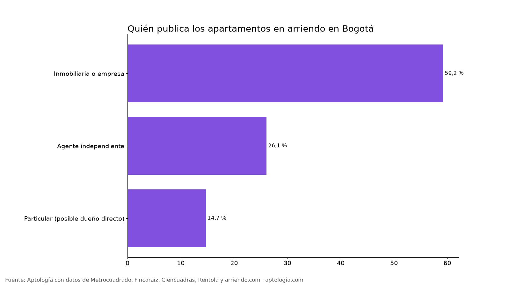
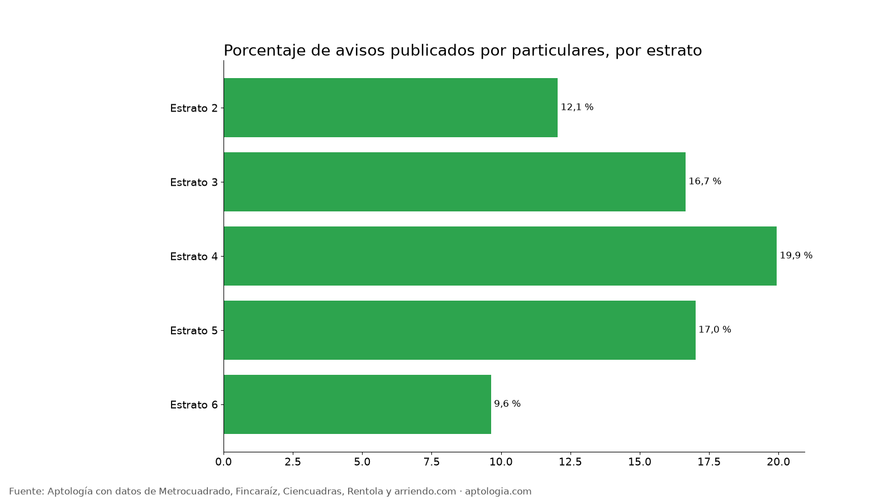

# Arrendar con inmobiliaria o directo con el dueño en Bogotá: cuántos hay y cuánto cambia el precio (2026)

**En Bogotá, solo el 14,7 % de los apartamentos en arriendo los publica un particular (posible dueño directo); el 59,2 % lo publica una inmobiliaria o empresa.** Frente a un apartamento comparable de inmobiliaria, el de particular cuesta 2,4 % menos por m².

*Resumen: clasificamos 16.553 apartamentos en arriendo únicos en Bogotá según quién los publica.*

**Actualizado:** 13 de octubre de 2026 · **Próxima actualización:** mensual.

## Inmobiliaria, agente o particular

| Anunciante | Avisos | % de avisos | Canon mediano | Por m² | Área mediana | Diferencia por m² vs. inmobiliaria (comparable) |
|---|---|---|---|---|---|---|
| Inmobiliaria o empresa | 9.803 | 59,2 % | $3.200.000 | $50.449/m² | 65 m² | 0,0 % |
| Agente independiente | 4.316 | 26,1 % | $4.606.500 | $55.000/m² | 83 m² | 2,3 % |
| Particular (posible dueño directo) | 2.434 | 14,7 % | $2.800.000 | $49.123/m² | 60 m² | -2,4 % |
| Particular · estrato 2 | 67 | 12,1 % | $1.300.000 | $25.926/m² | 50 m² | 4,6 % |
| Particular · estrato 3 | 611 | 16,7 % | $1.650.000 | $38.889/m² | 45 m² | -2,2 % |
| Particular · estrato 4 | 786 | 19,9 % | $2.500.000 | $48.639/m² | 53 m² | -1,2 % |
| Particular · estrato 5 | 369 | 17,0 % | $3.800.000 | $54.286/m² | 73 m² | -2,0 % |
| Particular · estrato 6 | 590 | 9,6 % | $6.475.000 | $60.417/m² | 109 m² | -9,5 % |

**Cómo usarlo para decidir:** con un particular suele haber más margen para negociar y menos requisitos, pero pide contrato escrito y no pagues nada antes de ver el inmueble y verificar que quien lo ofrece es el dueño (certificado de tradición y libertad). Con inmobiliaria pagas estudio de póliza, pero tienes respaldo en reparaciones y en la entrega.

## Preguntas frecuentes

**¿Es más barato arrendar directo con el dueño en Bogotá?**
Frente a un apartamento comparable de inmobiliaria, el de particular cuesta -2,4 % por m², corte al 13 de octubre de 2026.

**¿Cuántos arriendos publica el dueño directamente en Bogotá?**
El 14,7 % de los avisos con anunciante identificado.

## Metodología

- **Fuente:** base de ingesta diaria de Aptología, con avisos públicos de Metrocuadrado, Fincaraíz, Ciencuadras, Rentola y arriendo.com. Corte al 13 de octubre de 2026.
- **Filtros:** avisos vivos que pasan el control de calidad, en Bogotá, canon entre $400.000 y $30.000.000. Se excluyen TikTok y Facebook Marketplace.
- **Duplicados:** se deja un aviso por grupo de duplicados (el mismo inmueble en varios portales).
- **Prima emparejada:** se compara el precio por m² de avisos de cada tipo de anunciante frente a inmobiliarias dentro de la misma celda de estrato × habitaciones (mínimo 8 avisos por lado) y se reporta la mediana ponderada de las diferencias. Así la prima no se confunde con estrato o tamaño. El atributo se detecta en el texto del aviso, por lo que solo cuentan avisos con descripción. **Tipo de anunciante:** se clasifica por el nombre del anunciante en Metrocuadrado, Fincaraíz y Ciencuadras. Es empresa si el nombre trae palabras como inmobiliaria, SAS o Ltda.; si es un nombre de persona con 3 avisos o menos, se toma como particular (posible dueño directo); con más de 3 avisos, como agente independiente. Es una aproximación.
- **Limitaciones:** son precios pedidos, no cerrados. Los barrios y localidades vienen tal como los escribe cada portal.
- **Datos abiertos:** [datos.csv](data/inmobiliaria_vs_particular_arriendo_bogota_datos.csv), licencia CC BY 4.0.

## Cómo citar

Pinzón Pineda, D. M. (2026). *Arrendar con inmobiliaria o directo con el dueño en Bogotá: cuántos hay y cuánto cambia el precio (2026)*. Aptología. https://www.aptologia.com/estudios/inmobiliaria-vs-particular-arriendo-bogota. Datos: datos.csv, licencia CC BY 4.0.
