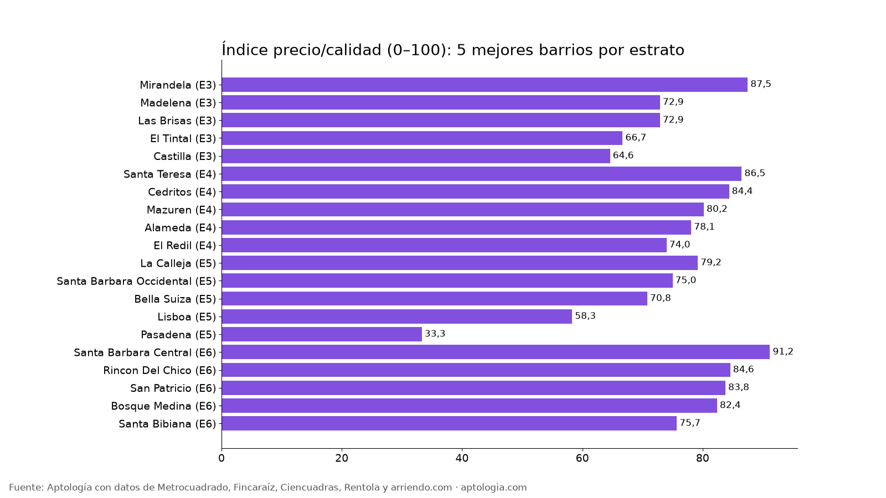

# Mejores barrios de Bogotá en relación precio/calidad para arrendar (octubre 2026)

**Por lo que pagas, los barrios que más dan en Bogotá son Mirandela en estrato 3 (33,6 m² por cada millón de canon), Santa Teresa en estrato 4 (26,0 m² por millón, 76 % con parqueadero), La Calleja en estrato 5 y Santa Barbara Central en estrato 6.** El índice compara cada barrio solo con barrios de su mismo estrato: 50 % metros cuadrados por peso, 25 % parqueadero y 25 % habitaciones por peso.

*Resumen: 80 barrios con al menos 30 apartamentos en arriendo (área, habitaciones y estrato publicados), sin duplicados, corte al 12 de octubre de 2026.*

**Actualizado:** 12 de octubre de 2026 · **Próxima actualización:** mensual.

## Estrato 3

| Barrio | Índice (0–100) | m² por millón | % con parqueadero | Habitaciones (prom.) | Canon mediano | Área mediana | Avisos |
|---|---|---|---|---|---|---|---|
| [Mirandela](/arriendo/bogota/mirandela) | 87,5 | 33,6 | 26 % | 2,1 | $1.500.000 | 45 m² | 51 |
| [Madelena](/arriendo/bogota/madelena) | 72,9 | 30,4 | 11 % | 2,2 | $1.369.600 | 41 m² | 35 |
| [Las Brisas](/arriendo/bogota/las-brisas) | 72,9 | 32,1 | 3 % | 2,2 | $1.417.000 | 45 m² | 32 |
| [El Tintal](/arriendo/bogota/el-tintal) | 66,7 | 28,0 | 18 % | 2,2 | $1.450.000 | 40 m² | 39 |
| [Castilla](/arriendo/bogota/castilla) | 64,6 | 29,4 | 16 % | 2,2 | $1.600.000 | 48 m² | 51 |
| [Casa Blanca](/arriendo/bogota/casa-blanca) | 58,3 | 26,4 | 19 % | 2,1 | $1.650.000 | 45 m² | 36 |
| [Hayuelos](/arriendo/bogota/hayuelos) | 52,1 | 25,8 | 36 % | 2,2 | $1.700.000 | 42 m² | 45 |
| [Lagos de Torca](/arriendo/bogota/lagos-de-torca) | 47,9 | 25,9 | 25 % | 2,1 | $1.650.000 | 43 m² | 116 |
| [Torca](/arriendo/bogota/torca) | 41,7 | 26,2 | 15 % | 2,0 | $1.750.000 | 45 m² | 47 |
| [Chapinero Central](/arriendo/bogota/chapinero-central) | 33,3 | 18,6 | 39 % | 1,3 | $2.100.000 | 38 m² | 117 |
| [Las Nieves](/arriendo/bogota/las-nieves) | 27,1 | 16,4 | 29 % | 1,2 | $2.000.000 | 33 m² | 89 |
| [Siete De Agosto](/arriendo/bogota/siete-de-agosto) | 20,8 | 19,2 | 3 % | 1,2 | $1.500.000 | 25 m² | 37 |
| [La Veracruz](/arriendo/bogota/la-veracruz) | 4,2 | 14,8 | 0 % | 1,2 | $1.700.000 | 25 m² | 31 |

## Estrato 4

| Barrio | Índice (0–100) | m² por millón | % con parqueadero | Habitaciones (prom.) | Canon mediano | Área mediana | Avisos |
|---|---|---|---|---|---|---|---|
| [Santa Teresa](/arriendo/bogota/santa-teresa) | 86,5 | 26,0 | 76 % | 2,5 | $2.700.000 | 68 m² | 33 |
| [Cedritos](/arriendo/bogota/cedritos) | 84,4 | 24,0 | 91 % | 2,0 | $2.650.000 | 70 m² | 339 |
| [Mazuren](/arriendo/bogota/mazuren) | 80,2 | 23,0 | 73 % | 2,6 | $2.800.000 | 74 m² | 48 |
| [Alameda](/arriendo/bogota/alameda) | 78,1 | 23,9 | 47 % | 2,3 | $1.850.000 | 50 m² | 49 |
| [El Redil](/arriendo/bogota/el-redil) | 74,0 | 31,8 | 14 % | 1,5 | $1.300.000 | 40 m² | 167 |
| [Colina Campestre](/arriendo/bogota/colina-campestre) | 74,0 | 21,2 | 60 % | 2,3 | $2.400.000 | 60 m² | 167 |
| [San Jose De Usaquen](/arriendo/bogota/san-jose-de-usaquen) | 69,8 | 22,9 | 47 % | 2,3 | $2.000.000 | 52 m² | 45 |
| [San jose de bavaria](/arriendo/bogota/san-jose-de-bavaria) | 66,7 | 21,0 | 47 % | 2,1 | $2.000.000 | 42 m² | 68 |
| [Nicolas De Federman](/arriendo/bogota/nicolas-de-federman) | 61,5 | 20,7 | 62 % | 2,2 | $3.312.625 | 75 m² | 52 |
| [Montevideo](/arriendo/bogota/montevideo) | 58,3 | 20,9 | 31 % | 2,1 | $2.000.000 | 42 m² | 51 |
| [Quinta Paredes](/arriendo/bogota/quinta-paredes) | 58,3 | 20,0 | 92 % | 1,9 | $3.000.000 | 59 m² | 38 |
| [La Felicidad](/arriendo/bogota/la-felicidad) | 57,3 | 20,6 | 56 % | 2,3 | $3.100.000 | 64 m² | 73 |
| [La Salle](/arriendo/bogota/la-salle) | 52,1 | 20,6 | 48 % | 1,9 | $2.600.000 | 50 m² | 31 |
| [Modelia](/arriendo/bogota/modelia) | 52,1 | 20,2 | 48 % | 1,9 | $2.250.000 | 51 m² | 44 |
| [Chapinero Alto](/arriendo/bogota/chapinero-alto) | 44,8 | 18,2 | 79 % | 1,7 | $3.300.000 | 58 m² | 126 |
| [El Plan](/arriendo/bogota/el-plan) | 42,7 | 18,8 | 30 % | 2,0 | $2.099.000 | 37 m² | 30 |
| [Ciudad salitre](/arriendo/bogota/ciudad-salitre) | 39,6 | 17,1 | 56 % | 2,1 | $3.400.000 | 60 m² | 117 |
| [Pardo Rubio](/arriendo/bogota/pardo-rubio) | 38,5 | 17,3 | 49 % | 1,7 | $3.000.000 | 53 m² | 35 |
| [Quinta Camacho](/arriendo/bogota/quinta-camacho) | 26,0 | 14,7 | 64 % | 2,2 | $4.200.000 | 65 m² | 39 |
| [Samper](/arriendo/bogota/samper) | 22,9 | 15,8 | 52 % | 1,3 | $2.800.000 | 40 m² | 31 |
| [Polo Club](/arriendo/bogota/polo-club) | 19,8 | 16,0 | 36 % | 1,3 | $2.400.000 | 35 m² | 31 |
| [La Macarena](/arriendo/bogota/la-macarena) | 18,8 | 16,8 | 39 % | 1,4 | $3.000.000 | 46 m² | 51 |
| [Centro Internacional](/arriendo/bogota/centro-internacional) | 16,7 | 16,2 | 30 % | 1,4 | $2.600.000 | 40 m² | 112 |
| [La Castellana](/arriendo/bogota/la-castellana) | 12,5 | 14,0 | 46 % | 1,6 | $2.900.000 | 44 m² | 44 |
| [San Martin](/arriendo/bogota/san-martin) | 11,5 | 14,9 | 47 % | 1,3 | $3.282.500 | 49 m² | 30 |

## Estrato 5

| Barrio | Índice (0–100) | m² por millón | % con parqueadero | Habitaciones (prom.) | Canon mediano | Área mediana | Avisos |
|---|---|---|---|---|---|---|---|
| [La Calleja](/arriendo/bogota/la-calleja) | 79,2 | 19,2 | 97 % | 2,3 | $4.783.500 | 87 m² | 59 |
| [Santa Barbara Occidental](/arriendo/bogota/santa-barbara-occidental) | 75,0 | 17,8 | 97 % | 2,5 | $4.550.000 | 90 m² | 139 |
| [Bella Suiza](/arriendo/bogota/bella-suiza) | 70,8 | 18,9 | 97 % | 2,1 | $4.500.000 | 101 m² | 132 |
| [Lisboa](/arriendo/bogota/lisboa) | 58,3 | 18,2 | 79 % | 2,0 | $3.650.000 | 67 m² | 34 |
| [Pasadena](/arriendo/bogota/pasadena) | 33,3 | 17,0 | 75 % | 1,9 | $3.650.000 | 68 m² | 40 |
| [Santa Barbara Oriental](/arriendo/bogota/santa-barbara-oriental) | 20,8 | 15,1 | 91 % | 1,9 | $4.000.300 | 70 m² | 69 |
| [Antiguo Country](/arriendo/bogota/antiguo-country) | 12,5 | 14,5 | 94 % | 2,0 | $5.500.000 | 83 m² | 138 |

## Estrato 6

| Barrio | Índice (0–100) | m² por millón | % con parqueadero | Habitaciones (prom.) | Canon mediano | Área mediana | Avisos |
|---|---|---|---|---|---|---|---|
| [Santa Barbara Central](/arriendo/bogota/santa-barbara-central) | 91,2 | 21,2 | 98 % | 2,3 | $4.775.500 | 92 m² | 162 |
| [Rincon Del Chico](/arriendo/bogota/rincon-del-chico) | 84,6 | 19,4 | 97 % | 2,4 | $5.500.000 | 120 m² | 73 |
| [San Patricio](/arriendo/bogota/san-patricio) | 83,8 | 17,9 | 99 % | 2,6 | $5.600.000 | 97 m² | 189 |
| [Bosque Medina](/arriendo/bogota/bosque-medina) | 82,4 | 20,0 | 100 % | 3,1 | $11.500.000 | 260 m² | 39 |
| [Santa Bibiana](/arriendo/bogota/santa-bibiana) | 75,7 | 17,3 | 99 % | 2,2 | $6.500.000 | 112 m² | 75 |
| [Santa Barbara](/arriendo/bogota/santa-barbara) | 75,0 | 18,8 | 94 % | 2,2 | $4.600.000 | 94 m² | 363 |
| [Santa Paula](/arriendo/bogota/santa-paula) | 72,8 | 17,5 | 96 % | 2,4 | $5.500.000 | 105 m² | 130 |
| [Chico Navarra](/arriendo/bogota/chico-navarra) | 68,4 | 17,2 | 97 % | 2,3 | $6.410.000 | 103 m² | 176 |
| [Chico Alto](/arriendo/bogota/chico-alto) | 66,9 | 18,7 | 98 % | 3,0 | $13.200.000 | 268 m² | 61 |
| [La Carolina](/arriendo/bogota/la-carolina) | 61,8 | 16,9 | 96 % | 2,6 | $8.500.000 | 160 m² | 127 |
| [Molinos Norte](/arriendo/bogota/molinos-norte) | 56,6 | 17,2 | 86 % | 2,7 | $6.157.000 | 105 m² | 37 |
| [Rosales](/arriendo/bogota/rosales) | 56,6 | 16,6 | 100 % | 2,5 | $10.050.000 | 170 m² | 110 |
| [Las Rosales](/arriendo/bogota/las-rosales) | 52,9 | 16,8 | 100 % | 2,8 | $13.750.000 | 229 m² | 62 |
| [Santa Barbara Alta](/arriendo/bogota/santa-barbara-alta) | 51,5 | 18,2 | 95 % | 2,8 | $14.000.000 | 206 m² | 83 |
| [Chico Virrey](/arriendo/bogota/chico-virrey) | 50,7 | 14,0 | 100 % | 2,4 | $8.000.000 | 120 m² | 50 |
| [Bellavista](/arriendo/bogota/bellavista) | 47,8 | 16,4 | 97 % | 2,3 | $9.000.000 | 150 m² | 37 |
| [Santa Ana Oriental](/arriendo/bogota/santa-ana-oriental) | 44,9 | 16,1 | 100 % | 2,9 | $14.000.000 | 220 m² | 64 |
| [Santa Ana](/arriendo/bogota/santa-ana) | 44,9 | 16,8 | 91 % | 2,6 | $9.650.000 | 190 m² | 44 |
| [Chico Norte Iii](/arriendo/bogota/chico-norte-iii) | 44,1 | 14,0 | 96 % | 1,7 | $4.550.000 | 70 m² | 45 |
| [Nogal](/arriendo/bogota/nogal) | 42,6 | 16,8 | 93 % | 2,6 | $10.000.000 | 200 m² | 43 |
| [El Refugio](/arriendo/bogota/el-refugio) | 41,2 | 16,4 | 96 % | 2,8 | $11.500.000 | 214 m² | 113 |
| [Los Rosales](/arriendo/bogota/los-rosales) | 41,2 | 16,2 | 96 % | 2,6 | $10.994.000 | 181 m² | 427 |
| [Parque Del Virrey](/arriendo/bogota/parque-del-virrey) | 41,2 | 13,8 | 100 % | 2,0 | $7.500.000 | 100 m² | 45 |
| [Chico Norte Et. Iii](/arriendo/bogota/chico-norte-et-iii) | 36,0 | 14,0 | 93 % | 1,8 | $5.500.000 | 75 m² | 71 |
| [Cabrera](/arriendo/bogota/cabrera) | 35,3 | 14,2 | 98 % | 2,7 | $15.000.000 | 210 m² | 105 |
| [El Nogal](/arriendo/bogota/el-nogal) | 34,6 | 15,1 | 93 % | 2,5 | $9.871.000 | 151 m² | 176 |
| [El Virrey](/arriendo/bogota/el-virrey) | 33,1 | 13,7 | 97 % | 2,3 | $8.500.000 | 115 m² | 123 |
| [El chico](/arriendo/bogota/el-chico) | 32,4 | 13,8 | 95 % | 2,3 | $8.000.000 | 120 m² | 129 |
| [Chico Reservado](/arriendo/bogota/chico-reservado) | 31,6 | 13,7 | 100 % | 2,4 | $11.500.000 | 160 m² | 294 |
| [Chico](/arriendo/bogota/chico) | 27,2 | 13,6 | 95 % | 2,0 | $7.065.000 | 100 m² | 304 |
| [La Cabrera](/arriendo/bogota/la-cabrera) | 24,3 | 13,8 | 96 % | 2,7 | $14.000.000 | 200 m² | 429 |
| [Chico norte](/arriendo/bogota/chico-norte) | 22,8 | 13,6 | 89 % | 2,0 | $6.510.000 | 90 m² | 694 |
| [Chico   La Cabrera](/arriendo/bogota/chico-la-cabrera) | 22,1 | 12,6 | 100 % | 2,6 | $14.000.000 | 190 m² | 50 |
| [Virrey](/arriendo/bogota/virrey) | 20,6 | 13,5 | 95 % | 2,2 | $8.300.000 | 115 m² | 61 |
| [Chico Norte Et. Ii](/arriendo/bogota/chico-norte-et-ii) | 7,4 | 11,4 | 89 % | 1,9 | $8.000.000 | 86 m² | 46 |

**Cómo usarlo para decidir:** si ya sabes en qué estrato buscas, empieza por los barrios con índice alto: te dan más espacio, parqueadero y habitaciones por cada peso. El índice no mide seguridad, transporte ni estado del edificio; revisa eso en la visita.

## Preguntas frecuentes

**¿Cuál es el mejor barrio para arrendar en Bogotá por precio?**
Depende del estrato. Por espacio, parqueadero y habitaciones por peso: Mirandela (estrato 3), Santa Teresa (estrato 4), La Calleja (estrato 5) y Santa Barbara Central (estrato 6), con corte al 12 de octubre de 2026.

**¿Qué barrio de estrato 3 da más metros por el arriendo?**
Mirandela: 33,6 m² por cada millón de canon, con canon mediano de $1.500.000.

**¿Qué barrio de estrato 4 conviene más?**
Santa Teresa y Cedritos encabezan el índice; en Santa Teresa el 76 % de los apartamentos tiene parqueadero.

**¿Cómo se calcula el índice precio/calidad?**
Dentro de cada estrato, cada barrio recibe un percentil en tres medidas: metros cuadrados por millón de canon (50 %), porcentaje de apartamentos con parqueadero (25 %) y habitaciones por millón de canon (25 %). 100 es el mejor del estrato.

**¿El índice incluye seguridad o transporte?**
No. Solo mide lo que traen los avisos: precio, área, habitaciones y parqueadero.

## Metodología

- **Fuente:** base de ingesta diaria de Aptología, con avisos públicos de Metrocuadrado, Fincaraíz, Ciencuadras, Rentola y arriendo.com. Corte al 12 de octubre de 2026.
- **Filtros:** avisos vivos que pasan el control de calidad, solo apartamentos en Bogotá, canon entre $400.000 y $30.000.000. Se excluyen TikTok y Facebook Marketplace.
- **Duplicados:** se deja un aviso por grupo de duplicados (el mismo inmueble en varios portales). Quedan 21.042 apartamentos únicos.
- **Índice:** solo barrios con al menos 30 avisos con área (20 a 400 m²), habitaciones y estrato 2 a 6. El estrato del barrio es el más común entre sus avisos.
- **Limitaciones:** son precios pedidos, no cerrados. Los barrios vienen tal como los escribe cada portal, así que un mismo sector puede aparecer con dos nombres. Solo se publican grupos con al menos 20 avisos.
- **Datos abiertos:** [datos.csv](datos.csv), licencia CC BY 4.0.

## Cómo citar

Pinzón Pineda, D. M. (2026). *Mejores barrios de Bogotá en relación precio/calidad para arrendar (octubre 2026)*. Aptología. https://www.aptologia.com/estudios/mejores-barrios-precio-calidad-bogota. Datos: datos.csv, licencia CC BY 4.0.
