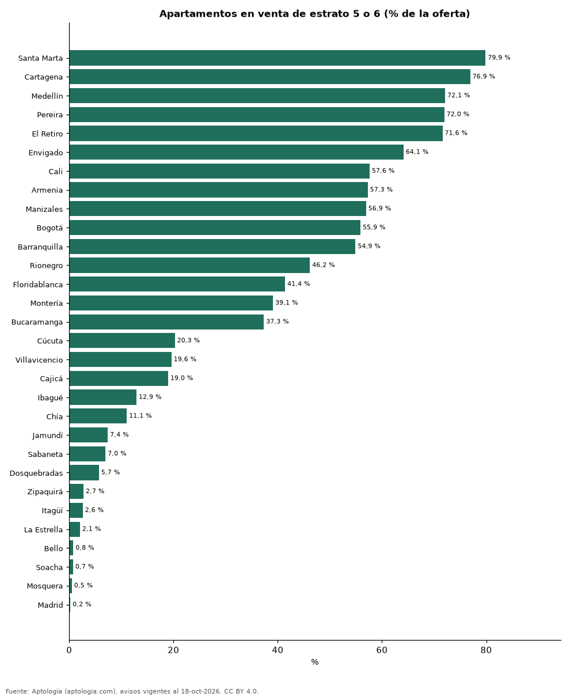

# En qué estratos está la oferta de apartamentos en cada ciudad de Colombia (octubre 2026)

**En Santa Marta el 79,9 % de los apartamentos en venta es de estrato 5 o 6, la mayor proporción de 30 ciudades; en Madrid es apenas el 0,2 %.** En todo el país, el estrato 4 reúne el 27,8 % de la oferta en venta y el estrato 3 el 16,3 %; en Bogotá el estrato más ofrecido es el 6.

*Resumen: clasificamos 185.481 apartamentos en venta y arriendo con estrato declarado.*

**Actualizado:** 18 de octubre de 2026 (datos del 18 de octubre de 2026) · **Próxima actualización:** mensual.

## Resumen

| Indicador | Valor |
|---|---|
| Estrato 1 (venta) | 0,5 % |
| Estrato 2 (venta) | 2,3 % |
| Estrato 3 (venta) | 16,3 % |
| Estrato 4 (venta) | 27,8 % |
| Estrato 5 (venta) | 23,5 % |
| Estrato 6 (venta) | 29,6 % |

## Distribución de la oferta en venta por estrato (300 avisos o más)

| Ciudad | Estrato 1 | Estrato 2 | Estrato 3 | Estrato 4 | Estrato 5 | Estrato 6 | Avisos |
|---|---|---|---|---|---|---|---|
| Santa Marta | 0,3 % | 0,7 % | 5,9 % | 13,3 % | 18,9 % | 61,0 % | 3.830 |
| Cartagena | 0,3 % | 0,4 % | 8,5 % | 13,8 % | 32,0 % | 44,9 % | 5.981 |
| Medellín | 0,2 % | 1,0 % | 8,5 % | 18,2 % | 29,3 % | 42,8 % | 20.008 |
| Pereira | 0,4 % | 1,3 % | 6,4 % | 19,9 % | 30,3 % | 41,7 % | 4.391 |
| El Retiro | 0,0 % | 1,2 % | 5,9 % | 21,2 % | 64,8 % | 6,8 % | 560 |
| Envigado | 0,2 % | 1,2 % | 7,3 % | 27,2 % | 55,2 % | 8,9 % | 5.525 |
| Cali | 0,3 % | 0,9 % | 8,8 % | 32,3 % | 28,6 % | 29,1 % | 9.486 |
| Armenia | 1,5 % | 1,2 % | 20,5 % | 19,6 % | 47,5 % | 9,7 % | 2.310 |
| Manizales | 0,0 % | 0,6 % | 17,5 % | 25,0 % | 14,6 % | 42,3 % | 2.808 |
| Bogotá | 0,6 % | 3,9 % | 18,1 % | 21,5 % | 17,3 % | 38,6 % | 31.495 |
| Barranquilla | 0,3 % | 2,2 % | 12,3 % | 30,3 % | 26,5 % | 28,4 % | 7.746 |
| Rionegro | 0,2 % | 0,5 % | 13,0 % | 40,0 % | 39,4 % | 6,8 % | 2.902 |
| Floridablanca | 0,3 % | 1,6 % | 14,5 % | 42,2 % | 38,1 % | 3,3 % | 937 |
| Montería | 0,0 % | 4,5 % | 34,5 % | 21,8 % | 26,1 % | 13,0 % | 330 |
| Bucaramanga | 0,1 % | 0,8 % | 16,2 % | 45,5 % | 17,0 % | 20,4 % | 2.493 |
| Cúcuta | 0,0 % | 4,4 % | 34,1 % | 41,3 % | 18,2 % | 2,1 % | 666 |
| Villavicencio | 0,0 % | 7,5 % | 57,2 % | 15,7 % | 8,8 % | 10,8 % | 362 |
| Cajicá | 0,5 % | 2,8 % | 18,0 % | 59,8 % | 18,3 % | 0,7 % | 1.481 |
| Ibagué | 1,0 % | 6,9 % | 32,1 % | 47,0 % | 10,8 % | 2,1 % | 1.255 |
| Chía | 0,7 % | 3,4 % | 44,0 % | 40,9 % | 7,8 % | 3,2 % | 1.483 |
| Jamundí | 0,2 % | 1,3 % | 26,4 % | 64,7 % | 6,8 % | 0,6 % | 473 |
| Sabaneta | 0,1 % | 3,7 % | 16,8 % | 72,5 % | 6,4 % | 0,5 % | 4.183 |
| Dosquebradas | 0,0 % | 1,8 % | 43,8 % | 48,7 % | 3,5 % | 2,2 % | 596 |
| Zipaquirá | 2,5 % | 4,6 % | 46,3 % | 43,9 % | 1,1 % | 1,6 % | 806 |
| Itagüí | 0,6 % | 3,0 % | 43,7 % | 50,2 % | 2,1 % | 0,5 % | 1.928 |
| La Estrella | 0,2 % | 1,0 % | 36,8 % | 59,9 % | 2,1 % | 0,0 % | 486 |
| Bello | 1,6 % | 4,1 % | 49,9 % | 43,7 % | 0,7 % | 0,1 % | 2.200 |
| Soacha | 5,5 % | 13,2 % | 79,0 % | 1,5 % | 0,6 % | 0,2 % | 544 |
| Mosquera | 1,7 % | 3,1 % | 38,1 % | 56,6 % | 0,4 % | 0,1 % | 801 |
| Madrid | 0,4 % | 2,9 % | 47,5 % | 49,0 % | 0,2 % | 0,0 % | 451 |

Porcentaje de los avisos de apartamentos con estrato declarado. Refleja lo que se anuncia en los portales, no el parque de vivienda.

## Colombia: venta y arriendo por estrato

| Estrato | Venta | Arriendo |
|---|---|---|
| 1 | 0,5 % | 0,3 % |
| 2 | 2,3 % | 1,6 % |
| 3 | 16,3 % | 14,7 % |
| 4 | 27,8 % | 26,6 % |
| 5 | 23,5 % | 26,8 % |
| 6 | 29,6 % | 30,0 % |

## Preguntas frecuentes

**¿Qué estrato tiene más apartamentos en venta en Colombia?**
El estrato 6, con el 29,6 % de la oferta.

**¿Qué ciudad tiene más oferta de estrato 5 y 6?**
Santa Marta: 79,9 % de los avisos en venta.

## Metodología

- **Fuente:** exportes nocturnos de la base de datos de Aptología (aptologia.com) del 18 de octubre de 2026: avisos vigentes de vivienda en portales inmobiliarios de 13 países, recogidos por Aptología y vistos en línea entre el 11 y el 18 de octubre de 2026. Corte: 18 de octubre de 2026.
- **Depuración:** se eliminan duplicados exactos (misma ciudad, zona, tipo, precio, moneda, área, habitaciones y baños) y los precios fuera del percentil 1–99 de cada país, operación, moneda y tipo; el precio por m² usa solo avisos con área declarada entre 12 y 2.000 m² y también se recorta al P1–P99.
- **Qué se mide:** precios pedidos (publicados), no precios de cierre. En arriendo, el canon mensual sin administración, gastos comunes ni condominio.
- **Muestra mínima:** cada cifra publicada se apoya en al menos 30 avisos; las celdas con menos se omiten.
- **Colombia:** Precios en pesos colombianos, sin conversión de moneda.
- **Limitaciones:** la cobertura depende de los portales que recorre Aptología en cada país y es mayor en las ciudades grandes y en los segmentos medio-alto y alto; el área es la que declara el aviso, sin verificar; los nombres de zona vienen de los portales.
- **Privacidad:** solo se publican agregados; no se publica ningún dato personal, enlace a avisos ni nombre de anunciante.
- **Datos abiertos:** [datos.csv](datos.csv), licencia CC BY 4.0.

## Cómo citar

Pinzón Pineda, D. M. (2026). *En qué estratos está la oferta de apartamentos en cada ciudad de Colombia (octubre 2026)*. Aptología (aptologia.com). https://github.com/elbroker/aptologia-datos/tree/main/estudios/oferta-de-vivienda-por-estrato-ciudades-colombia-2026. Datos: datos.csv, licencia CC BY 4.0.
