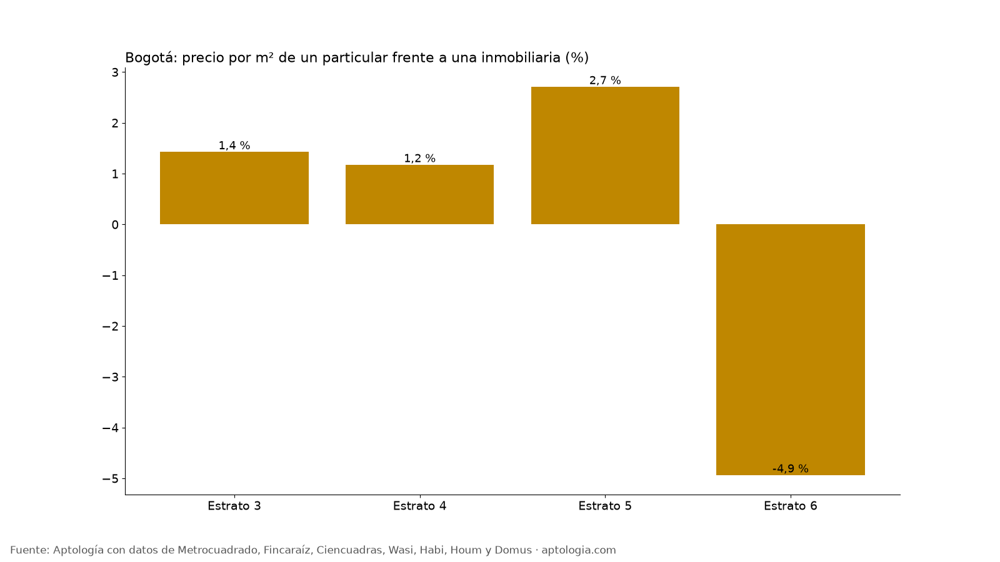

# Comprar directo al dueño o con inmobiliaria en Bogotá: diferencia de precio en venta (octubre 2026)

**En Bogotá, el 5,7 % de los apartamentos en venta lo publica directamente el dueño; comparado con apartamentos parecidos publicados por inmobiliarias, el particular pide 0,7 % más por m².** La comparación es dentro del mismo estrato, localidad, tamaño y habitaciones.

*Resumen: comparamos 34.696 apartamentos en venta únicos en Bogotá según si los publica un particular o una inmobiliaria.*

**Actualizado:** 18 de octubre de 2026 (datos del 18 de octubre de 2026) · **Próxima actualización:** mensual.

## Resumen

| Indicador | Valor |
|---|---|
| Avisos de venta con tipo de anunciante | 34.696 |
| Publicados por particulares | 5,7 % |
| Diferencia de precio por m², particular vs. inmobiliaria (emparejada) | +0,7 % |
| Grupos comparables | 101 |

## Por estrato

| Estrato | % particulares | Diferencia emparejada por m² | Por m² particular | Por m² inmobiliaria | Avisos |
|---|---|---|---|---|---|
| 3 | 10,2 % | +1,4 % | $5.569.904 | $5.666.667 | 5.914 |
| 4 | 9,7 % | +1,2 % | $7.430.556 | $7.258.662 | 7.244 |
| 5 | 5,5 % | +2,7 % | $7.963.051 | $7.587.746 | 5.833 |
| 6 | 1,9 % | -4,9 % | $8.848.645 | $8.750.000 | 13.702 |

**Cómo usarlo para decidir:** comprarle directo al dueño puede ahorrar parte de la comisión, pero exige que tú revises títulos, certificado de libertad, deudas de predial y administración. Con inmobiliaria pagas por ese acompañamiento. En ambos casos, compara el precio por m² con la mediana del barrio.

## Preguntas frecuentes

**¿Es más barato comprar apartamento directo al dueño en Bogotá?**
En la comparación emparejada, el particular pide 0,7 % más por m² que una inmobiliaria con un apartamento parecido (datos del 18 de octubre de 2026).

**¿Cuántos apartamentos en venta publica el dueño directamente?**
El 5,7 % de los avisos de venta que informan el tipo de anunciante.

**¿Qué revisar si compro directo al dueño?**
Certificado de tradición y libertad, paz y salvo de predial y administración, licencia del inmueble y que quien vende sea el titular.

## Metodología

- **Fuente:** avisos vivos de vivienda recogidos por la ingesta de Aptología en Metrocuadrado, Fincaraíz, Ciencuadras, Wasi, Habi, Houm y Domus, del 11 al 18 de octubre de 2026. Corte: 18 de octubre de 2026.
- **Depuración:** un mismo inmueble publicado varias veces se cuenta una sola vez (agrupación por portal y, entre portales, por precio, área, habitaciones y coordenadas). Se descartan precios y áreas fuera de rango y, en arriendo, se resta la administración cuando el portal la incluye en el canon.
- **Qué se mide:** precios pedidos (publicados), no precios de cierre.
- **Tipo de anunciante:** el que informa el portal (particular o profesional). Diferencia emparejada: mediana ponderada de las diferencias de precio por m² dentro de grupos del mismo estrato, localidad, habitaciones y rango de área. Por estrato solo con 10 grupos o más.
- **Limitaciones:** son precios pedidos en portales, que pueden diferir del valor final de arriendo o venta. La cobertura es mayor en el norte de Bogotá y en estratos 4 a 6, porque ahí se concentra la oferta publicada. Los barrios y la localidad vienen de lo que escribe cada portal; cuando falta la localidad se asigna por los avisos vecinos más cercanos.
- **Datos abiertos:** [datos.csv](datos.csv), licencia CC BY 4.0.

## Cómo citar

Pinzón Pineda, D. M. (2026). *Comprar directo al dueño o con inmobiliaria en Bogotá: diferencia de precio en venta (octubre 2026)*. Aptología. https://www.aptologia.com/estudios/particular-vs-inmobiliaria-venta-bogota-2026. Datos: datos.csv, licencia CC BY 4.0.
