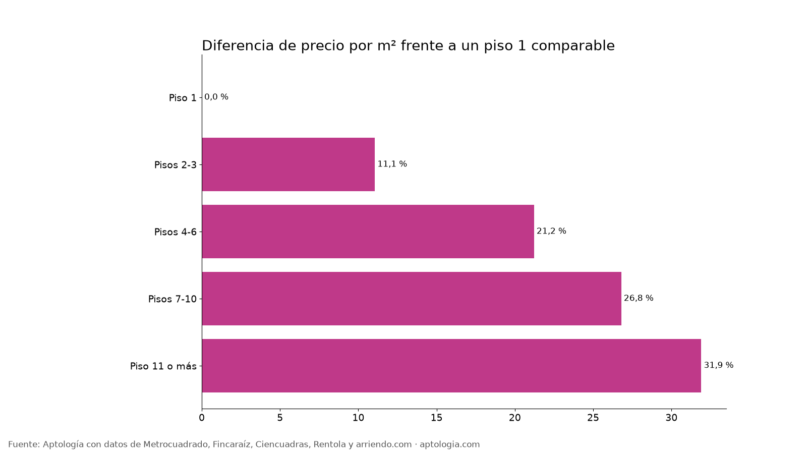

# Piso alto o piso bajo: cuánto cambia el arriendo según el piso en Bogotá (2026)

**En Bogotá, un apartamento en piso 11 o más arrienda 31,9 % más por metro cuadrado que uno comparable en piso 1, del mismo estrato y número de habitaciones.** Los pisos 2-3 cambian 11,1 % y los pisos 7-10 26,8 %.

*Resumen: analizamos 10.742 apartamentos en arriendo únicos en Bogotá que publican el piso.*

**Actualizado:** 13 de octubre de 2026 · **Próxima actualización:** mensual.

## Por piso

| Piso | Avisos | Canon mediano | Por m² | Diferencia por m² vs. piso 1 (comparable) |
|---|---|---|---|---|
| Piso 1 | 1.033 | $2.600.000 | $42.000/m² | 0,0 % |
| Pisos 2-3 | 3.190 | $3.500.000 | $49.072/m² | 11,1 % |
| Pisos 4-6 | 3.681 | $4.500.000 | $55.307/m² | 21,2 % |
| Pisos 7-10 | 1.637 | $5.500.000 | $57.500/m² | 26,8 % |
| Piso 11 o más | 1.201 | $2.250.000 | $49.020/m² | 31,9 % |

**Cómo usarlo para decidir:** los pisos bajos suelen ser más ruidosos y menos iluminados, pero más baratos; si el ascensor no es problema, compara la diferencia por m² con lo que valoras la vista y la luz.

## Preguntas frecuentes

**¿Es más caro arrendar un piso alto en Bogotá?**
Sí: piso 11 o más cuesta 31,9 % por m² frente a un piso 1 comparable, corte al 13 de octubre de 2026.

**¿Cuánto más barato es un primer piso?**
Frente a pisos 4-6, un piso 1 comparable cuesta 21,2 % menos por m².

## Metodología

- **Fuente:** base de ingesta diaria de Aptología, con avisos públicos de Metrocuadrado, Fincaraíz, Ciencuadras, Rentola y arriendo.com. Corte al 13 de octubre de 2026.
- **Filtros:** avisos vivos que pasan el control de calidad, en Bogotá, canon entre $400.000 y $30.000.000. Se excluyen TikTok y Facebook Marketplace.
- **Duplicados:** se deja un aviso por grupo de duplicados (el mismo inmueble en varios portales).
- **Prima emparejada:** se compara el precio por m² de avisos de cada grupo de pisos frente al piso 1 dentro de la misma celda de estrato × habitaciones (mínimo 8 avisos por lado) y se reporta la mediana ponderada de las diferencias. Así la prima no se confunde con estrato o tamaño. El atributo se detecta en el texto del aviso, por lo que solo cuentan avisos con descripción.
- **Limitaciones:** son precios pedidos, no cerrados. Los barrios y localidades vienen tal como los escribe cada portal.
- **Datos abiertos:** [datos.csv](datos.csv), licencia CC BY 4.0.

## Cómo citar

Pinzón Pineda, D. M. (2026). *Piso alto o piso bajo: cuánto cambia el arriendo según el piso en Bogotá (2026)*. Aptología. https://www.aptologia.com/estudios/piso-alto-vs-piso-bajo-arriendo-bogota. Datos: datos.csv, licencia CC BY 4.0.
