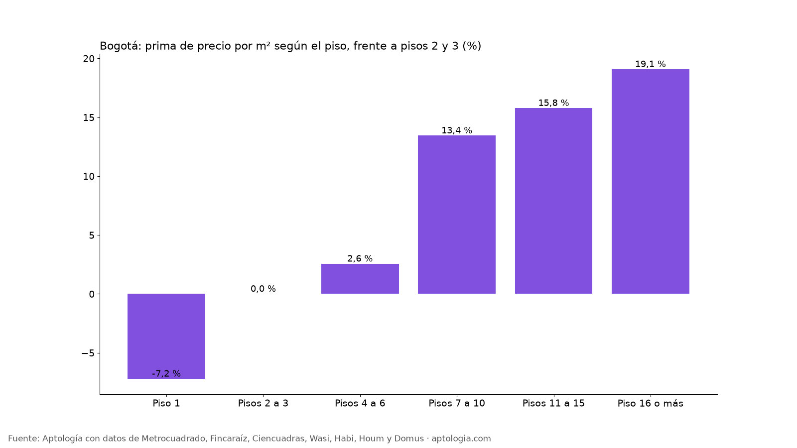

# Piso alto vs. piso bajo en Bogotá: cuánto cambia el precio de venta según el piso (octubre 2026)

**En Bogotá, un apartamento en venta en el primer piso pide 7,2 % menos por m² que uno comparable en los pisos 2 o 3, y uno en el piso 16 o más 19,1 % más.** La comparación es entre apartamentos del mismo estrato, localidad, tamaño y número de habitaciones.

*Resumen: analizamos 27.956 apartamentos en venta únicos en Bogotá con piso informado.*

**Actualizado:** 18 de octubre de 2026 (datos del 18 de octubre de 2026) · **Próxima actualización:** mensual.

## Precio según el piso

| Piso | Prima emparejada vs. pisos 2–3 | Precio por m² (mediana simple) | Precio mediano | Avisos |
|---|---|---|---|---|
| Piso 1 | -7,2 % | $6.363.636 | $650 millones | 2.604 |
| Pisos 2 a 3 | 0,0 % | $7.272.727 | $780 millones | 8.307 |
| Pisos 4 a 6 | +2,6 % | $7.272.727 | $798 millones | 10.133 |
| Pisos 7 a 10 | +13,4 % | $8.333.333 | $980 millones | 4.011 |
| Pisos 11 a 15 | +15,8 % | $7.542.615 | $635 millones | 1.798 |
| Piso 16 o más | +19,1 % | $7.552.632 | $405 millones | 1.103 |

Los pisos muy altos se concentran en torres del norte, por eso la mediana simple los sobrevalora; la prima emparejada corrige esa mezcla.

**Cómo usarlo para decidir:** el piso alto suele ganar vista, luz y menos ruido; el primer piso, acceso y a veces patio, pero menos privacidad y más humedad. Si te da igual el piso, el primero suele ser la forma más directa de pagar menos por el mismo apartamento.

## Preguntas frecuentes

**¿Es más barato un apartamento en primer piso en Bogotá?**
Sí: en la comparación emparejada pide 7,2 % menos por m² que uno de piso 2 o 3 (datos del 18 de octubre de 2026).

**¿Cuánto más vale un piso alto en Bogotá?**
En el tramo piso 16 o más, la diferencia frente a pisos 2 y 3 es 19,1 % por m².

**¿Qué piso conviene comprar?**
Depende de lo que valores: luz, vista y ruido (pisos altos) o precio y acceso (primeros pisos). La tabla muestra cuánto paga el mercado por cada tramo.

## Metodología

- **Fuente:** avisos vivos de vivienda recogidos por la ingesta de Aptología en Metrocuadrado, Fincaraíz, Ciencuadras, Wasi, Habi, Houm y Domus, del 11 al 18 de octubre de 2026. Corte: 18 de octubre de 2026.
- **Depuración:** un mismo inmueble publicado varias veces se cuenta una sola vez (agrupación por portal y, entre portales, por precio, área, habitaciones y coordenadas). Se descartan precios y áreas fuera de rango y, en arriendo, se resta la administración cuando el portal la incluye en el canon.
- **Qué se mide:** precios pedidos (publicados), no precios de cierre.
- **Prima emparejada:** mediana ponderada de las diferencias de precio por m² frente a apartamentos en pisos 2 y 3, dentro de grupos del mismo estrato, localidad, habitaciones y rango de área. Solo tramos con 80 avisos o más.
- **Limitaciones:** son precios pedidos en portales, que pueden diferir del valor final de arriendo o venta. La cobertura es mayor en el norte de Bogotá y en estratos 4 a 6, porque ahí se concentra la oferta publicada. Los barrios y la localidad vienen de lo que escribe cada portal; cuando falta la localidad se asigna por los avisos vecinos más cercanos.
- **Datos abiertos:** [datos.csv](datos.csv), licencia CC BY 4.0.

## Cómo citar

Pinzón Pineda, D. M. (2026). *Piso alto vs. piso bajo en Bogotá: cuánto cambia el precio de venta según el piso (octubre 2026)*. Aptología. https://www.aptologia.com/estudios/piso-alto-vs-piso-bajo-venta-bogota-2026. Datos: datos.csv, licencia CC BY 4.0.
