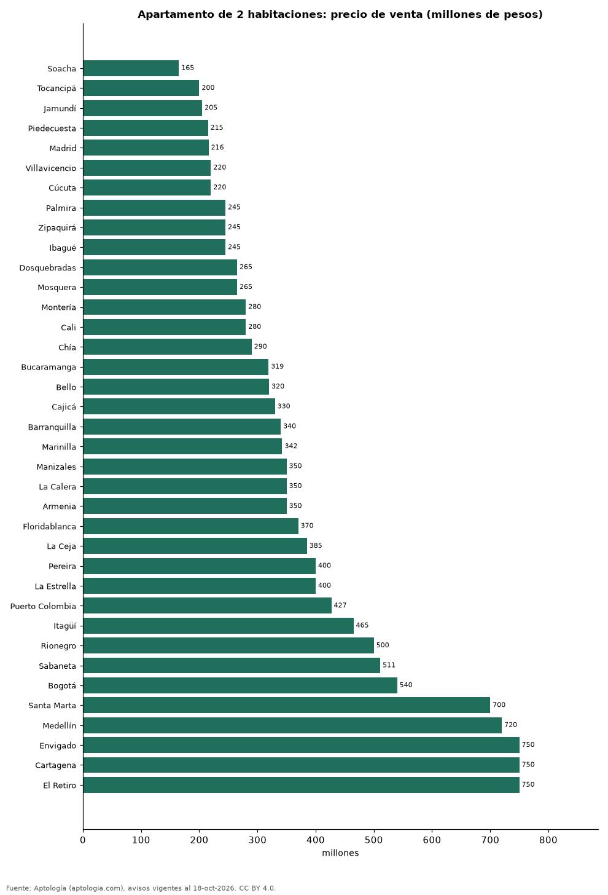

# Cuánto cuesta un apartamento de 2 habitaciones en las ciudades de Colombia: venta y arriendo (octubre 2026)

**Comprar un apartamento de 2 habitaciones cuesta en la mediana 165 millones de pesos en Soacha, la ciudad más barata de la muestra, y 750 millones de pesos en El Retiro, la más cara.** En Bogotá la mediana es 540 millones de pesos y el arriendo es de 2.646.500 pesos al mes.

*Resumen: comparamos 56.632 apartamentos de 2 habitaciones en 38 ciudades.*

**Actualizado:** 18 de octubre de 2026 (datos del 18 de octubre de 2026) · **Próxima actualización:** mensual.

## Resumen

| Indicador | Valor |
|---|---|
| Más barata (venta) | Soacha: 165 millones de pesos |
| Más cara (venta) | El Retiro: 750 millones de pesos |
| Bogotá (venta) | 540 millones de pesos |

## Ciudades

| Ciudad | Precio de venta | Arriendo mensual | Avisos (venta / arriendo) |
|---|---|---|---|
| Soacha | 165 millones de pesos | 950.000 pesos | 109 / 73 |
| Tocancipá | 200 millones de pesos | — | 71 / — |
| Jamundí | 205 millones de pesos | 1.220.000 pesos | 283 / 96 |
| Piedecuesta | 215 millones de pesos | — | 59 / — |
| Madrid | 216 millones de pesos | 1.200.000 pesos | 68 / 60 |
| Villavicencio | 220 millones de pesos | 1.200.000 pesos | 97 / 36 |
| Cúcuta | 220 millones de pesos | 1.300.000 pesos | 105 / 108 |
| Palmira | 245 millones de pesos | 1.100.000 pesos | 57 / 31 |
| Zipaquirá | 245 millones de pesos | — | 109 / — |
| Ibagué | 245 millones de pesos | 1.349.350 pesos | 192 / 68 |
| Dosquebradas | 265 millones de pesos | — | 155 / — |
| Mosquera | 265 millones de pesos | 1.250.000 pesos | 109 / 43 |
| Montería | 280 millones de pesos | — | 55 / — |
| Cali | 280 millones de pesos | 1.550.000 pesos | 2.485 / 633 |
| Chía | 290 millones de pesos | 1.550.000 pesos | 641 / 233 |
| Bucaramanga | 319 millones de pesos | 2.000.000 pesos | 367 / 113 |
| Bello | 320 millones de pesos | 1.800.000 pesos | 646 / 306 |
| Cajicá | 330 millones de pesos | 1.900.000 pesos | 566 / 206 |
| Barranquilla | 340 millones de pesos | 2.300.000 pesos | 1.855 / 1.442 |
| Marinilla | 342 millones de pesos | 1.700.000 pesos | 62 / 56 |
| Manizales | 350 millones de pesos | 1.650.000 pesos | 767 / 126 |
| La Calera | 350 millones de pesos | — | 48 / — |
| Armenia | 350 millones de pesos | 2.250.000 pesos | 778 / 149 |
| Floridablanca | 370 millones de pesos | 1.900.000 pesos | 99 / 62 |
| La Ceja | 385 millones de pesos | 2.500.000 pesos | 133 / 159 |
| Pereira | 400 millones de pesos | 2.600.000 pesos | 1.236 / 535 |
| La Estrella | 400 millones de pesos | 2.400.000 pesos | 243 / 252 |
| Puerto Colombia | 427 millones de pesos | 2.000.000 pesos | 52 / 58 |
| Itagüí | 465 millones de pesos | 2.500.000 pesos | 513 / 295 |
| Rionegro | 500 millones de pesos | 2.600.000 pesos | 1.636 / 1.750 |
| Sabaneta | 511 millones de pesos | 2.900.000 pesos | 1.392 / 1.301 |
| Bogotá | 540 millones de pesos | 2.646.500 pesos | 7.726 / 4.530 |
| Santa Marta | 700 millones de pesos | 3.500.000 pesos | 1.409 / 268 |
| Medellín | 720 millones de pesos | 4.200.000 pesos | 4.659 / 6.601 |
| Envigado | 750 millones de pesos | 4.200.000 pesos | 1.413 / 2.529 |
| Cartagena | 750 millones de pesos | 3.400.000 pesos | 2.412 / 983 |
| El Retiro | 750 millones de pesos | 4.300.000 pesos | 373 / 346 |
| El Carmen de Viboral | — | 1.400.000 pesos | — / 51 |

Medianas del precio pedido; arriendo sin administración.

## Preguntas frecuentes

**¿Cuánto cuesta un apartamento de 2 habitaciones en Bogotá?**
540 millones de pesos en la mediana de la oferta en venta (octubre de 2026).

**¿Dónde es más barato comprar un apartamento de 2 habitaciones en Colombia?**
En Soacha: 165 millones de pesos.

## Metodología

- **Fuente:** exportes nocturnos de la base de datos de Aptología (aptologia.com) del 18 de octubre de 2026: avisos vigentes de vivienda en portales inmobiliarios de 13 países, recogidos por Aptología y vistos en línea entre el 11 y el 18 de octubre de 2026. Corte: 18 de octubre de 2026.
- **Depuración:** se eliminan duplicados exactos (misma ciudad, zona, tipo, precio, moneda, área, habitaciones y baños) y los precios fuera del percentil 1–99 de cada país, operación, moneda y tipo; el precio por m² usa solo avisos con área declarada entre 12 y 2.000 m² y también se recorta al P1–P99.
- **Qué se mide:** precios pedidos (publicados), no precios de cierre. En arriendo, el canon mensual sin administración, gastos comunes ni condominio.
- **Muestra mínima:** cada cifra publicada se apoya en al menos 30 avisos; las celdas con menos se omiten.
- **Colombia:** Precios en pesos colombianos, sin conversión de moneda.
- **Limitaciones:** la cobertura depende de los portales que recorre Aptología en cada país y es mayor en las ciudades grandes y en los segmentos medio-alto y alto; el área es la que declara el aviso, sin verificar; los nombres de zona vienen de los portales.
- **Privacidad:** solo se publican agregados; no se publica ningún dato personal, enlace a avisos ni nombre de anunciante.
- **Datos abiertos:** [datos.csv](datos.csv), licencia CC BY 4.0.

## Cómo citar

Pinzón Pineda, D. M. (2026). *Cuánto cuesta un apartamento de 2 habitaciones en las ciudades de Colombia: venta y arriendo (octubre 2026)*. Aptología (aptologia.com). https://github.com/elbroker/aptologia-datos/tree/main/estudios/precio-apartamento-2-habitaciones-venta-ciudades-colombia-2026. Datos: datos.csv, licencia CC BY 4.0.
