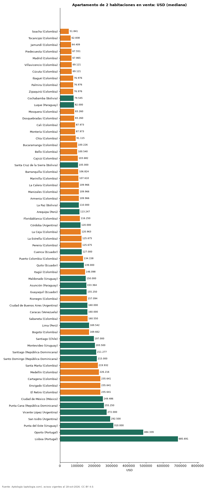

# Cuánto cuesta comprar un apartamento de 2 habitaciones en 62 ciudades de Latinoamérica y Portugal (octubre 2026)

**Comprar un apartamento de 2 habitaciones es más barato en Soacha (Colombia), con una mediana de USD 51.841, y más caro en Lisboa (Portugal), con USD 685.691.** En Bogotá la mediana es USD 169.662 (540 millones de pesos), puesto 46 de 62 de menor a mayor.

*Resumen: comparamos 58.256 apartamentos de 2 habitaciones en venta en 62 ciudades.*

**Actualizado:** 18 de octubre de 2026 (datos del 18 de octubre de 2026) · **Próxima actualización:** mensual.

## Resumen

| Indicador | Valor |
|---|---|
| Más barata | Soacha: USD 51.841 |
| Más cara | Lisboa: USD 685.691 |
| Bogotá | USD 169.662 |
| Ciudades | 62 |

## Ciudades de menor a mayor (30 avisos o más)

| País | Ciudad | Precio USD | Avisos |
|---|---|---|---|
| Colombia | Soacha | 51.841 | 109 |
| Colombia | Tocancipá | 62.838 | 71 |
| Colombia | Jamundí | 64.409 | 283 |
| Colombia | Piedecuesta | 67.551 | 59 |
| Colombia | Madrid | 67.865 | 68 |
| Colombia | Villavicencio | 69.121 | 97 |
| Colombia | Cúcuta | 69.121 | 105 |
| Colombia | Ibagué | 76.976 | 192 |
| Colombia | Palmira | 76.976 | 57 |
| Colombia | Zipaquirá | 76.976 | 109 |
| Bolivia | Cochabamba | 79.545 | 106 |
| Paraguay | Luque | 82.000 | 53 |
| Colombia | Mosquera | 83.260 | 109 |
| Colombia | Dosquebradas | 83.260 | 155 |
| Colombia | Cali | 87.973 | 2.485 |
| Colombia | Montería | 87.973 | 55 |
| Colombia | Chía | 91.115 | 641 |
| Colombia | Bucaramanga | 100.226 | 367 |
| Colombia | Bello | 100.540 | 646 |
| Colombia | Cajicá | 103.682 | 566 |
| Bolivia | Santa Cruz de la Sierra | 105.000 | 683 |
| Colombia | Barranquilla | 106.824 | 1.855 |
| Colombia | Marinilla | 107.610 | 62 |
| Colombia | La Calera | 109.966 | 48 |
| Colombia | Manizales | 109.966 | 767 |
| Colombia | Armenia | 109.966 | 778 |
| Bolivia | La Paz | 110.000 | 105 |
| Perú | Arequipa | 113.247 | 72 |
| Colombia | Floridablanca | 116.250 | 99 |
| Argentina | Córdoba | 120.000 | 33 |
| Colombia | La Ceja | 120.963 | 133 |
| Colombia | La Estrella | 125.675 | 243 |
| Colombia | Pereira | 125.675 | 1.236 |
| Ecuador | Cuenca | 127.000 | 159 |
| Colombia | Puerto Colombia | 134.158 | 52 |
| Ecuador | Quito | 139.000 | 758 |
| Colombia | Itagüí | 146.098 | 513 |
| Uruguay | Maldonado | 150.000 | 95 |
| Paraguay | Asunción | 153.364 | 2.345 |
| Ecuador | Guayaquil | 155.250 | 310 |
| Colombia | Rionegro | 157.094 | 1.636 |
| Argentina | Ciudad de Buenos Aires | 160.000 | 2.338 |
| Venezuela | Caracas | 160.000 | 300 |
| Colombia | Sabaneta | 160.550 | 1.392 |
| Perú | Lima | 169.542 | 2.932 |
| Colombia | Bogotá | 169.662 | 7.726 |
| Chile | Santiago | 197.000 | 2.809 |
| Uruguay | Montevideo | 203.500 | 1.831 |
| República Dominicana | Santiago | 211.277 | 112 |
| República Dominicana | Santo Domingo | 215.000 | 2.359 |
| Colombia | Santa Marta | 219.932 | 1.409 |
| Colombia | Medellín | 226.216 | 4.659 |
| Colombia | Cartagena | 235.641 | 2.412 |
| Colombia | Envigado | 235.641 | 1.413 |
| Colombia | El Retiro | 235.641 | 373 |
| México | Ciudad de México | 249.486 | 4.754 |
| República Dominicana | Punta Cana | 255.250 | 232 |
| Argentina | Vicente López | 272.000 | 35 |
| Argentina | San Isidro | 292.500 | 46 |
| Uruguay | Punta del Este | 310.000 | 1.988 |
| Portugal | Oporto | 484.339 | 254 |
| Portugal | Lisboa | 685.691 | 567 |

## Preguntas frecuentes

**¿Dónde es más barato comprar un apartamento de 2 habitaciones en Latinoamérica?**
En Soacha (Colombia): USD 51.841 en la mediana.

**¿Cuánto cuesta comprar un apartamento de 2 habitaciones en Bogotá?**
USD 169.662, es decir 540.000.000 pesos.

## Metodología

- **Fuente:** exportes nocturnos de la base de datos de Aptología (aptologia.com) del 18 de octubre de 2026: avisos vigentes de vivienda en portales inmobiliarios de 13 países, recogidos por Aptología y vistos en línea entre el 11 y el 18 de octubre de 2026. Corte: 18 de octubre de 2026.
- **Depuración:** se eliminan duplicados exactos (misma ciudad, zona, tipo, precio, moneda, área, habitaciones y baños) y los precios fuera del percentil 1–99 de cada país, operación, moneda y tipo; el precio por m² usa solo avisos con área declarada entre 12 y 2.000 m² y también se recorta al P1–P99.
- **Qué se mide:** precios pedidos (publicados), no precios de cierre. En arriendo, el canon mensual sin administración, gastos comunes ni condominio.
- **Muestra mínima:** cada cifra publicada se apoya en al menos 30 avisos; las celdas con menos se omiten.
- **Monedas:** nunca se mezclan avisos de monedas distintas sin convertirlos. Conversión a dólares con la tasa de mercado de ExchangeRate-API (open.er-api.com, actualización del 18 Oct 2026): 1 USD = 3.182,80 COP, 1 USD = 18,47 M.N, 1 USD = 5,09 BRL, 1 USD = 3,44 PEN, 1 USD = 982,44 CLP, 1 USD = 1.514,57 ARS, 1 USD = 40,20 UYU, 1 USD = 5.705,37 PYG, 1 USD = 61,27 DOP, 1 USD = 0,89 EUR, 1 USD = 11,72 BOB; la UF chilena a 41.178,64 CLP (mindicador,cl. 18-oct-2026). Los avisos publicados en dólares se usan tal cual.
- **Limitaciones:** la cobertura depende de los portales que recorre Aptología en cada país y es mayor en las ciudades grandes y en los segmentos medio-alto y alto; el área es la que declara el aviso, sin verificar; los nombres de zona vienen de los portales.
- **Privacidad:** solo se publican agregados; no se publica ningún dato personal, enlace a avisos ni nombre de anunciante.
- **Datos abiertos:** [datos.csv](datos.csv), licencia CC BY 4.0.

## Cómo citar

Pinzón Pineda, D. M. (2026). *Cuánto cuesta comprar un apartamento de 2 habitaciones en 62 ciudades de Latinoamérica y Portugal (octubre 2026)*. Aptología (aptologia.com). https://github.com/elbroker/aptologia-datos/tree/main/estudios/precio-apartamento-2-habitaciones-venta-latinoamerica-2026. Datos: datos.csv, licencia CC BY 4.0.
