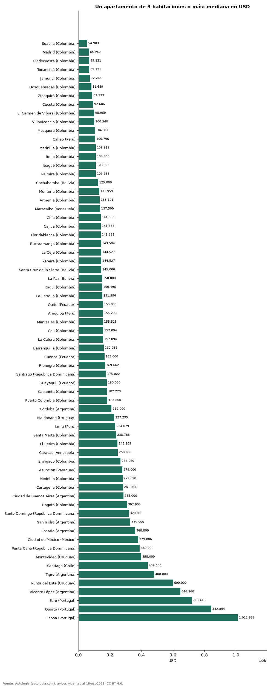

# Cuánto cuesta un apartamento familiar de 3 habitaciones o más en 67 ciudades de Latinoamérica y Portugal (octubre 2026)

**Un apartamento de 3 habitaciones o más se pide por USD 54.983 en la mediana de Soacha (Colombia), la más baja de 67 ciudades, y por USD 1.011.675 en Lisboa (Portugal), la más alta.** En Bogotá, USD 307.905. Entre las capitales, de USD 150.000 en La Paz a USD 1.011.675 en Lisboa.

*Resumen: comparamos 108.451 avisos en 67 ciudades con 30 avisos o más.*

**Actualizado:** 18 de octubre de 2026 (datos del 18 de octubre de 2026) · **Próxima actualización:** mensual.

## Resumen

| Indicador | Valor |
|---|---|
| Más barato | Soacha (Colombia): USD 54.983 |
| Más caro | Lisboa (Portugal): USD 1.011.675 |
| Bogotá | USD 307.905 |
| Ciudades | 67 |

## Ciudades de menor a mayor

| Ciudad | Precio (mediana) | USD por m² | Avisos |
|---|---|---|---|
| Soacha (Colombia) | USD 54.983 | 1.047 | 460 |
| Madrid (Colombia) | USD 65.980 | 1.119 | 411 |
| Piedecuesta (Colombia) | USD 69.121 | 1.119 | 196 |
| Tocancipá (Colombia) | USD 69.121 | 1.145 | 193 |
| Jamundí (Colombia) | USD 72.263 | 1.115 | 189 |
| Dosquebradas (Colombia) | USD 81.689 | 1.423 | 446 |
| Zipaquirá (Colombia) | USD 87.973 | 1.332 | 710 |
| Cúcuta (Colombia) | USD 92.686 | 1.093 | 559 |
| El Carmen de Viboral (Colombia) | USD 98.969 | 1.333 | 61 |
| Villavicencio (Colombia) | USD 100.540 | 1.328 | 260 |
| Mosquera (Colombia) | USD 104.311 | 1.544 | 709 |
| Callao (Perú) | USD 106.796 | 1.141 | 59 |
| Marinilla (Colombia) | USD 109.919 | 1.710 | 96 |
| Bello (Colombia) | USD 109.966 | 1.686 | 1.668 |
| Ibagué (Colombia) | USD 109.966 | 1.309 | 1.051 |
| Palmira (Colombia) | USD 109.966 | 1.351 | 67 |
| Cochabamba (Bolivia) | USD 125.000 | 900 | 181 |
| Montería (Colombia) | USD 131.959 | 1.162 | 258 |
| Armenia (Colombia) | USD 135.101 | 1.534 | 1.451 |
| Maracaibo (Venezuela) | USD 137.500 | 644 | 46 |
| Chía (Colombia) | USD 141.385 | 1.638 | 676 |
| Cajicá (Colombia) | USD 141.385 | 1.761 | 917 |
| Floridablanca (Colombia) | USD 141.385 | 1.609 | 836 |
| Bucaramanga (Colombia) | USD 143.584 | 1.425 | 2.116 |
| La Ceja (Colombia) | USD 144.527 | 1.816 | 150 |
| Pereira (Colombia) | USD 144.527 | 1.616 | 3.061 |
| Santa Cruz de la Sierra (Bolivia) | USD 145.000 | 1.014 | 601 |
| La Paz (Bolivia) | USD 150.000 | 1.060 | 332 |
| Itagüí (Colombia) | USD 150.496 | 2.065 | 1.470 |
| La Estrella (Colombia) | USD 151.596 | 2.020 | 316 |
| Quito (Ecuador) | USD 155.000 | 892 | 1.492 |
| Arequipa (Perú) | USD 155.299 | 1.232 | 414 |
| Manizales (Colombia) | USD 155.523 | 1.683 | 1.944 |
| Cali (Colombia) | USD 157.094 | 1.459 | 6.694 |
| La Calera (Colombia) | USD 157.094 | 1.838 | 82 |
| Barranquilla (Colombia) | USD 160.236 | 1.376 | 5.796 |
| Cuenca (Ecuador) | USD 165.000 | 1.081 | 189 |
| Rionegro (Colombia) | USD 169.662 | 2.218 | 1.256 |
| Santiago (República Dominicana) | USD 175.000 | 1.424 | 424 |
| Guayaquil (Ecuador) | USD 180.000 | 1.260 | 617 |
| Sabaneta (Colombia) | USD 182.229 | 2.185 | 2.891 |
| Puerto Colombia (Colombia) | USD 183.800 | 1.837 | 86 |
| Córdoba (Argentina) | USD 210.000 | 1.700 | 117 |
| Maldonado (Uruguay) | USD 227.295 | 2.471 | 37 |
| Lima (Perú) | USD 234.079 | 2.028 | 3.263 |
| Santa Marta (Colombia) | USD 238.783 | 1.800 | 1.410 |
| El Retiro (Colombia) | USD 248.209 | 2.661 | 135 |
| Caracas (Venezuela) | USD 250.000 | 1.290 | 1.094 |
| Envigado (Colombia) | USD 267.060 | 2.545 | 4.146 |
| Asunción (Paraguay) | USD 279.000 | 1.871 | 1.093 |
| Medellín (Colombia) | USD 279.628 | 2.218 | 15.088 |
| Cartagena (Colombia) | USD 281.984 | 2.116 | 2.786 |
| Ciudad de Buenos Aires (Argentina) | USD 285.000 | 2.458 | 3.262 |
| Bogotá (Colombia) | USD 307.905 | 2.169 | 20.632 |
| Santo Domingo (República Dominicana) | USD 320.000 | 1.654 | 3.334 |
| San Isidro (Argentina) | USD 330.000 | 2.713 | 81 |
| Rosario (Argentina) | USD 360.000 | 1.895 | 35 |
| Ciudad de México (México) | USD 379.086 | 2.708 | 2.407 |
| Punta Cana (República Dominicana) | USD 389.000 | 2.661 | 55 |
| Montevideo (Uruguay) | USD 398.000 | 3.089 | 864 |
| Santiago (Chile) | USD 439.686 | 3.248 | 3.810 |
| Tigre (Argentina) | USD 480.000 | 3.149 | 71 |
| Punta del Este (Uruguay) | USD 600.000 | 3.836 | 2.304 |
| Vicente López (Argentina) | USD 646.960 | 3.400 | 77 |
| Faro (Portugal) | USD 719.413 | 5.541 | 47 |
| Oporto (Portugal) | USD 842.894 | 5.652 | 194 |
| Lisboa (Portugal) | USD 1.011.675 | 7.731 | 678 |

Medianas en la moneda mayoritaria de cada ciudad, convertidas a dólares.

## Preguntas frecuentes

**¿Dónde es más barato comprar un apartamento de 3 habitaciones o más?**
En Soacha (Colombia): USD 54.983 en la mediana (octubre de 2026).

**¿Dónde es más caro?**
En Lisboa (Portugal): USD 1.011.675.

## Metodología

- **Fuente:** exportes nocturnos de la base de datos de Aptología (aptologia.com) del 18 de octubre de 2026: avisos vigentes de vivienda en portales inmobiliarios de 13 países, recogidos por Aptología y vistos en línea entre el 11 y el 18 de octubre de 2026. Corte: 18 de octubre de 2026.
- **Depuración:** se eliminan duplicados exactos (misma ciudad, zona, tipo, precio, moneda, área, habitaciones y baños) y los precios fuera del percentil 1–99 de cada país, operación, moneda y tipo; el precio por m² usa solo avisos con área declarada entre 12 y 2.000 m² y también se recorta al P1–P99.
- **Qué se mide:** precios pedidos (publicados), no precios de cierre. En arriendo, el canon mensual sin administración, gastos comunes ni condominio.
- **Muestra mínima:** cada cifra publicada se apoya en al menos 30 avisos; las celdas con menos se omiten.
- **Monedas:** nunca se mezclan avisos de monedas distintas sin convertirlos. Conversión a dólares con la tasa de mercado de ExchangeRate-API (open.er-api.com, actualización del 18 Oct 2026): 1 USD = 3.182,80 COP, 1 USD = 18,47 M.N, 1 USD = 5,09 BRL, 1 USD = 3,44 PEN, 1 USD = 982,44 CLP, 1 USD = 1.514,57 ARS, 1 USD = 40,20 UYU, 1 USD = 5.705,37 PYG, 1 USD = 61,27 DOP, 1 USD = 0,89 EUR, 1 USD = 11,72 BOB; la UF chilena a 41.178,64 CLP (mindicador,cl. 18-oct-2026). Los avisos publicados en dólares se usan tal cual.
- **Monedas:** en cada ciudad y operación se usa solo la moneda mayoritaria de los avisos (los avisos en otra moneda se excluyen) y la mediana se convierte a dólares con la tasa citada; nunca se promedian avisos de monedas distintas.
- **Limitaciones:** la cobertura depende de los portales que recorre Aptología en cada país y es mayor en las ciudades grandes y en los segmentos medio-alto y alto; el área es la que declara el aviso, sin verificar; los nombres de zona vienen de los portales.
- **Privacidad:** solo se publican agregados; no se publica ningún dato personal, enlace a avisos ni nombre de anunciante.
- **Datos abiertos:** [datos.csv](datos.csv), licencia CC BY 4.0.

## Cómo citar

Pinzón Pineda, D. M. (2026). *Cuánto cuesta un apartamento familiar de 3 habitaciones o más en 67 ciudades de Latinoamérica y Portugal (octubre 2026)*. Aptología (aptologia.com). https://github.com/elbroker/aptologia-datos/tree/main/estudios/precio-apartamento-3-habitaciones-venta-ciudades-latinoamerica-2026. Datos: datos.csv, licencia CC BY 4.0.
