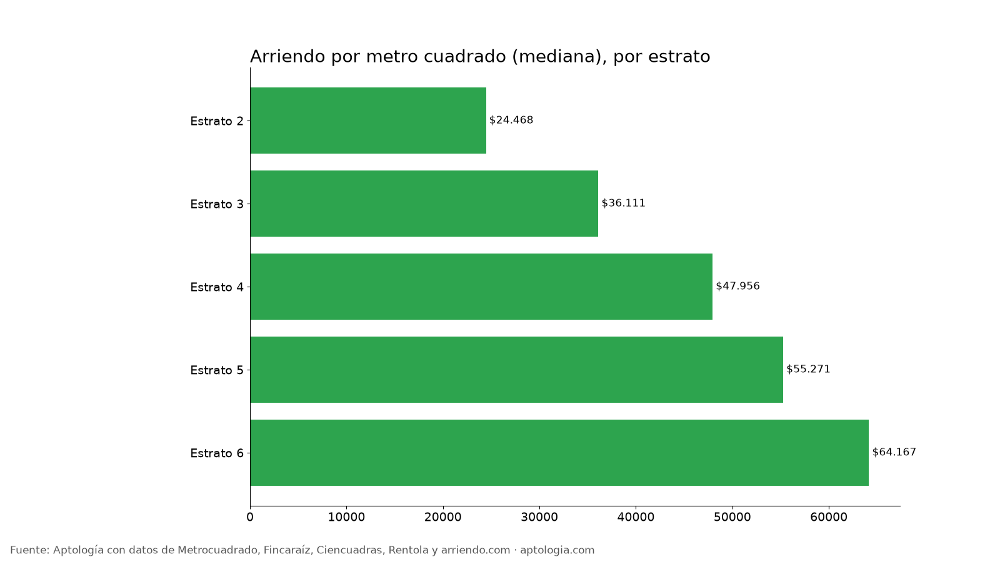
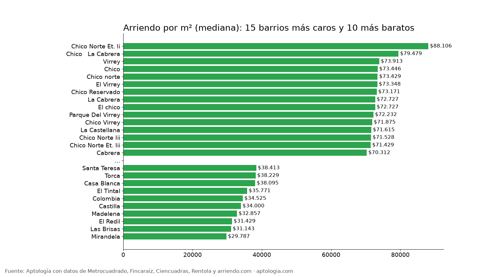

# Precio del arriendo por metro cuadrado en Bogotá, por barrio y estrato (octubre 2026)

**En Bogotá, el arriendo de un apartamento cuesta en la mediana $47.500 por metro cuadrado al mes.** Va de $36.111/m² en estrato 3 a $64.167/m² en estrato 6. Entre barrios con al menos 30 avisos, el más caro por m² es Chico Norte Et. Ii ($88.106/m²) y el más barato Mirandela ($29.787/m²). Los apartamentos de 1 habitación son los más caros por m² ($60.000/m²).

*Resumen: 20.638 apartamentos en arriendo con área publicada, sin duplicados, corte al 12 de octubre de 2026.*

**Actualizado:** 12 de octubre de 2026 · **Próxima actualización:** mensual.

## Por estrato

| Estrato | Arriendo por m² (mediana) | Rango típico | Área mediana | Canon mediano | Avisos |
|---|---|---|---|---|---|
| Estrato 2 | $24.468 | $20.000 – $30.435 | 47 m² | $1.200.000 | 550 |
| Estrato 3 | $36.111 | $28.889 – $47.193 | 45 m² | $1.600.000 | 3.626 |
| Estrato 4 | $47.956 | $39.130 – $60.000 | 54 m² | $2.500.000 | 3.921 |
| Estrato 5 | $55.271 | $44.588 – $68.729 | 82 m² | $4.300.000 | 2.142 |
| Estrato 6 | $64.167 | $51.282 – $79.552 | 145 m² | $8.690.918 | 5.852 |

## Por número de habitaciones

| Habitaciones | Arriendo por m² | Área mediana | Avisos |
|---|---|---|---|
| 1 hab | $60.000 | 38 m² | 5.836 |
| 2 hab | $41.026 | 51 m² | 7.823 |
| 3 hab | $44.233 | 115 m² | 6.026 |
| 4+ hab | $45.998 | 260 m² | 923 |

## Por barrio

| Barrio | Estrato más común | Arriendo por m² | Área mediana | Canon mediano | Avisos |
|---|---|---|---|---|---|
| [Chico Norte Et. Ii](/arriendo/bogota/chico-norte-et-ii) | 6 | $88.106 | 87 m² | $8.000.000 | 47 |
| [Chico   La Cabrera](/arriendo/bogota/chico-la-cabrera) | 6 | $79.479 | 190 m² | $14.000.000 | 50 |
| [Virrey](/arriendo/bogota/virrey) | 6 | $73.913 | 115 m² | $8.300.000 | 61 |
| [Chico](/arriendo/bogota/chico) | 6 | $73.446 | 100 m² | $7.164.000 | 309 |
| [Chico norte](/arriendo/bogota/chico-norte) | 6 | $73.429 | 90 m² | $6.600.000 | 701 |
| [El Virrey](/arriendo/bogota/el-virrey) | 6 | $73.348 | 115 m² | $8.500.000 | 126 |
| [Chico Reservado](/arriendo/bogota/chico-reservado) | 6 | $73.171 | 160 m² | $11.500.000 | 295 |
| [La Cabrera](/arriendo/bogota/la-cabrera) | 6 | $72.727 | 200 m² | $14.000.000 | 429 |
| [El chico](/arriendo/bogota/el-chico) | 6 | $72.727 | 120 m² | $8.000.000 | 133 |
| [Parque Del Virrey](/arriendo/bogota/parque-del-virrey) | 6 | $72.232 | 100 m² | $7.500.000 | 46 |
| [Chico Virrey](/arriendo/bogota/chico-virrey) | 6 | $71.875 | 120 m² | $8.000.000 | 51 |
| [La Castellana](/arriendo/bogota/la-castellana) | 4 | $71.615 | 44 m² | $2.900.000 | 44 |
| [Chico Norte Iii](/arriendo/bogota/chico-norte-iii) | 6 | $71.528 | 70 m² | $4.550.000 | 45 |
| [Chico Norte Et. Iii](/arriendo/bogota/chico-norte-et-iii) | 6 | $71.429 | 75 m² | $5.500.000 | 71 |
| [Cabrera](/arriendo/bogota/cabrera) | 6 | $70.312 | 210 m² | $15.000.000 | 105 |
| [Antiguo Country](/arriendo/bogota/antiguo-country) | 5 | $68.819 | 83 m² | $5.500.000 | 138 |
| [Quinta Camacho](/arriendo/bogota/quinta-camacho) | 4 | $68.000 | 65 m² | $4.200.000 | 39 |
| [La Veracruz](/arriendo/bogota/la-veracruz) | 3 | $67.093 | 25 m² | $1.700.000 | 32 |
| [San Martin](/arriendo/bogota/san-martin) | 4 | $66.556 | 50 m² | $3.300.000 | 33 |
| [Santa Barbara Oriental](/arriendo/bogota/santa-barbara-oriental) | 5 | $66.176 | 70 m² | $4.000.300 | 69 |
| [El Nogal](/arriendo/bogota/el-nogal) | 6 | $66.176 | 151 m² | $9.671.000 | 178 |
| [Samper](/arriendo/bogota/samper) | 4 | $63.633 | 38 m² | $2.750.000 | 32 |
| [Polo Club](/arriendo/bogota/polo-club) | 4 | $62.500 | 35 m² | $2.400.000 | 31 |
| [Santa Ana Oriental](/arriendo/bogota/santa-ana-oriental) | 6 | $62.500 | 224 m² | $14.000.000 | 66 |
| [Centro Internacional](/arriendo/bogota/centro-internacional) | 4 | $61.905 | 40 m² | $2.600.000 | 113 |
| [Los Rosales](/arriendo/bogota/los-rosales) | 6 | $61.471 | 182 m² | $10.997.000 | 432 |
| [Bellavista](/arriendo/bogota/bellavista) | 6 | $61.111 | 150 m² | $9.000.000 | 37 |
| [El Refugio](/arriendo/bogota/el-refugio) | 6 | $60.811 | 214 m² | $11.500.000 | 113 |
| [Las Nieves](/arriendo/bogota/las-nieves) | 3 | $60.677 | 33 m² | $2.000.000 | 90 |
| [Rosales](/arriendo/bogota/rosales) | 6 | $60.000 | 170 m² | $10.050.000 | 110 |
| [Las Rosales](/arriendo/bogota/las-rosales) | 6 | $59.677 | 230 m² | $13.500.000 | 61 |
| [Nogal](/arriendo/bogota/nogal) | 6 | $59.649 | 200 m² | $10.000.000 | 43 |
| [Ciudad salitre](/arriendo/bogota/ciudad-salitre) | 4 | $59.623 | 60 m² | $3.400.000 | 121 |
| [Santa Ana](/arriendo/bogota/santa-ana) | 6 | $59.545 | 190 m² | $9.650.000 | 44 |
| [La Macarena](/arriendo/bogota/la-macarena) | 4 | $59.459 | 46 m² | $3.000.000 | 51 |
| [La Carolina](/arriendo/bogota/la-carolina) | 6 | $59.213 | 159 m² | $8.750.000 | 128 |
| [Pasadena](/arriendo/bogota/pasadena) | 5 | $58.776 | 68 m² | $3.650.000 | 40 |
| [Chico Navarra](/arriendo/bogota/chico-navarra) | 6 | $58.621 | 103 m² | $6.350.000 | 178 |
| [Molinos Norte](/arriendo/bogota/molinos-norte) | 6 | $58.168 | 105 m² | $6.157.000 | 37 |
| [Pardo Rubio](/arriendo/bogota/pardo-rubio) | 4 | $57.838 | 50 m² | $3.000.000 | 37 |
| [Santa Bibiana](/arriendo/bogota/santa-bibiana) | 6 | $57.176 | 114 m² | $6.500.000 | 74 |
| [Santa Paula](/arriendo/bogota/santa-paula) | 6 | $57.143 | 105 m² | $5.500.000 | 131 |
| [Santa Barbara Occidental](/arriendo/bogota/santa-barbara-occidental) | 5 | $56.111 | 90 m² | $4.550.000 | 139 |
| [San Patricio](/arriendo/bogota/san-patricio) | 6 | $56.000 | 96 m² | $5.600.000 | 191 |
| [Santa Barbara Alta](/arriendo/bogota/santa-barbara-alta) | 6 | $55.000 | 206 m² | $14.000.000 | 85 |
| [Lisboa](/arriendo/bogota/lisboa) | 5 | $54.959 | 67 m² | $3.650.000 | 34 |
| [Chapinero Alto](/arriendo/bogota/chapinero-alto) | 4 | $54.902 | 58 m² | $3.300.000 | 127 |
| [Chapinero Central](/arriendo/bogota/chapinero-central) | 3 | $53.711 | 38 m² | $2.100.000 | 117 |
| [Chico Alto](/arriendo/bogota/chico-alto) | 6 | $53.459 | 268 m² | $13.200.000 | 61 |
| [Santa Barbara](/arriendo/bogota/santa-barbara) | 6 | $53.235 | 94 m² | $4.600.000 | 367 |
| [El Plan](/arriendo/bogota/el-plan) | 4 | $53.195 | 37 m² | $2.099.000 | 30 |
| [Bella Suiza](/arriendo/bogota/bella-suiza) | 5 | $52.778 | 101 m² | $4.500.000 | 133 |
| [Siete De Agosto](/arriendo/bogota/siete-de-agosto) | 3 | $52.000 | 25 m² | $1.500.000 | 37 |
| [La Calleja](/arriendo/bogota/la-calleja) | 5 | $51.961 | 87 m² | $4.783.500 | 59 |
| [Rincon Del Chico](/arriendo/bogota/rincon-del-chico) | 6 | $51.711 | 120 m² | $5.500.000 | 74 |
| [Quinta Paredes](/arriendo/bogota/quinta-paredes) | 4 | $50.000 | 59 m² | $3.000.000 | 38 |
| [Bosque Medina](/arriendo/bogota/bosque-medina) | 6 | $50.000 | 260 m² | $11.500.000 | 39 |
| [Modelia](/arriendo/bogota/modelia) | 4 | $49.457 | 51 m² | $2.250.000 | 44 |
| [La Salle](/arriendo/bogota/la-salle) | 4 | $48.571 | 51 m² | $2.625.000 | 32 |
| [La Felicidad](/arriendo/bogota/la-felicidad) | 4 | $48.438 | 64 m² | $3.100.000 | 73 |
| [Nicolas De Federman](/arriendo/bogota/nicolas-de-federman) | 4 | $48.229 | 75 m² | $3.312.625 | 52 |
| [Montevideo](/arriendo/bogota/montevideo) | 4 | $47.887 | 42 m² | $2.000.000 | 51 |
| [San jose de bavaria](/arriendo/bogota/san-jose-de-bavaria) | 4 | $47.619 | 42 m² | $2.000.000 | 69 |
| [Santa Barbara Central](/arriendo/bogota/santa-barbara-central) | 6 | $47.191 | 92 m² | $4.800.000 | 165 |
| [Colina Campestre](/arriendo/bogota/colina-campestre) | 4 | $47.067 | 60 m² | $2.400.000 | 168 |
| [San Jose De Usaquen](/arriendo/bogota/san-jose-de-usaquen) | 4 | $43.750 | 52 m² | $2.000.000 | 45 |
| [Mazuren](/arriendo/bogota/mazuren) | 4 | $43.399 | 74 m² | $2.800.000 | 48 |
| [Alameda](/arriendo/bogota/alameda) | 4 | $41.892 | 50 m² | $1.850.000 | 49 |
| [Cedritos](/arriendo/bogota/cedritos) | 4 | $41.584 | 70 m² | $2.650.000 | 341 |
| [Hayuelos](/arriendo/bogota/hayuelos) | 3 | $38.750 | 42 m² | $1.700.000 | 45 |
| [Lagos de Torca](/arriendo/bogota/lagos-de-torca) | 3 | $38.632 | 43 m² | $1.650.000 | 116 |
| [Santa Teresa](/arriendo/bogota/santa-teresa) | 4 | $38.413 | 68 m² | $2.700.000 | 33 |
| [Torca](/arriendo/bogota/torca) | 3 | $38.229 | 45 m² | $1.750.000 | 47 |
| [Casa Blanca](/arriendo/bogota/casa-blanca) | 3 | $38.095 | 45 m² | $1.650.000 | 37 |
| [El Tintal](/arriendo/bogota/el-tintal) | 3 | $35.771 | 40 m² | $1.450.000 | 39 |
| [Colombia](/arriendo/bogota/colombia) |  | $34.525 | 42 m² | $1.600.000 | 37 |
| [Castilla](/arriendo/bogota/castilla) | 3 | $34.000 | 48 m² | $1.600.000 | 51 |
| [Madelena](/arriendo/bogota/madelena) | 3 | $32.857 | 41 m² | $1.369.600 | 35 |
| [El Redil](/arriendo/bogota/el-redil) | 4 | $31.429 | 40 m² | $1.300.000 | 167 |
| [Las Brisas](/arriendo/bogota/las-brisas) | 3 | $31.143 | 45 m² | $1.417.000 | 32 |
| [Mirandela](/arriendo/bogota/mirandela) | 3 | $29.787 | 45 m² | $1.500.000 | 51 |

**Cómo usarlo para decidir:** multiplica el área del apartamento que viste por el valor por m² de su barrio. Si el canon pedido queda muy por encima del p75, hay margen para negociar.

## Preguntas frecuentes

**¿Cuánto vale el metro cuadrado de arriendo en Bogotá?**
La mediana es $47.500 por m² al mes (20.638 avisos, corte al 12 de octubre de 2026). La mitad de los apartamentos está entre $34.524 y $63.333 por m².

**¿Cuánto cuesta el m² de arriendo en estrato 3?**
$36.111 por m² al mes en la mediana; en estrato 4, $47.956.

**¿Cuál es el barrio más caro por metro cuadrado?**
Entre barrios con al menos 30 avisos, Chico Norte Et. Ii con $88.106/m², seguido de Chico   La Cabrera ($79.479/m²).

**¿Cuál es el barrio más barato por metro cuadrado?**
Mirandela con $29.787/m² y Las Brisas con $31.143/m².

**¿Por qué los apartamentos pequeños son más caros por m²?**
Porque cocina, baño y zonas comunes pesan igual en un apartamento pequeño. Un apartamento de 1 habitación cuesta $60.000/m², frente a $41.026/m² uno de 2.

## Metodología

- **Fuente:** base de ingesta diaria de Aptología, con avisos públicos de Metrocuadrado, Fincaraíz, Ciencuadras, Rentola y arriendo.com. Corte al 12 de octubre de 2026.
- **Filtros:** avisos vivos que pasan el control de calidad, solo apartamentos en Bogotá, canon entre $400.000 y $30.000.000. Se excluyen TikTok y Facebook Marketplace.
- **Duplicados:** se deja un aviso por grupo de duplicados (el mismo inmueble en varios portales). Quedan 21.042 apartamentos únicos.
- **Precio por m²:** canon dividido por el área publicada; áreas de 20 a 400 m² y valores de $8.000 a $200.000 por m².
- **Limitaciones:** son precios pedidos, no cerrados. Los barrios vienen tal como los escribe cada portal, así que un mismo sector puede aparecer con dos nombres. Solo se publican grupos con al menos 20 avisos.
- **Datos abiertos:** [datos.csv](datos.csv), licencia CC BY 4.0.

## Cómo citar

Pinzón Pineda, D. M. (2026). *Precio del arriendo por metro cuadrado en Bogotá, por barrio y estrato (octubre 2026)*. Aptología. https://www.aptologia.com/estudios/precio-arriendo-m2-bogota. Datos: datos.csv, licencia CC BY 4.0.
