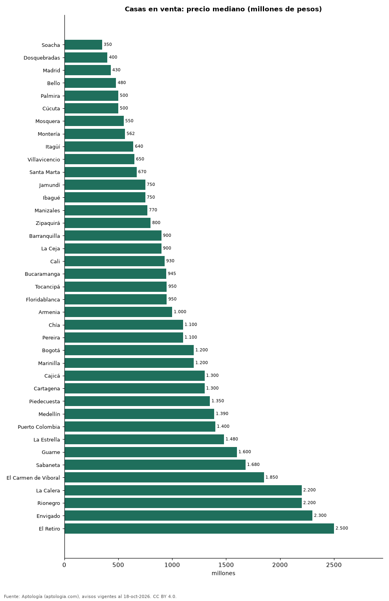

# Cuánto cuesta comprar una casa en las ciudades de Colombia: precio mediano en 39 ciudades (octubre 2026)

**Comprar una casa cuesta en la mediana 350 millones de pesos en Soacha, la ciudad más barata de 39, y 2.500 millones de pesos en El Retiro, la más cara.** En Bogotá la mediana es 1.200 millones de pesos. En todo el país, la casa en venta mediana mide 256 m².

*Resumen: analizamos 69.999 casas en venta en 39 ciudades con 30 avisos o más.*

**Actualizado:** 18 de octubre de 2026 (datos del 18 de octubre de 2026) · **Próxima actualización:** mensual.

## Resumen

| Indicador | Valor |
|---|---|
| Más barata | Soacha: 350 millones de pesos |
| Más cara | El Retiro: 2.500 millones de pesos |
| Bogotá | 1.200 millones de pesos |
| Ciudades | 39 |

## Ciudades de menor a mayor

| Ciudad | Precio de venta | Millones por m² | Área mediana (m²) | Avisos |
|---|---|---|---|---|
| Soacha | 350 millones de pesos | 2,76 | 144 | 207 |
| Dosquebradas | 400 millones de pesos | 3,41 | 120 | 401 |
| Madrid | 430 millones de pesos | 3,32 | 123 | 74 |
| Bello | 480 millones de pesos | 4,22 | 120 | 357 |
| Palmira | 500 millones de pesos | 2,45 | 240 | 393 |
| Cúcuta | 500 millones de pesos | 2,92 | 200 | 1.022 |
| Mosquera | 550 millones de pesos | 3,80 | 134 | 517 |
| Montería | 562 millones de pesos | 2,62 | 210 | 480 |
| Itagüí | 640 millones de pesos | 4,95 | 133 | 240 |
| Villavicencio | 650 millones de pesos | 3,05 | 198 | 609 |
| Santa Marta | 670 millones de pesos | 3,49 | 210 | 1.127 |
| Jamundí | 750 millones de pesos | 3,56 | 220 | 1.256 |
| Ibagué | 750 millones de pesos | 3,32 | 232 | 630 |
| Manizales | 770 millones de pesos | 3,85 | 220 | 2.384 |
| Zipaquirá | 800 millones de pesos | 4,08 | 210 | 209 |
| Barranquilla | 900 millones de pesos | 3,46 | 284 | 3.511 |
| La Ceja | 900 millones de pesos | 5,75 | 161 | 713 |
| Cali | 930 millones de pesos | 3,40 | 300 | 5.687 |
| Bucaramanga | 945 millones de pesos | 4,00 | 240 | 1.000 |
| Tocancipá | 950 millones de pesos | 4,08 | 247 | 65 |
| Floridablanca | 950 millones de pesos | 4,80 | 232 | 565 |
| Armenia | 1.000 millones de pesos | 4,44 | 228 | 1.460 |
| Chía | 1.100 millones de pesos | 5,06 | 230 | 4.172 |
| Pereira | 1.100 millones de pesos | 4,17 | 250 | 4.343 |
| Bogotá | 1.200 millones de pesos | 4,69 | 270 | 18.098 |
| Marinilla | 1.200 millones de pesos | 5,46 | 200 | 60 |
| Cajicá | 1.300 millones de pesos | 6,33 | 206 | 2.388 |
| Cartagena | 1.300 millones de pesos | 4,30 | 280 | 1.478 |
| Piedecuesta | 1.350 millones de pesos | 3,88 | 360 | 272 |
| Medellín | 1.390 millones de pesos | 5,53 | 242 | 6.282 |
| Puerto Colombia | 1.400 millones de pesos | 3,94 | 350 | 140 |
| La Estrella | 1.480 millones de pesos | 5,54 | 270 | 145 |
| Guarne | 1.600 millones de pesos | 5,92 | 288 | 175 |
| Sabaneta | 1.680 millones de pesos | 5,00 | 340 | 513 |
| El Carmen de Viboral | 1.850 millones de pesos | 5,40 | 300 | 280 |
| La Calera | 2.200 millones de pesos | 6,05 | 360 | 1.328 |
| Rionegro | 2.200 millones de pesos | 6,69 | 300 | 2.601 |
| Envigado | 2.300 millones de pesos | 7,02 | 300 | 3.713 |
| El Retiro | 2.500 millones de pesos | 7,84 | 300 | 1.104 |

Medianas del precio pedido de casas (no incluye apartamentos ni lotes).

## Preguntas frecuentes

**¿Cuánto cuesta comprar una casa en Colombia?**
Entre 350 millones de pesos (Soacha) y 2.500 millones de pesos (El Retiro) en la mediana.

**¿Cuánto cuesta comprar una casa en Bogotá?**
1.200 millones de pesos en la mediana.

## Metodología

- **Fuente:** exportes nocturnos de la base de datos de Aptología (aptologia.com) del 18 de octubre de 2026: avisos vigentes de vivienda en portales inmobiliarios de 13 países, recogidos por Aptología y vistos en línea entre el 11 y el 18 de octubre de 2026. Corte: 18 de octubre de 2026.
- **Depuración:** se eliminan duplicados exactos (misma ciudad, zona, tipo, precio, moneda, área, habitaciones y baños) y los precios fuera del percentil 1–99 de cada país, operación, moneda y tipo; el precio por m² usa solo avisos con área declarada entre 12 y 2.000 m² y también se recorta al P1–P99.
- **Qué se mide:** precios pedidos (publicados), no precios de cierre. En arriendo, el canon mensual sin administración, gastos comunes ni condominio.
- **Muestra mínima:** cada cifra publicada se apoya en al menos 30 avisos; las celdas con menos se omiten.
- **Colombia:** Precios en pesos colombianos, sin conversión de moneda.
- **Limitaciones:** la cobertura depende de los portales que recorre Aptología en cada país y es mayor en las ciudades grandes y en los segmentos medio-alto y alto; el área es la que declara el aviso, sin verificar; los nombres de zona vienen de los portales.
- **Privacidad:** solo se publican agregados; no se publica ningún dato personal, enlace a avisos ni nombre de anunciante.
- **Datos abiertos:** [datos.csv](datos.csv), licencia CC BY 4.0.

## Cómo citar

Pinzón Pineda, D. M. (2026). *Cuánto cuesta comprar una casa en las ciudades de Colombia: precio mediano en 39 ciudades (octubre 2026)*. Aptología (aptologia.com). https://github.com/elbroker/aptologia-datos/tree/main/estudios/precio-casas-en-venta-ciudades-colombia-2026. Datos: datos.csv, licencia CC BY 4.0.
