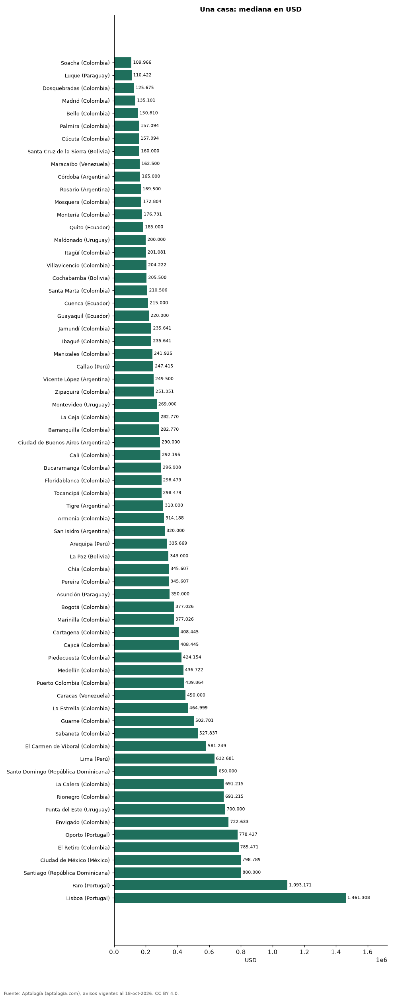

# Cuánto cuesta comprar una casa en 67 ciudades de Latinoamérica y Portugal (octubre 2026)

**Una casa se pide por USD 109.966 en la mediana de Soacha (Colombia), la más baja de 67 ciudades, y por USD 1.461.308 en Lisboa (Portugal), la más alta.** En Bogotá, USD 377.026. Entre las capitales, de USD 185.000 en Quito a USD 1.461.308 en Lisboa.

*Resumen: comparamos 105.911 avisos en 67 ciudades con 30 avisos o más.*

**Actualizado:** 18 de octubre de 2026 (datos del 18 de octubre de 2026) · **Próxima actualización:** mensual.

## Resumen

| Indicador | Valor |
|---|---|
| Más barato | Soacha (Colombia): USD 109.966 |
| Más caro | Lisboa (Portugal): USD 1.461.308 |
| Bogotá | USD 377.026 |
| Ciudades | 67 |

## Ciudades de menor a mayor

| Ciudad | Precio (mediana) | USD por m² | Avisos |
|---|---|---|---|
| Soacha (Colombia) | USD 109.966 | 869 | 207 |
| Luque (Paraguay) | USD 110.422 | 564 | 493 |
| Dosquebradas (Colombia) | USD 125.675 | 1.070 | 401 |
| Madrid (Colombia) | USD 135.101 | 1.043 | 74 |
| Bello (Colombia) | USD 150.810 | 1.327 | 357 |
| Palmira (Colombia) | USD 157.094 | 771 | 393 |
| Cúcuta (Colombia) | USD 157.094 | 919 | 1.022 |
| Santa Cruz de la Sierra (Bolivia) | USD 160.000 | 790 | 3.989 |
| Maracaibo (Venezuela) | USD 162.500 | 619 | 52 |
| Córdoba (Argentina) | USD 165.000 | 1.243 | 229 |
| Rosario (Argentina) | USD 169.500 | 1.233 | 218 |
| Mosquera (Colombia) | USD 172.804 | 1.194 | 517 |
| Montería (Colombia) | USD 176.731 | 825 | 480 |
| Quito (Ecuador) | USD 185.000 | 765 | 2.850 |
| Maldonado (Uruguay) | USD 200.000 | 1.865 | 327 |
| Itagüí (Colombia) | USD 201.081 | 1.555 | 240 |
| Villavicencio (Colombia) | USD 204.222 | 959 | 609 |
| Cochabamba (Bolivia) | USD 205.500 | 775 | 291 |
| Santa Marta (Colombia) | USD 210.506 | 1.097 | 1.127 |
| Cuenca (Ecuador) | USD 215.000 | 866 | 812 |
| Guayaquil (Ecuador) | USD 220.000 | 946 | 2.348 |
| Jamundí (Colombia) | USD 235.641 | 1.117 | 1.256 |
| Ibagué (Colombia) | USD 235.641 | 1.042 | 630 |
| Manizales (Colombia) | USD 241.925 | 1.208 | 2.384 |
| Callao (Perú) | USD 247.415 | 1.223 | 73 |
| Vicente López (Argentina) | USD 249.500 | 1.848 | 196 |
| Zipaquirá (Colombia) | USD 251.351 | 1.283 | 209 |
| Montevideo (Uruguay) | USD 269.000 | 1.626 | 3.317 |
| La Ceja (Colombia) | USD 282.770 | 1.807 | 713 |
| Barranquilla (Colombia) | USD 282.770 | 1.088 | 3.511 |
| Ciudad de Buenos Aires (Argentina) | USD 290.000 | 1.568 | 3.372 |
| Cali (Colombia) | USD 292.195 | 1.068 | 5.687 |
| Bucaramanga (Colombia) | USD 296.908 | 1.257 | 1.000 |
| Floridablanca (Colombia) | USD 298.479 | 1.508 | 565 |
| Tocancipá (Colombia) | USD 298.479 | 1.283 | 65 |
| Tigre (Argentina) | USD 310.000 | 2.083 | 213 |
| Armenia (Colombia) | USD 314.188 | 1.395 | 1.460 |
| San Isidro (Argentina) | USD 320.000 | 1.896 | 201 |
| Arequipa (Perú) | USD 335.669 | 1.340 | 303 |
| La Paz (Bolivia) | USD 343.000 | 990 | 339 |
| Chía (Colombia) | USD 345.607 | 1.590 | 4.172 |
| Pereira (Colombia) | USD 345.607 | 1.309 | 4.343 |
| Asunción (Paraguay) | USD 350.000 | 1.028 | 4.728 |
| Bogotá (Colombia) | USD 377.026 | 1.472 | 18.098 |
| Marinilla (Colombia) | USD 377.026 | 1.717 | 60 |
| Cartagena (Colombia) | USD 408.445 | 1.350 | 1.478 |
| Cajicá (Colombia) | USD 408.445 | 1.990 | 2.388 |
| Piedecuesta (Colombia) | USD 424.154 | 1.219 | 272 |
| Medellín (Colombia) | USD 436.722 | 1.738 | 6.282 |
| Puerto Colombia (Colombia) | USD 439.864 | 1.237 | 140 |
| Caracas (Venezuela) | USD 450.000 | 920 | 777 |
| La Estrella (Colombia) | USD 464.999 | 1.742 | 145 |
| Guarne (Colombia) | USD 502.701 | 1.859 | 175 |
| Sabaneta (Colombia) | USD 527.837 | 1.571 | 513 |
| El Carmen de Viboral (Colombia) | USD 581.249 | 1.697 | 280 |
| Lima (Perú) | USD 632.681 | 1.725 | 2.448 |
| Santo Domingo (República Dominicana) | USD 650.000 | 1.400 | 234 |
| La Calera (Colombia) | USD 691.215 | 1.902 | 1.328 |
| Rionegro (Colombia) | USD 691.215 | 2.102 | 2.601 |
| Punta del Este (Uruguay) | USD 700.000 | 2.734 | 4.713 |
| Envigado (Colombia) | USD 722.633 | 2.206 | 3.713 |
| Oporto (Portugal) | USD 778.427 | 4.984 | 118 |
| El Retiro (Colombia) | USD 785.471 | 2.464 | 1.104 |
| Ciudad de México (México) | USD 798.789 | 2.186 | 3.095 |
| Santiago (República Dominicana) | USD 800.000 | 2.207 | 44 |
| Faro (Portugal) | USD 1.093.171 | 5.442 | 44 |
| Lisboa (Portugal) | USD 1.461.308 | 8.712 | 88 |

Medianas en la moneda mayoritaria de cada ciudad, convertidas a dólares.

## Preguntas frecuentes

**¿Dónde es más barato comprar una casa?**
En Soacha (Colombia): USD 109.966 en la mediana (octubre de 2026).

**¿Dónde es más caro?**
En Lisboa (Portugal): USD 1.461.308.

## Metodología

- **Fuente:** exportes nocturnos de la base de datos de Aptología (aptologia.com) del 18 de octubre de 2026: avisos vigentes de vivienda en portales inmobiliarios de 13 países, recogidos por Aptología y vistos en línea entre el 11 y el 18 de octubre de 2026. Corte: 18 de octubre de 2026.
- **Depuración:** se eliminan duplicados exactos (misma ciudad, zona, tipo, precio, moneda, área, habitaciones y baños) y los precios fuera del percentil 1–99 de cada país, operación, moneda y tipo; el precio por m² usa solo avisos con área declarada entre 12 y 2.000 m² y también se recorta al P1–P99.
- **Qué se mide:** precios pedidos (publicados), no precios de cierre. En arriendo, el canon mensual sin administración, gastos comunes ni condominio.
- **Muestra mínima:** cada cifra publicada se apoya en al menos 30 avisos; las celdas con menos se omiten.
- **Monedas:** nunca se mezclan avisos de monedas distintas sin convertirlos. Conversión a dólares con la tasa de mercado de ExchangeRate-API (open.er-api.com, actualización del 18 Oct 2026): 1 USD = 3.182,80 COP, 1 USD = 18,47 M.N, 1 USD = 5,09 BRL, 1 USD = 3,44 PEN, 1 USD = 982,44 CLP, 1 USD = 1.514,57 ARS, 1 USD = 40,20 UYU, 1 USD = 5.705,37 PYG, 1 USD = 61,27 DOP, 1 USD = 0,89 EUR, 1 USD = 11,72 BOB; la UF chilena a 41.178,64 CLP (mindicador,cl. 18-oct-2026). Los avisos publicados en dólares se usan tal cual.
- **Monedas:** en cada ciudad y operación se usa solo la moneda mayoritaria de los avisos (los avisos en otra moneda se excluyen) y la mediana se convierte a dólares con la tasa citada; nunca se promedian avisos de monedas distintas.
- **Limitaciones:** la cobertura depende de los portales que recorre Aptología en cada país y es mayor en las ciudades grandes y en los segmentos medio-alto y alto; el área es la que declara el aviso, sin verificar; los nombres de zona vienen de los portales.
- **Privacidad:** solo se publican agregados; no se publica ningún dato personal, enlace a avisos ni nombre de anunciante.
- **Datos abiertos:** [datos.csv](datos.csv), licencia CC BY 4.0.

## Cómo citar

Pinzón Pineda, D. M. (2026). *Cuánto cuesta comprar una casa en 67 ciudades de Latinoamérica y Portugal (octubre 2026)*. Aptología (aptologia.com). https://github.com/elbroker/aptologia-datos/tree/main/estudios/precio-de-casas-en-venta-ciudades-latinoamerica-2026. Datos: datos.csv, licencia CC BY 4.0.
