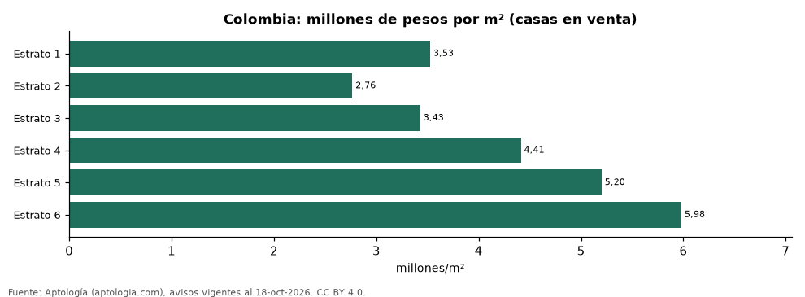

# Precio de las casas en venta en Colombia por estrato: total, m² y comparación con apartamentos (octubre 2026)

**En Colombia una casa en venta cuesta en la mediana 2,76 millones de pesos por m² en estrato 2 y 5,98 millones de pesos en estrato 6; el precio total mediano va de 450 millones de pesos a 2.200 millones de pesos.** En estrato 6 el m² de casa sale -24,9 % frente al de apartamento; en estrato 3, -30,1 %.

*Resumen: analizamos 68.112 casas en venta con estrato declarado en todas las ciudades de Colombia que recorre Aptología.*

**Actualizado:** 18 de octubre de 2026 (datos del 18 de octubre de 2026) · **Próxima actualización:** mensual.

## Resumen

| Indicador | Valor |
|---|---|
| m² casa, estrato 2 | 2,76 millones de pesos |
| m² casa, estrato 6 | 5,98 millones de pesos |
| Avisos de casas | 68.112 |

## Casas en venta por estrato

| Estrato | Casa (mediana) | Casa por m² | Apartamento por m² | Casa vs. apartamento por m² | Área mediana casa (m²) | Avisos casas |
|---|---|---|---|---|---|---|
| 1 | 750 millones de pesos | 3,53 millones de pesos | 5,13 millones de pesos | -31,3 % | 245 | 490 |
| 2 | 450 millones de pesos | 2,76 millones de pesos | 4,25 millones de pesos | -34,9 % | 186 | 3.677 |
| 3 | 630 millones de pesos | 3,43 millones de pesos | 4,91 millones de pesos | -30,1 % | 190 | 13.484 |
| 4 | 890 millones de pesos | 4,41 millones de pesos | 5,98 millones de pesos | -26,2 % | 211 | 14.776 |
| 5 | 1.400 millones de pesos | 5,20 millones de pesos | 6,94 millones de pesos | -25,1 % | 272 | 16.926 |
| 6 | 2.200 millones de pesos | 5,98 millones de pesos | 7,97 millones de pesos | -24,9 % | 370 | 15.629 |

Medianas nacionales del precio pedido; mezcla ciudades, así que refleja también dónde se concentra la oferta de casas de cada estrato.

## Preguntas frecuentes

**¿Cuánto cuesta una casa en estrato 3 en Colombia?**
630 millones de pesos en la mediana nacional de octubre de 2026.

**¿Es más barato el m² de una casa que el de un apartamento?**
Depende del estrato: ver la columna «Casa vs. apartamento por m²».

## Metodología

- **Fuente:** exportes nocturnos de la base de datos de Aptología (aptologia.com) del 18 de octubre de 2026: avisos vigentes de vivienda en portales inmobiliarios de 13 países, recogidos por Aptología y vistos en línea entre el 11 y el 18 de octubre de 2026. Corte: 18 de octubre de 2026.
- **Depuración:** se eliminan duplicados exactos (misma ciudad, zona, tipo, precio, moneda, área, habitaciones y baños) y los precios fuera del percentil 1–99 de cada país, operación, moneda y tipo; el precio por m² usa solo avisos con área declarada entre 12 y 2.000 m² y también se recorta al P1–P99.
- **Qué se mide:** precios pedidos (publicados), no precios de cierre. En arriendo, el canon mensual sin administración, gastos comunes ni condominio.
- **Muestra mínima:** cada cifra publicada se apoya en al menos 30 avisos; las celdas con menos se omiten.
- **Colombia:** Precios en pesos colombianos, sin conversión de moneda.
- **Limitaciones:** la cobertura depende de los portales que recorre Aptología en cada país y es mayor en las ciudades grandes y en los segmentos medio-alto y alto; el área es la que declara el aviso, sin verificar; los nombres de zona vienen de los portales.
- **Privacidad:** solo se publican agregados; no se publica ningún dato personal, enlace a avisos ni nombre de anunciante.
- **Datos abiertos:** [datos.csv](datos.csv), licencia CC BY 4.0.

## Cómo citar

Pinzón Pineda, D. M. (2026). *Precio de las casas en venta en Colombia por estrato: total, m² y comparación con apartamentos (octubre 2026)*. Aptología (aptologia.com). https://github.com/elbroker/aptologia-datos/tree/main/estudios/precio-de-casas-en-venta-por-estrato-colombia-2026. Datos: datos.csv, licencia CC BY 4.0.
