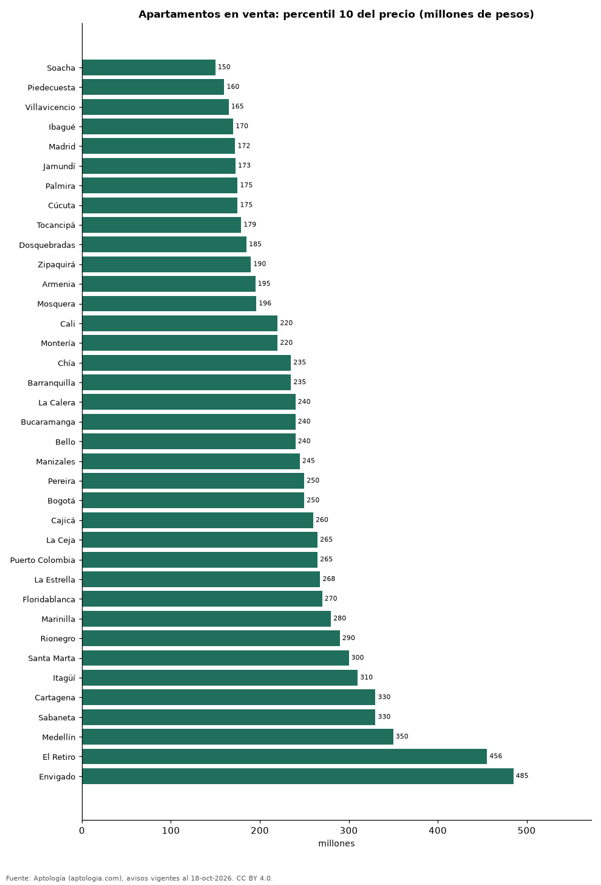

# Cuánto cuesta el apartamento más económico en cada ciudad de Colombia: precio de entrada en venta y arriendo (octubre 2026)

**El 10 % más barato de los apartamentos en venta arranca en 150 millones de pesos en Soacha, el precio de entrada más bajo de 37 ciudades, y en 485 millones de pesos en Envigado, el más alto.** En Bogotá el precio de entrada es 250 millones de pesos en venta y 1.350.000 pesos al mes en arriendo; el arriendo de entrada más bajo está en Soacha (850.000 pesos).

*Resumen: calculamos el percentil 10 del precio de 202.273 apartamentos y apartaestudios en 37 ciudades con 100 avisos o más.*

**Actualizado:** 18 de octubre de 2026 (datos del 18 de octubre de 2026) · **Próxima actualización:** mensual.

## Resumen

| Indicador | Valor |
|---|---|
| Entrada más baja (venta) | Soacha: 150 millones de pesos |
| Entrada más alta (venta) | Envigado: 485 millones de pesos |
| Bogotá (venta) | 250 millones de pesos |
| Bogotá (arriendo) | 1.350.000 pesos |

## Precio de entrada por ciudad

| Ciudad | Precio de entrada en venta (P10) | Arriendo de entrada (P10) | Avisos (venta / arriendo) |
|---|---|---|---|
| Soacha | 150 millones de pesos | 850.000 pesos | 575 / 148 |
| Piedecuesta | 160 millones de pesos | — | 266 / 74 |
| Villavicencio | 165 millones de pesos | — | 366 / 81 |
| Ibagué | 170 millones de pesos | 950.000 pesos | 1.298 / 289 |
| Madrid | 172 millones de pesos | 950.000 pesos | 484 / 275 |
| Jamundí | 173 millones de pesos | 950.000 pesos | 480 / 121 |
| Palmira | 175 millones de pesos | — | 125 / 57 |
| Cúcuta | 175 millones de pesos | 900.000 pesos | 682 / 438 |
| Tocancipá | 179 millones de pesos | — | 266 / 99 |
| Dosquebradas | 185 millones de pesos | — | 653 / 86 |
| Zipaquirá | 190 millones de pesos | 1.000.000 pesos | 838 / 177 |
| Armenia | 195 millones de pesos | 1.200.000 pesos | 2.611 / 454 |
| Mosquera | 196 millones de pesos | 1.146.958 pesos | 821 / 167 |
| Cali | 220 millones de pesos | 960.000 pesos | 9.832 / 2.093 |
| Montería | 220 millones de pesos | — | 346 / 70 |
| Chía | 235 millones de pesos | 1.300.000 pesos | 1.630 / 582 |
| Barranquilla | 235 millones de pesos | 1.400.000 pesos | 8.146 / 4.250 |
| La Calera | 240 millones de pesos | — | 149 / 59 |
| Bucaramanga | 240 millones de pesos | 1.100.000 pesos | 2.609 / 515 |
| Bello | 240 millones de pesos | 1.550.000 pesos | 2.380 / 1.148 |
| Manizales | 245 millones de pesos | 950.000 pesos | 3.058 / 414 |
| Pereira | 250 millones de pesos | 1.600.000 pesos | 4.769 / 1.782 |
| Bogotá | 250 millones de pesos | 1.350.000 pesos | 34.113 / 16.212 |
| Cajicá | 260 millones de pesos | 1.470.350 pesos | 1.570 / 406 |
| La Ceja | 265 millones de pesos | 1.600.000 pesos | 326 / 391 |
| Puerto Colombia | 265 millones de pesos | — | 155 / 94 |
| La Estrella | 268 millones de pesos | 1.800.000 pesos | 566 / 496 |
| Floridablanca | 270 millones de pesos | 1.400.000 pesos | 947 / 375 |
| Marinilla | 280 millones de pesos | 1.400.000 pesos | 168 / 111 |
| Rionegro | 290 millones de pesos | 1.600.000 pesos | 3.129 / 3.350 |
| Santa Marta | 300 millones de pesos | 1.700.000 pesos | 4.265 / 733 |
| Itagüí | 310 millones de pesos | 1.900.000 pesos | 2.033 / 938 |
| Cartagena | 330 millones de pesos | 2.000.000 pesos | 6.230 / 2.078 |
| Sabaneta | 330 millones de pesos | 2.200.000 pesos | 4.526 / 4.012 |
| Medellín | 350 millones de pesos | 2.199.000 pesos | 21.840 / 22.535 |
| El Retiro | 456 millones de pesos | 2.700.000 pesos | 662 / 593 |
| Envigado | 485 millones de pesos | 3.000.000 pesos | 5.874 / 7.530 |

Precio de entrada = percentil 10 del precio pedido: el 10 % de la oferta cuesta eso o menos. Incluye apartamentos y apartaestudios de cualquier tamaño.

## Preguntas frecuentes

**¿Cuánto cuesta el apartamento más barato en Bogotá?**
El 10 % más económico de la oferta en venta pide 250 millones de pesos o menos; en arriendo, 1.350.000 pesos al mes o menos.

**¿Dónde es más barato comprar un apartamento en Colombia?**
En Soacha, con un precio de entrada de 150 millones de pesos.

## Metodología

- **Fuente:** exportes nocturnos de la base de datos de Aptología (aptologia.com) del 18 de octubre de 2026: avisos vigentes de vivienda en portales inmobiliarios de 13 países, recogidos por Aptología y vistos en línea entre el 11 y el 18 de octubre de 2026. Corte: 18 de octubre de 2026.
- **Depuración:** se eliminan duplicados exactos (misma ciudad, zona, tipo, precio, moneda, área, habitaciones y baños) y los precios fuera del percentil 1–99 de cada país, operación, moneda y tipo; el precio por m² usa solo avisos con área declarada entre 12 y 2.000 m² y también se recorta al P1–P99.
- **Qué se mide:** precios pedidos (publicados), no precios de cierre. En arriendo, el canon mensual sin administración, gastos comunes ni condominio.
- **Muestra mínima:** cada cifra publicada se apoya en al menos 30 avisos; las celdas con menos se omiten.
- **Colombia:** Precios en pesos colombianos, sin conversión de moneda.
- **Limitaciones:** la cobertura depende de los portales que recorre Aptología en cada país y es mayor en las ciudades grandes y en los segmentos medio-alto y alto; el área es la que declara el aviso, sin verificar; los nombres de zona vienen de los portales.
- **Privacidad:** solo se publican agregados; no se publica ningún dato personal, enlace a avisos ni nombre de anunciante.
- **Datos abiertos:** [datos.csv](datos.csv), licencia CC BY 4.0.

## Cómo citar

Pinzón Pineda, D. M. (2026). *Cuánto cuesta el apartamento más económico en cada ciudad de Colombia: precio de entrada en venta y arriendo (octubre 2026)*. Aptología (aptologia.com). https://github.com/elbroker/aptologia-datos/tree/main/estudios/precio-de-entrada-apartamento-mas-economico-ciudades-colombia-2026. Datos: datos.csv, licencia CC BY 4.0.
