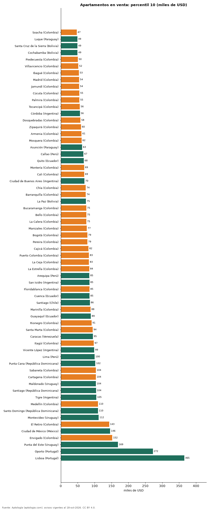

# El apartamento más económico en 71 ciudades de Latinoamérica y Portugal: precio de entrada en dólares (octubre 2026)

**El 10 % más barato de los apartamentos en venta arranca en USD 47.128 en Soacha (Colombia) y en USD 365.208 en Lisboa (Portugal), el precio de entrada más alto de 64 ciudades.** En arriendo, la entrada va de USD 236 al mes en Cochabamba a USD 1.500 en Punta del Este. En Bogotá: USD 78.547 en venta y USD 424 al mes en arriendo.

*Resumen: calculamos el percentil 10 del precio en dólares de 342.954 apartamentos en 71 ciudades con 100 avisos o más.*

**Actualizado:** 18 de octubre de 2026 (datos del 18 de octubre de 2026) · **Próxima actualización:** mensual.

## Resumen

| Indicador | Valor |
|---|---|
| Entrada más baja (venta) | Soacha: USD 47.128 |
| Entrada más alta (venta) | Lisboa: USD 365.208 |
| Entrada más baja (arriendo) | Cochabamba: USD 236/mes |
| Bogotá (venta) | USD 78.547 |

## Precio de entrada por ciudad

| País | Ciudad | Entrada en venta (USD, P10) | Entrada en arriendo (USD/mes, P10) | Avisos (venta / arriendo) |
|---|---|---|---|---|
| Colombia | Soacha | 47.128 | 267 | 575 / 148 |
| Paraguay | Luque | 49.000 | 386 | 166 / 123 |
| Bolivia | Santa Cruz de la Sierra | 49.113 | 300 | 2.260 / 1.317 |
| Bolivia | Cochabamba | 49.259 | 236 | 388 / 110 |
| Colombia | Piedecuesta | 50.270 | — | 266 / 74 |
| Colombia | Villavicencio | 51.841 | — | 366 / 81 |
| Colombia | Ibagué | 53.412 | 298 | 1.298 / 289 |
| Colombia | Madrid | 54.135 | 298 | 484 / 275 |
| Colombia | Jamundí | 54.260 | 298 | 480 / 121 |
| Colombia | Cúcuta | 54.983 | 283 | 682 / 438 |
| Colombia | Palmira | 54.983 | — | 125 / 57 |
| Colombia | Tocancipá | 56.240 | — | 266 / 99 |
| Argentina | Córdoba | 56.400 | 317 | 218 / 284 |
| Colombia | Dosquebradas | 58.125 | — | 653 / 86 |
| Colombia | Zipaquirá | 59.696 | 314 | 838 / 177 |
| Colombia | Armenia | 61.267 | 377 | 2.611 / 454 |
| Colombia | Mosquera | 61.581 | 360 | 821 / 167 |
| Paraguay | Asunción | 63.000 | 613 | 7.220 / 5.053 |
| Perú | Callao | 66.948 | — | 133 / 33 |
| Ecuador | Quito | 67.930 | 320 | 2.494 / 1.433 |
| Colombia | Montería | 69.121 | — | 346 / 70 |
| Colombia | Cali | 69.121 | 302 | 9.832 / 2.093 |
| Argentina | Ciudad de Buenos Aires | 70.000 | 390 | 9.690 / 5.661 |
| Colombia | Chía | 73.834 | 408 | 1.630 / 582 |
| Colombia | Barranquilla | 73.834 | 440 | 8.146 / 4.250 |
| Bolivia | La Paz | 74.560 | 337 | 489 / 323 |
| Colombia | Bucaramanga | 75.405 | 346 | 2.609 / 515 |
| Colombia | Bello | 75.405 | 487 | 2.380 / 1.148 |
| Colombia | La Calera | 75.405 | — | 149 / 59 |
| Colombia | Manizales | 76.976 | 298 | 3.058 / 414 |
| Colombia | Bogotá | 78.547 | 424 | 34.113 / 16.212 |
| Colombia | Pereira | 78.547 | 503 | 4.769 / 1.782 |
| Colombia | Cajicá | 81.689 | 462 | 1.570 / 406 |
| Colombia | Puerto Colombia | 83.260 | — | 155 / 94 |
| Colombia | La Ceja | 83.260 | 503 | 326 / 391 |
| Colombia | La Estrella | 84.145 | 566 | 566 / 496 |
| Perú | Arequipa | 84.568 | — | 642 / 51 |
| Argentina | San Isidro | 84.800 | 495 | 200 / 159 |
| Colombia | Floridablanca | 84.831 | 440 | 947 / 375 |
| Ecuador | Cuenca | 85.000 | 350 | 453 / 225 |
| Chile | Santiago | 85.925 | 295 | 8.592 / 8.876 |
| Colombia | Marinilla | 87.973 | 440 | 168 / 111 |
| Ecuador | Guayaquil | 89.000 | 350 | 1.028 / 1.434 |
| Colombia | Rionegro | 91.115 | 503 | 3.129 / 3.350 |
| Colombia | Santa Marta | 94.257 | 534 | 4.265 / 733 |
| Venezuela | Caracas | 95.000 | 700 | 1.524 / 342 |
| Colombia | Itagüí | 97.398 | 597 | 2.033 / 938 |
| Argentina | Vicente López | 99.000 | 462 | 175 / 196 |
| Perú | Lima | 100.029 | 524 | 9.613 / 4.383 |
| República Dominicana | Punta Cana | 102.031 | 850 | 472 / 113 |
| Colombia | Sabaneta | 103.682 | 691 | 4.526 / 4.012 |
| Colombia | Cartagena | 103.682 | 628 | 6.230 / 2.078 |
| Uruguay | Maldonado | 103.800 | — | 185 / 39 |
| República Dominicana | Santiago | 104.135 | 408 | 630 / 137 |
| Argentina | Tigre | 105.000 | 541 | 147 / 182 |
| Colombia | Medellín | 109.966 | 691 | 21.840 / 22.535 |
| República Dominicana | Santo Domingo | 110.000 | 692 | 8.367 / 3.965 |
| Uruguay | Montevideo | 112.000 | 522 | 5.371 / 4.601 |
| Colombia | El Retiro | 143.113 | 848 | 662 / 593 |
| México | Ciudad de México | 145.942 | 866 | 7.877 / 5.098 |
| Colombia | Envigado | 152.381 | 943 | 5.874 / 7.530 |
| Uruguay | Punta del Este | 169.000 | 1.500 | 5.388 / 2.572 |
| Portugal | Oporto | 272.309 | — | 696 / 91 |
| Portugal | Lisboa | 365.208 | 1.349 | 1.654 / 511 |
| Argentina | Rosario | — | 277 | 35 / 184 |
| Brasil | São Paulo | — | 326 | 0 / 12.884 |
| Colombia | El Carmen de Viboral | — | 377 | 93 / 107 |
| México | Guadalajara | — | 737 | 1 / 870 |
| México | Monterrey | — | 839 | 0 / 1.834 |
| México | San Pedro Garza Garcia | — | 1.246 | 0 / 672 |
| México | Zapopan | — | 812 | 4 / 865 |

Percentil 10 del precio pedido convertido a dólares; apartamentos y estudios de cualquier tamaño.

## Preguntas frecuentes

**¿Dónde es más barato comprar un apartamento en Latinoamérica?**
En Soacha (Colombia): el 10 % más barato de la oferta pide USD 47.128 o menos.

**¿Dónde es más barato arrendar?**
En Cochabamba (Bolivia), desde USD 236 al mes.

## Metodología

- **Fuente:** exportes nocturnos de la base de datos de Aptología (aptologia.com) del 18 de octubre de 2026: avisos vigentes de vivienda en portales inmobiliarios de 13 países, recogidos por Aptología y vistos en línea entre el 11 y el 18 de octubre de 2026. Corte: 18 de octubre de 2026.
- **Depuración:** se eliminan duplicados exactos (misma ciudad, zona, tipo, precio, moneda, área, habitaciones y baños) y los precios fuera del percentil 1–99 de cada país, operación, moneda y tipo; el precio por m² usa solo avisos con área declarada entre 12 y 2.000 m² y también se recorta al P1–P99.
- **Qué se mide:** precios pedidos (publicados), no precios de cierre. En arriendo, el canon mensual sin administración, gastos comunes ni condominio.
- **Muestra mínima:** cada cifra publicada se apoya en al menos 30 avisos; las celdas con menos se omiten.
- **Monedas:** nunca se mezclan avisos de monedas distintas sin convertirlos. Conversión a dólares con la tasa de mercado de ExchangeRate-API (open.er-api.com, actualización del 18 Oct 2026): 1 USD = 3.182,80 COP, 1 USD = 18,47 M.N, 1 USD = 5,09 BRL, 1 USD = 3,44 PEN, 1 USD = 982,44 CLP, 1 USD = 1.514,57 ARS, 1 USD = 40,20 UYU, 1 USD = 5.705,37 PYG, 1 USD = 61,27 DOP, 1 USD = 0,89 EUR, 1 USD = 11,72 BOB; la UF chilena a 41.178,64 CLP (mindicador,cl. 18-oct-2026). Los avisos publicados en dólares se usan tal cual.
- **Limitaciones:** la cobertura depende de los portales que recorre Aptología en cada país y es mayor en las ciudades grandes y en los segmentos medio-alto y alto; el área es la que declara el aviso, sin verificar; los nombres de zona vienen de los portales.
- **Privacidad:** solo se publican agregados; no se publica ningún dato personal, enlace a avisos ni nombre de anunciante.
- **Datos abiertos:** [datos.csv](datos.csv), licencia CC BY 4.0.

## Cómo citar

Pinzón Pineda, D. M. (2026). *El apartamento más económico en 71 ciudades de Latinoamérica y Portugal: precio de entrada en dólares (octubre 2026)*. Aptología (aptologia.com). https://github.com/elbroker/aptologia-datos/tree/main/estudios/precio-de-entrada-vivienda-ciudades-latinoamerica-2026. Datos: datos.csv, licencia CC BY 4.0.
