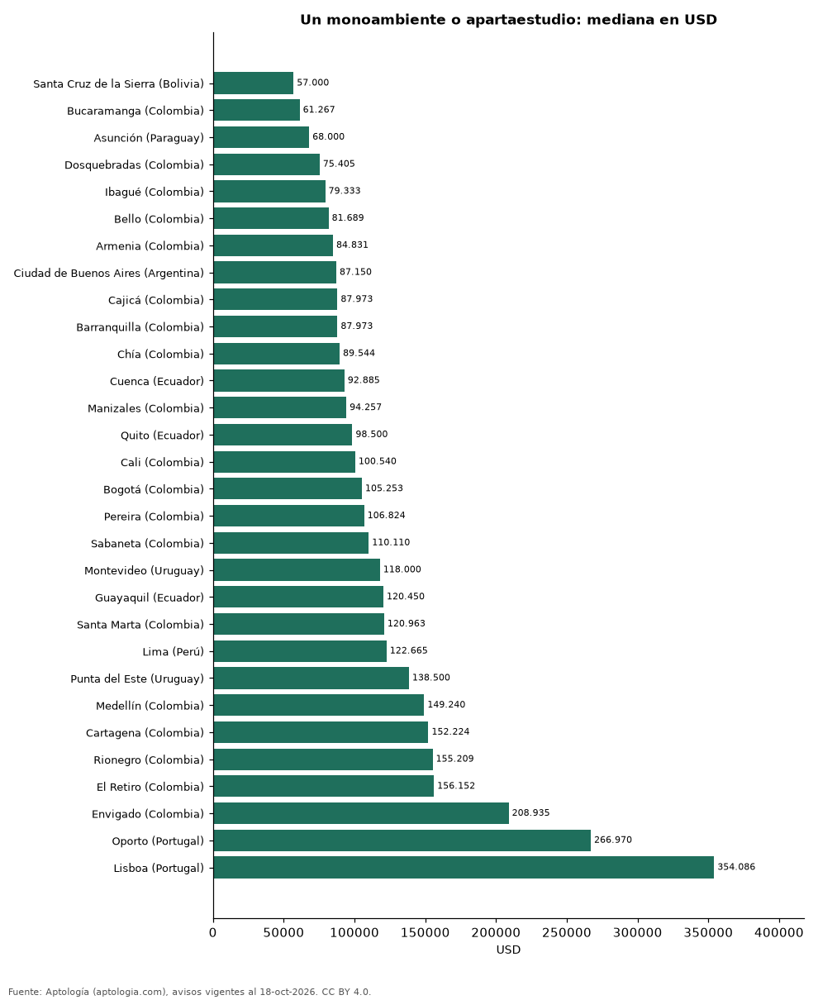

# Cuánto cuesta comprar un monoambiente, estudio o apartaestudio en 30 ciudades de Latinoamérica y Portugal (octubre 2026)

**Un monoambiente o apartaestudio se pide por USD 57.000 en la mediana de Santa Cruz de la Sierra (Bolivia), la más baja de 30 ciudades, y por USD 354.086 en Lisboa (Portugal), la más alta.** En Bogotá, USD 105.253. Entre las capitales, de USD 68.000 en Asunción a USD 354.086 en Lisboa.

*Resumen: comparamos 9.711 avisos en 30 ciudades con 30 avisos o más.*

**Actualizado:** 18 de octubre de 2026 (datos del 18 de octubre de 2026) · **Próxima actualización:** mensual.

## Resumen

| Indicador | Valor |
|---|---|
| Más barato | Santa Cruz de la Sierra (Bolivia): USD 57.000 |
| Más caro | Lisboa (Portugal): USD 354.086 |
| Bogotá | USD 105.253 |
| Ciudades | 30 |

## Ciudades de menor a mayor

| Ciudad | Precio (mediana) | USD por m² | Avisos |
|---|---|---|---|
| Santa Cruz de la Sierra (Bolivia) | USD 57.000 | 1.422 | 392 |
| Bucaramanga (Colombia) | USD 61.267 | 1.852 | 100 |
| Asunción (Paraguay) | USD 68.000 | 1.925 | 891 |
| Dosquebradas (Colombia) | USD 75.405 | 1.813 | 39 |
| Ibagué (Colombia) | USD 79.333 | 1.863 | 38 |
| Bello (Colombia) | USD 81.689 | 2.012 | 33 |
| Armenia (Colombia) | USD 84.831 | 2.191 | 291 |
| Ciudad de Buenos Aires (Argentina) | USD 87.150 | 2.646 | 1.382 |
| Cajicá (Colombia) | USD 87.973 | 2.181 | 44 |
| Barranquilla (Colombia) | USD 87.973 | 1.806 | 243 |
| Chía (Colombia) | USD 89.544 | 2.290 | 118 |
| Cuenca (Ecuador) | USD 92.885 | 1.690 | 55 |
| Manizales (Colombia) | USD 94.257 | 2.316 | 234 |
| Quito (Ecuador) | USD 98.500 | 1.881 | 157 |
| Cali (Colombia) | USD 100.540 | 2.712 | 327 |
| Bogotá (Colombia) | USD 105.253 | 3.142 | 2.202 |
| Pereira (Colombia) | USD 106.824 | 2.285 | 319 |
| Sabaneta (Colombia) | USD 110.110 | 2.514 | 133 |
| Montevideo (Uruguay) | USD 118.000 | 3.160 | 729 |
| Guayaquil (Ecuador) | USD 120.450 | 1.982 | 50 |
| Santa Marta (Colombia) | USD 120.963 | 3.315 | 345 |
| Lima (Perú) | USD 122.665 | 2.544 | 49 |
| Punta del Este (Uruguay) | USD 138.500 | 3.376 | 190 |
| Medellín (Colombia) | USD 149.240 | 3.242 | 900 |
| Cartagena (Colombia) | USD 152.224 | 3.474 | 104 |
| Rionegro (Colombia) | USD 155.209 | 2.845 | 77 |
| El Retiro (Colombia) | USD 156.152 | 2.965 | 41 |
| Envigado (Colombia) | USD 208.935 | 3.142 | 86 |
| Oporto (Portugal) | USD 266.970 | 5.987 | 71 |
| Lisboa (Portugal) | USD 354.086 | 9.908 | 71 |

Medianas en la moneda mayoritaria de cada ciudad, convertidas a dólares.

## Preguntas frecuentes

**¿Dónde es más barato comprar un monoambiente o apartaestudio?**
En Santa Cruz de la Sierra (Bolivia): USD 57.000 en la mediana (octubre de 2026).

**¿Dónde es más caro?**
En Lisboa (Portugal): USD 354.086.

## Metodología

- **Fuente:** exportes nocturnos de la base de datos de Aptología (aptologia.com) del 18 de octubre de 2026: avisos vigentes de vivienda en portales inmobiliarios de 13 países, recogidos por Aptología y vistos en línea entre el 11 y el 18 de octubre de 2026. Corte: 18 de octubre de 2026.
- **Depuración:** se eliminan duplicados exactos (misma ciudad, zona, tipo, precio, moneda, área, habitaciones y baños) y los precios fuera del percentil 1–99 de cada país, operación, moneda y tipo; el precio por m² usa solo avisos con área declarada entre 12 y 2.000 m² y también se recorta al P1–P99.
- **Qué se mide:** precios pedidos (publicados), no precios de cierre. En arriendo, el canon mensual sin administración, gastos comunes ni condominio.
- **Muestra mínima:** cada cifra publicada se apoya en al menos 30 avisos; las celdas con menos se omiten.
- **Monedas:** nunca se mezclan avisos de monedas distintas sin convertirlos. Conversión a dólares con la tasa de mercado de ExchangeRate-API (open.er-api.com, actualización del 18 Oct 2026): 1 USD = 3.182,80 COP, 1 USD = 18,47 M.N, 1 USD = 5,09 BRL, 1 USD = 3,44 PEN, 1 USD = 982,44 CLP, 1 USD = 1.514,57 ARS, 1 USD = 40,20 UYU, 1 USD = 5.705,37 PYG, 1 USD = 61,27 DOP, 1 USD = 0,89 EUR, 1 USD = 11,72 BOB; la UF chilena a 41.178,64 CLP (mindicador,cl. 18-oct-2026). Los avisos publicados en dólares se usan tal cual.
- **Monedas:** en cada ciudad y operación se usa solo la moneda mayoritaria de los avisos (los avisos en otra moneda se excluyen) y la mediana se convierte a dólares con la tasa citada; nunca se promedian avisos de monedas distintas.
- **Limitaciones:** la cobertura depende de los portales que recorre Aptología en cada país y es mayor en las ciudades grandes y en los segmentos medio-alto y alto; el área es la que declara el aviso, sin verificar; los nombres de zona vienen de los portales.
- **Privacidad:** solo se publican agregados; no se publica ningún dato personal, enlace a avisos ni nombre de anunciante.
- **Datos abiertos:** [datos.csv](datos.csv), licencia CC BY 4.0.

## Cómo citar

Pinzón Pineda, D. M. (2026). *Cuánto cuesta comprar un monoambiente, estudio o apartaestudio en 30 ciudades de Latinoamérica y Portugal (octubre 2026)*. Aptología (aptologia.com). https://github.com/elbroker/aptologia-datos/tree/main/estudios/precio-de-monoambientes-y-apartaestudios-en-venta-latinoamerica-2026. Datos: datos.csv, licencia CC BY 4.0.
