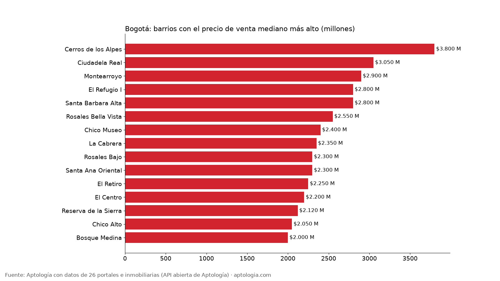
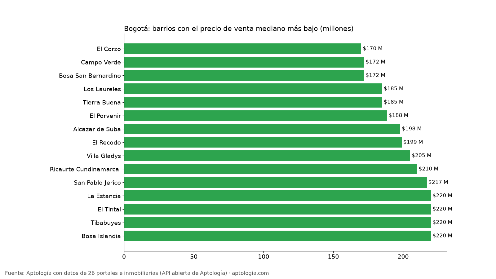

# Precio de venta de apartamentos en Bogotá por barrio: los más caros y los más baratos para comprar (octubre 2026)

**En Bogotá, el barrio típico pide $520 millones por un apartamento en venta (mediana entre 320 barrios con 30 avisos o más); un 2 alcobas, $450 millones.** El barrio más caro es Cerros de los Alpes ($3,80 mil millones) y el más barato El Corzo ($170 millones).

*Resumen: analizamos 53.217 avisos de apartamentos en venta en 533 barrios depurados de Bogotá.*

**Actualizado:** 18 de octubre de 2026 (datos del 5 de octubre de 2026) · **Próxima actualización:** mensual.

## Resumen

| Indicador | Valor |
|---|---|
| Precio mediano del barrio típico | $520 millones |
| 1 alcoba (barrio típico) | $370 millones |
| 2 alcobas (barrio típico) | $450 millones |
| 3 o más alcobas (barrio típico) | $700 millones |
| Barrios con 30 avisos o más | 320 |
| Avisos de venta en barrios depurados | 53.217 |

## Barrios más caros para comprar

| Barrio | Precio mediano | P25 – P75 | 2 alcobas | 3+ alcobas | Avisos |
|---|---|---|---|---|---|
| Cerros de los Alpes | $3,80 mil millones | $3,50 mil millones – $4,40 mil millones | — | $3,90 mil millones | 30 |
| Ciudadela Real | $3,05 mil millones | $2,40 mil millones – $3,65 mil millones | — | $3,05 mil millones | 46 |
| Montearroyo | $2,90 mil millones | $2,30 mil millones – $3,20 mil millones | — | $2,88 mil millones | 131 |
| El Refugio I | $2,80 mil millones | $1,50 mil millones – $3,20 mil millones | — | $2,80 mil millones | 65 |
| Santa Barbara Alta | $2,80 mil millones | $2,00 mil millones – $3,80 mil millones | $2,13 mil millones | $3,30 mil millones | 299 |
| Rosales Bella Vista | $2,55 mil millones | $1,79 mil millones – $3,17 mil millones | — | $2,52 mil millones | 39 |
| Chico Museo | $2,40 mil millones | $1,81 mil millones – $3,48 mil millones | $1,63 mil millones | $2,50 mil millones | 99 |
| La Cabrera | $2,35 mil millones | $1,58 mil millones – $3,20 mil millones | $1,69 mil millones | $2,90 mil millones | 803 |
| Rosales Bajo | $2,30 mil millones | $1,68 mil millones – $3,80 mil millones | — | $2,89 mil millones | 47 |
| Santa Ana Oriental | $2,30 mil millones | $1,61 mil millones – $2,84 mil millones | $1,86 mil millones | $2,54 mil millones | 166 |
| El Retiro | $2,25 mil millones | $1,60 mil millones – $3,30 mil millones | $1,42 mil millones | $2,95 mil millones | 114 |
| El Centro | $2,20 mil millones | $640 millones – $3,20 mil millones | $3,20 mil millones | — | 51 |
| Reserva de la Sierra | $2,12 mil millones | $1,85 mil millones – $2,40 mil millones | — | $2,12 mil millones | 30 |
| Chico Alto | $2,05 mil millones | $1,55 mil millones – $2,95 mil millones | $1,49 mil millones | $2,40 mil millones | 399 |
| Bosque Medina | $2,00 mil millones | $1,75 mil millones – $2,40 mil millones | — | $2,00 mil millones | 237 |

## Barrios más baratos para comprar

| Barrio | Precio mediano | P25 – P75 | 2 alcobas | 3+ alcobas | Avisos |
|---|---|---|---|---|---|
| El Corzo | $170 millones | $151 millones – $197 millones | $156 millones | $200 millones | 31 |
| Campo Verde | $172 millones | $166 millones – $184 millones | $172 millones | $174 millones | 75 |
| Bosa San Bernardino | $172 millones | $165 millones – $174 millones | — | $172 millones | 31 |
| Los Laureles | $185 millones | $175 millones – $198 millones | $175 millones | $187 millones | 33 |
| Tierra Buena | $185 millones | $150 millones – $199 millones | $184 millones | $198 millones | 58 |
| El Porvenir | $188 millones | $165 millones – $225 millones | $180 millones | $195 millones | 62 |
| Alcazar de Suba | $198 millones | $198 millones – $220 millones | $220 millones | $198 millones | 33 |
| El Recodo | $199 millones | $195 millones – $222 millones | $196 millones | $199 millones | 44 |
| Villa Gladys | $205 millones | $194 millones – $256 millones | $197 millones | — | 33 |
| Ricaurte Cundinamarca  | $210 millones | $185 millones – $220 millones | $198 millones | — | 35 |
| San Pablo Jerico | $217 millones | $204 millones – $226 millones | $216 millones | $231 millones | 35 |
| La Estancia | $220 millones | $202 millones – $235 millones | $210 millones | $236 millones | 43 |
| El Tintal | $220 millones | $190 millones – $269 millones | $220 millones | $225 millones | 100 |
| Tibabuyes | $220 millones | $215 millones – $240 millones | $200 millones | $220 millones | 102 |
| Bosa Islandia | $220 millones | $208 millones – $233 millones | $224 millones | $220 millones | 33 |

**Cómo usarlo para decidir:** si vas a comprar, compara el precio pedido con la franja P25 – P75 del barrio para saber si está alto o bajo, y negocia: son precios pedidos, no de cierre. Si compras para arrendar, cruza esta tabla con el arriendo del mismo barrio en [aptologia.com/precios-de-arriendo/bogota](https://www.aptologia.com/precios-de-arriendo/bogota). La tabla completa de barrios está en el CSV.

## Preguntas frecuentes

**¿Cuánto cuesta un apartamento en Bogotá?**
En el barrio típico (mediana entre 320 barrios con 30 avisos o más) el precio pedido es $520 millones; un 2 alcobas, $450 millones, con datos del 5 de octubre de 2026.

**¿Cuál es el barrio más caro para comprar apartamento en Bogotá?**
Cerros de los Alpes, con un precio mediano pedido de $3,80 mil millones (30 avisos).

**¿Dónde es más barato comprar apartamento en Bogotá?**
Entre los barrios con 30 avisos o más, El Corzo ($170 millones), seguido de Campo Verde ($172 millones).

## Metodología

- **Fuente:** API abierta de Aptología ([aptologia.com/datos-abiertos](https://www.aptologia.com/datos-abiertos)), que cada noche revisa los avisos vivos de 26 portales e inmobiliarias. Foto de los datos: 5 de octubre de 2026.
- **Qué se mide:** precio pedido de apartamentos (no casas ni habitaciones), sin administración. Son precios publicados, no cerrados.
- **Barrios:** etiquetas depuradas. Se excluyen nombres de localidad o comuna, textos de aviso, zonas genéricas, barrios de otro municipio y variantes del mismo nombre, para no contar dos veces el mismo barrio.
- **Barrio típico:** mediana de las medianas de los barrios con 30 avisos o más (no es la mediana de la ciudad). Por alcobas, solo barrios con 10 avisos o más de ese tamaño. Precios en pesos, sin gastos notariales ni de escrituración.
- **Limitaciones:** un mismo apartamento puede estar publicado en más de un portal, por lo que los conteos de avisos pueden incluir repetidos. Los barrios vienen tal como los escribe cada portal, después de la depuración.
- **Datos abiertos:** [datos.csv](datos.csv), licencia CC BY 4.0.

## Cómo citar

Pinzón Pineda, D. M. (2026). *Precio de venta de apartamentos en Bogotá por barrio: los más caros y los más baratos para comprar (octubre 2026)*. Aptología. https://www.aptologia.com/estudios/precio-de-venta-apartamentos-bogota-por-barrio-2026. Datos: datos.csv, licencia CC BY 4.0.
