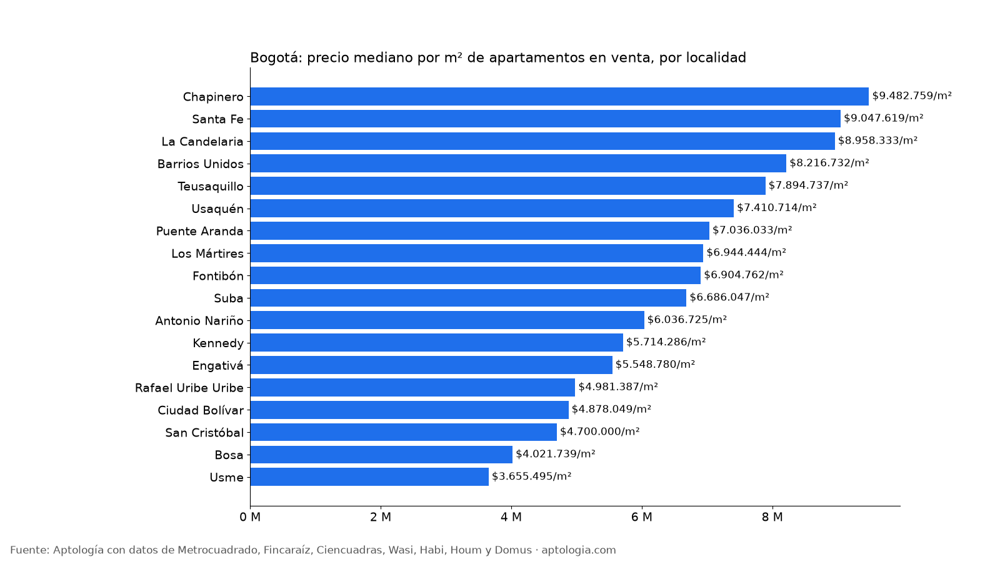
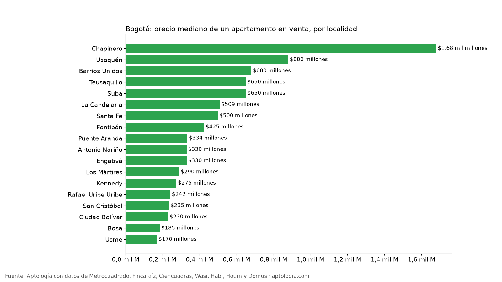

# Precio de venta de apartamentos en Bogotá por localidad: metro cuadrado, precio mediano y 2 habitaciones (octubre 2026)

**El metro cuadrado de un apartamento en venta en Bogotá cuesta en la mediana $7.360.406, y va de $3.655.495 en Usme a $9.482.759 en Chapinero: 2,6 veces más.** El precio mediano pedido de un apartamento en la ciudad es $750 millones.

*Resumen: analizamos 35.940 apartamentos en venta únicos con localidad identificada, en 18 localidades de Bogotá.*

**Actualizado:** 18 de octubre de 2026 (datos del 18 de octubre de 2026) · **Próxima actualización:** mensual.

## Precio de venta por localidad

| Localidad | Precio por m² | Precio mediano | P25 – P75 | 2 habitaciones | Área mediana | Avisos |
|---|---|---|---|---|---|---|
| Chapinero | $9.482.759 | $1,68 mil millones | $1,03 mil millones – $2,74 mil millones | $1,20 mil millones | 187 m² | 7.412 |
| Santa Fe | $9.047.619 | $500 millones | $330 millones – $717 millones | $580 millones | 59 m² | 766 |
| La Candelaria | $8.958.333 | $509 millones | $385 millones – $720 millones | — | 54 m² | 103 |
| Barrios Unidos | $8.216.732 | $680 millones | $461 millones – $1,05 mil millones | $685 millones | 87 m² | 1.061 |
| Teusaquillo | $7.894.737 | $650 millones | $435 millones – $820 millones | $510 millones | 86 m² | 1.401 |
| Usaquén | $7.410.714 | $880 millones | $570 millones – $1,45 mil millones | $650 millones | 123 m² | 12.111 |
| Puente Aranda | $7.036.033 | $334 millones | $270 millones – $550 millones | $290 millones | 55 m² | 501 |
| Los Mártires | $6.944.444 | $290 millones | $240 millones – $395 millones | $265 millones | 41 m² | 390 |
| Fontibón | $6.904.762 | $425 millones | $255 millones – $680 millones | $275 millones | 60 m² | 1.639 |
| Suba | $6.686.047 | $650 millones | $383 millones – $1,05 mil millones | $390 millones | 92 m² | 5.966 |
| Antonio Nariño | $6.036.725 | $330 millones | $279 millones – $422 millones | $278 millones | 60 m² | 172 |
| Kennedy | $5.714.286 | $275 millones | $225 millones – $390 millones | $248 millones | 53 m² | 1.431 |
| Engativá | $5.548.780 | $330 millones | $266 millones – $430 millones | $280 millones | 61 m² | 1.084 |
| Rafael Uribe Uribe | $4.981.387 | $242 millones | $205 millones – $310 millones | $237 millones | 50 m² | 306 |
| Ciudad Bolívar | $4.878.049 | $230 millones | $210 millones – $257 millones | $220 millones | 48 m² | 396 |
| San Cristóbal | $4.700.000 | $235 millones | $195 millones – $316 millones | $220 millones | 50 m² | 257 |
| Bosa | $4.021.739 | $185 millones | $165 millones – $211 millones | $176 millones | 46 m² | 643 |
| Usme | $3.655.495 | $170 millones | $135 millones – $240 millones | $145 millones | 49 m² | 248 |

**Cómo usarlo para decidir:** compara por metro cuadrado, no solo por precio total: en Usaquén y Chapinero los apartamentos son más grandes. Un aviso por debajo del P25 de su localidad está barato para la zona; por encima del P75, caro. Son precios pedidos: en venta suele haber margen de negociación.

## Preguntas frecuentes

**¿Cuánto cuesta el metro cuadrado de un apartamento en Bogotá?**
La mediana del precio pedido es $7.360.406 por m², con datos del 18 de octubre de 2026.

**¿Cuál es la localidad más cara para comprar apartamento en Bogotá?**
Chapinero, con $9.482.759 por m² y un precio mediano de $1,68 mil millones.

**¿Dónde es más barato comprar apartamento en Bogotá?**
Entre las localidades con 80 avisos o más, Usme, con $3.655.495 por m² y un precio mediano de $170 millones.

## Metodología

- **Fuente:** avisos vivos de vivienda recogidos por la ingesta de Aptología en Metrocuadrado, Fincaraíz, Ciencuadras, Wasi, Habi, Houm y Domus, del 11 al 18 de octubre de 2026. Corte: 18 de octubre de 2026.
- **Depuración:** un mismo inmueble publicado varias veces se cuenta una sola vez (agrupación por portal y, entre portales, por precio, área, habitaciones y coordenadas). Se descartan precios y áreas fuera de rango y, en arriendo, se resta la administración cuando el portal la incluye en el canon.
- **Qué se mide:** precios pedidos (publicados), no precios de cierre.
- **Localidad:** la que informa el portal o, si falta, la mayoritaria entre los 15 avisos más cercanos. Solo localidades con 80 avisos o más; 2 habitaciones solo con 20 avisos o más.
- **Limitaciones:** son precios pedidos en portales, que pueden diferir del valor final de arriendo o venta. La cobertura es mayor en el norte de Bogotá y en estratos 4 a 6, porque ahí se concentra la oferta publicada. Los barrios y la localidad vienen de lo que escribe cada portal; cuando falta la localidad se asigna por los avisos vecinos más cercanos.
- **Datos abiertos:** [datos.csv](datos.csv), licencia CC BY 4.0.

## Cómo citar

Pinzón Pineda, D. M. (2026). *Precio de venta de apartamentos en Bogotá por localidad: metro cuadrado, precio mediano y 2 habitaciones (octubre 2026)*. Aptología. https://www.aptologia.com/estudios/precio-de-venta-apartamentos-bogota-por-localidad-2026. Datos: datos.csv, licencia CC BY 4.0.
