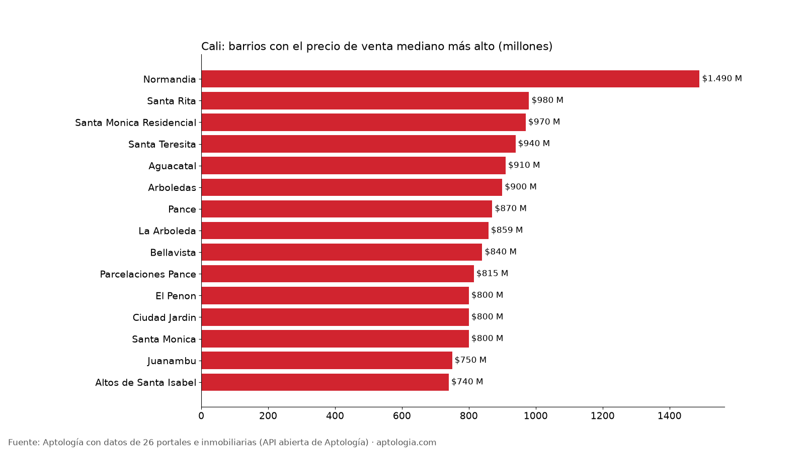
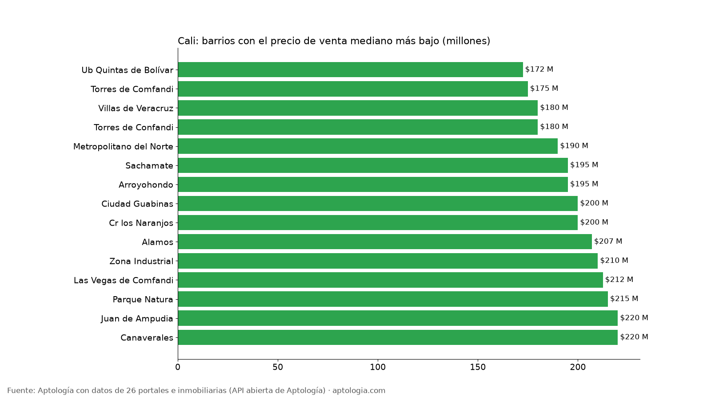

# Precio de venta de apartamentos en Cali por barrio: los más caros y los más baratos para comprar (octubre 2026)

**En Cali, el barrio típico pide $358 millones por un apartamento en venta (mediana entre 114 barrios con 30 avisos o más); un 2 alcobas, $280 millones.** El barrio más caro es Normandia ($1,49 mil millones) y el más barato Ub Quintas de Bolívar ($172 millones).

*Resumen: analizamos 16.318 avisos de apartamentos en venta en 182 barrios depurados de Cali.*

**Actualizado:** 18 de octubre de 2026 (datos del 5 de octubre de 2026) · **Próxima actualización:** mensual.

## Resumen

| Indicador | Valor |
|---|---|
| Precio mediano del barrio típico | $358 millones |
| 1 alcoba (barrio típico) | $316 millones |
| 2 alcobas (barrio típico) | $280 millones |
| 3 o más alcobas (barrio típico) | $390 millones |
| Barrios con 30 avisos o más | 114 |
| Avisos de venta en barrios depurados | 16.318 |

## Barrios más caros para comprar

| Barrio | Precio mediano | P25 – P75 | 2 alcobas | 3+ alcobas | Avisos |
|---|---|---|---|---|---|
| Normandia | $1,49 mil millones | $932 millones – $1,90 mil millones | $800 millones | $1,60 mil millones | 343 |
| Santa Rita | $980 millones | $750 millones – $1,50 mil millones | $1,45 mil millones | $980 millones | 161 |
| Santa Monica Residencial | $970 millones | $700 millones – $2,07 mil millones | — | $950 millones | 71 |
| Santa Teresita | $940 millones | $680 millones – $1,40 mil millones | $680 millones | $1,05 mil millones | 598 |
| Aguacatal | $910 millones | $249 millones – $1,50 mil millones | $230 millones | $1,30 mil millones | 275 |
| Arboledas | $900 millones | $690 millones – $1,37 mil millones | $680 millones | $1,20 mil millones | 97 |
| Pance | $870 millones | $670 millones – $1,10 mil millones | $699 millones | $980 millones | 709 |
| La Arboleda | $859 millones | $724 millones – $1,49 mil millones | $740 millones | $1,19 mil millones | 90 |
| Bellavista | $840 millones | $645 millones – $1,31 mil millones | $680 millones | $950 millones | 433 |
| Parcelaciones Pance | $815 millones | $622 millones – $1,03 mil millones | $280 millones | $930 millones | 152 |
| El Penon | $800 millones | $560 millones – $958 millones | $600 millones | $900 millones | 96 |
| Ciudad Jardin | $800 millones | $595 millones – $990 millones | $706 millones | $850 millones | 514 |
| Santa Monica | $800 millones | $420 millones – $1,12 mil millones | $850 millones | $950 millones | 251 |
| Juanambu | $750 millones | $504 millones – $1,16 mil millones | $765 millones | $900 millones | 238 |
| Altos de Santa Isabel | $740 millones | $620 millones – $820 millones | $620 millones | $780 millones | 37 |

## Barrios más baratos para comprar

| Barrio | Precio mediano | P25 – P75 | 2 alcobas | 3+ alcobas | Avisos |
|---|---|---|---|---|---|
| Ub Quintas de Bolívar | $172 millones | $168 millones – $210 millones | $172 millones | — | 32 |
| Torres de Comfandi | $175 millones | $160 millones – $184 millones | — | $175 millones | 57 |
| Villas de Veracruz | $180 millones | $175 millones – $230 millones | — | $180 millones | 59 |
| Torres de Confandi | $180 millones | $178 millones – $252 millones | — | $180 millones | 34 |
| Metropolitano del Norte | $190 millones | $170 millones – $219 millones | — | $190 millones | 44 |
| Sachamate | $195 millones | $180 millones – $209 millones | $195 millones | $190 millones | 34 |
| Arroyohondo | $195 millones | $172 millones – $230 millones | $188 millones | — | 35 |
| Ciudad Guabinas | $200 millones | $173 millones – $230 millones | $200 millones | $205 millones | 110 |
| Cr los Naranjos | $200 millones | $190 millones – $210 millones | $200 millones | $200 millones | 48 |
| Alamos | $207 millones | $207 millones – $255 millones | — | $207 millones | 57 |
| Zona Industrial | $210 millones | $182 millones – $235 millones | $212 millones | $212 millones | 58 |
| Las Vegas de Comfandi | $212 millones | $170 millones – $270 millones | $190 millones | $245 millones | 48 |
| Parque Natura | $215 millones | $185 millones – $269 millones | $210 millones | $238 millones | 154 |
| Juan de Ampudia | $220 millones | $185 millones – $240 millones | $199 millones | $220 millones | 37 |
| Canaverales | $220 millones | $186 millones – $250 millones | — | $220 millones | 62 |

**Cómo usarlo para decidir:** si vas a comprar, compara el precio pedido con la franja P25 – P75 del barrio para saber si está alto o bajo, y negocia: son precios pedidos, no de cierre. Si compras para arrendar, cruza esta tabla con el arriendo del mismo barrio en [aptologia.com/precios-de-arriendo/cali](https://www.aptologia.com/precios-de-arriendo/cali). La tabla completa de barrios está en el CSV.

## Preguntas frecuentes

**¿Cuánto cuesta un apartamento en Cali?**
En el barrio típico (mediana entre 114 barrios con 30 avisos o más) el precio pedido es $358 millones; un 2 alcobas, $280 millones, con datos del 5 de octubre de 2026.

**¿Cuál es el barrio más caro para comprar apartamento en Cali?**
Normandia, con un precio mediano pedido de $1,49 mil millones (343 avisos).

**¿Dónde es más barato comprar apartamento en Cali?**
Entre los barrios con 30 avisos o más, Ub Quintas de Bolívar ($172 millones), seguido de Torres de Comfandi ($175 millones).

## Metodología

- **Fuente:** API abierta de Aptología ([aptologia.com/datos-abiertos](https://www.aptologia.com/datos-abiertos)), que cada noche revisa los avisos vivos de 26 portales e inmobiliarias. Foto de los datos: 5 de octubre de 2026.
- **Qué se mide:** precio pedido de apartamentos (no casas ni habitaciones), sin administración. Son precios publicados, no cerrados.
- **Barrios:** etiquetas depuradas. Se excluyen nombres de localidad o comuna, textos de aviso, zonas genéricas, barrios de otro municipio y variantes del mismo nombre, para no contar dos veces el mismo barrio.
- **Barrio típico:** mediana de las medianas de los barrios con 30 avisos o más (no es la mediana de la ciudad). Por alcobas, solo barrios con 10 avisos o más de ese tamaño. Precios en pesos, sin gastos notariales ni de escrituración.
- **Limitaciones:** un mismo apartamento puede estar publicado en más de un portal, por lo que los conteos de avisos pueden incluir repetidos. Los barrios vienen tal como los escribe cada portal, después de la depuración.
- **Datos abiertos:** [datos.csv](datos.csv), licencia CC BY 4.0.

## Cómo citar

Pinzón Pineda, D. M. (2026). *Precio de venta de apartamentos en Cali por barrio: los más caros y los más baratos para comprar (octubre 2026)*. Aptología. https://www.aptologia.com/estudios/precio-de-venta-apartamentos-cali-por-barrio-2026. Datos: datos.csv, licencia CC BY 4.0.
