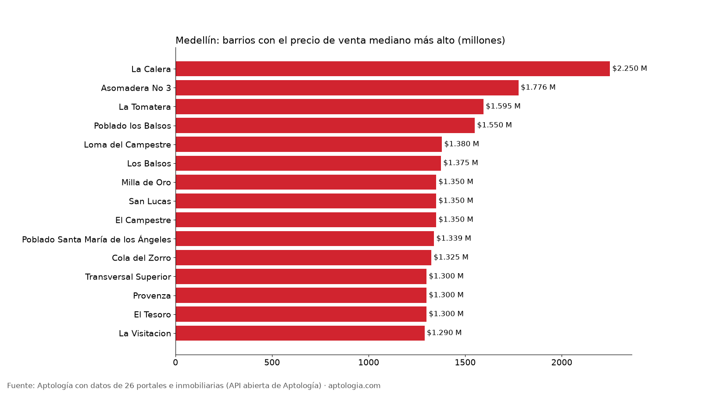
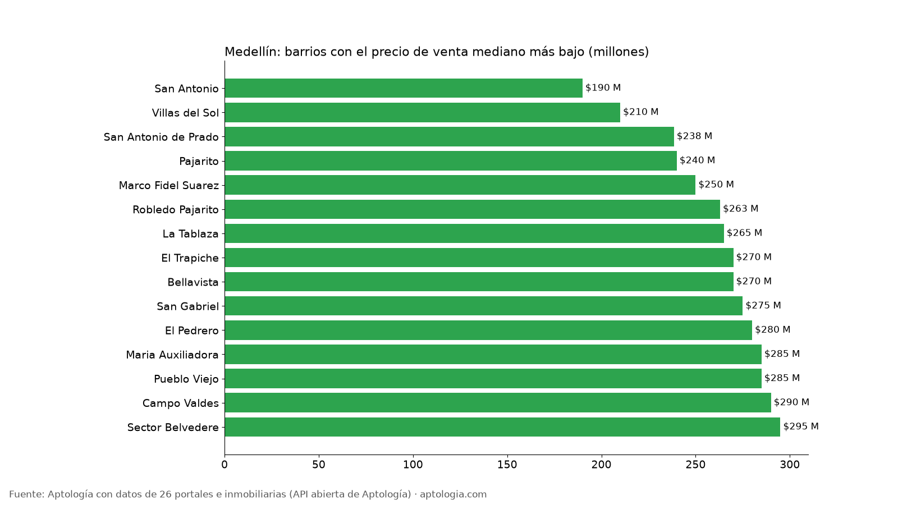

# Precio de venta de apartamentos en Medellín por barrio: los más caros y los más baratos para comprar (octubre 2026)

**En Medellín, el barrio típico pide $562 millones por un apartamento en venta (mediana entre 268 barrios con 30 avisos o más); un 2 alcobas, $530 millones.** El barrio más caro es La Calera ($2,25 mil millones) y el más barato San Antonio ($190 millones).

*Resumen: analizamos 47.896 avisos de apartamentos en venta en 389 barrios depurados de Medellín.*

**Actualizado:** 18 de octubre de 2026 (datos del 5 de octubre de 2026) · **Próxima actualización:** mensual.

## Resumen

| Indicador | Valor |
|---|---|
| Precio mediano del barrio típico | $562 millones |
| 1 alcoba (barrio típico) | $512 millones |
| 2 alcobas (barrio típico) | $530 millones |
| 3 o más alcobas (barrio típico) | $600 millones |
| Barrios con 30 avisos o más | 268 |
| Avisos de venta en barrios depurados | 47.896 |

## Barrios más caros para comprar

| Barrio | Precio mediano | P25 – P75 | 2 alcobas | 3+ alcobas | Avisos |
|---|---|---|---|---|---|
| La Calera | $2,25 mil millones | $1,55 mil millones – $2,89 mil millones | $1,24 mil millones | $2,29 mil millones | 103 |
| Asomadera No 3 | $1,78 mil millones | $1,29 mil millones – $2,00 mil millones | $770 millones | $1,94 mil millones | 52 |
| La Tomatera | $1,59 mil millones | $1,29 mil millones – $1,83 mil millones | — | $1,68 mil millones | 34 |
| Poblado los Balsos | $1,55 mil millones | $1,14 mil millones – $2,24 mil millones | — | $1,55 mil millones | 52 |
| Loma del Campestre | $1,38 mil millones | $1,19 mil millones – $1,85 mil millones | — | $1,37 mil millones | 49 |
| Los Balsos | $1,38 mil millones | $1,10 mil millones – $1,84 mil millones | $1,18 mil millones | $1,42 mil millones | 286 |
| Milla de Oro | $1,35 mil millones | $998 millones – $1,60 mil millones | $1,18 mil millones | $1,43 mil millones | 134 |
| San Lucas | $1,35 mil millones | $950 millones – $1,98 mil millones | $1,31 mil millones | $1,45 mil millones | 458 |
| El Campestre | $1,35 mil millones | $900 millones – $2,00 mil millones | $1,30 mil millones | $1,38 mil millones | 398 |
| Poblado Santa María de los Ángeles | $1,34 mil millones | $1,10 mil millones – $1,60 mil millones | — | $1,41 mil millones | 33 |
| Cola del Zorro | $1,32 mil millones | $1,24 mil millones – $1,96 mil millones | $1,29 mil millones | $1,49 mil millones | 88 |
| Transversal Superior | $1,30 mil millones | $999 millones – $1,98 mil millones | $1,25 mil millones | $1,65 mil millones | 143 |
| Provenza | $1,30 mil millones | $862 millones – $1,60 mil millones | $1,35 mil millones | $1,38 mil millones | 347 |
| El Tesoro | $1,30 mil millones | $916 millones – $1,96 mil millones | $1,16 mil millones | $1,47 mil millones | 719 |
| La Visitacion | $1,29 mil millones | $899 millones – $2,00 mil millones | — | $1,35 mil millones | 44 |

## Barrios más baratos para comprar

| Barrio | Precio mediano | P25 – P75 | 2 alcobas | 3+ alcobas | Avisos |
|---|---|---|---|---|---|
| San Antonio | $190 millones | $166 millones – $230 millones | $185 millones | $230 millones | 51 |
| Villas del Sol | $210 millones | $179 millones – $230 millones | $208 millones | $210 millones | 64 |
| San Antonio de Prado | $238 millones | $210 millones – $263 millones | $220 millones | $250 millones | 334 |
| Pajarito | $240 millones | $183 millones – $266 millones | $172 millones | $260 millones | 102 |
| Marco Fidel Suarez | $250 millones | $210 millones – $330 millones | — | $325 millones | 31 |
| Robledo Pajarito | $263 millones | $230 millones – $275 millones | — | $265 millones | 53 |
| La Tablaza | $265 millones | $245 millones – $290 millones | $256 millones | $272 millones | 235 |
| El Trapiche | $270 millones | $240 millones – $310 millones | $265 millones | $280 millones | 120 |
| Bellavista | $270 millones | $230 millones – $370 millones | $278 millones | $270 millones | 69 |
| San Gabriel | $275 millones | $256 millones – $308 millones | $280 millones | $275 millones | 155 |
| El Pedrero | $280 millones | $270 millones – $280 millones | $280 millones | — | 32 |
| Maria Auxiliadora | $285 millones | $260 millones – $326 millones | $325 millones | $280 millones | 207 |
| Pueblo Viejo | $285 millones | $270 millones – $350 millones | $280 millones | $320 millones | 54 |
| Campo Valdes | $290 millones | $202 millones – $400 millones | $210 millones | $360 millones | 30 |
| Sector Belvedere | $295 millones | $262 millones – $318 millones | — | $290 millones | 39 |

**Cómo usarlo para decidir:** si vas a comprar, compara el precio pedido con la franja P25 – P75 del barrio para saber si está alto o bajo, y negocia: son precios pedidos, no de cierre. Si compras para arrendar, cruza esta tabla con el arriendo del mismo barrio en [aptologia.com/precios-de-arriendo/medellin](https://www.aptologia.com/precios-de-arriendo/medellin). La tabla completa de barrios está en el CSV.

## Preguntas frecuentes

**¿Cuánto cuesta un apartamento en Medellín?**
En el barrio típico (mediana entre 268 barrios con 30 avisos o más) el precio pedido es $562 millones; un 2 alcobas, $530 millones, con datos del 5 de octubre de 2026.

**¿Cuál es el barrio más caro para comprar apartamento en Medellín?**
La Calera, con un precio mediano pedido de $2,25 mil millones (103 avisos).

**¿Dónde es más barato comprar apartamento en Medellín?**
Entre los barrios con 30 avisos o más, San Antonio ($190 millones), seguido de Villas del Sol ($210 millones).

## Metodología

- **Fuente:** API abierta de Aptología ([aptologia.com/datos-abiertos](https://www.aptologia.com/datos-abiertos)), que cada noche revisa los avisos vivos de 26 portales e inmobiliarias. Foto de los datos: 5 de octubre de 2026.
- **Qué se mide:** precio pedido de apartamentos (no casas ni habitaciones), sin administración. Son precios publicados, no cerrados.
- **Barrios:** etiquetas depuradas. Se excluyen nombres de localidad o comuna, textos de aviso, zonas genéricas, barrios de otro municipio y variantes del mismo nombre, para no contar dos veces el mismo barrio.
- **Barrio típico:** mediana de las medianas de los barrios con 30 avisos o más (no es la mediana de la ciudad). Por alcobas, solo barrios con 10 avisos o más de ese tamaño. Precios en pesos, sin gastos notariales ni de escrituración.
- **Limitaciones:** un mismo apartamento puede estar publicado en más de un portal, por lo que los conteos de avisos pueden incluir repetidos. Los barrios vienen tal como los escribe cada portal, después de la depuración.
- **Datos abiertos:** [datos.csv](datos.csv), licencia CC BY 4.0.

## Cómo citar

Pinzón Pineda, D. M. (2026). *Precio de venta de apartamentos en Medellín por barrio: los más caros y los más baratos para comprar (octubre 2026)*. Aptología. https://www.aptologia.com/estudios/precio-de-venta-apartamentos-medellin-por-barrio-2026. Datos: datos.csv, licencia CC BY 4.0.
