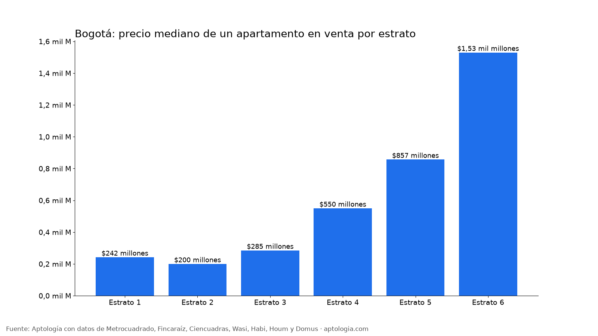
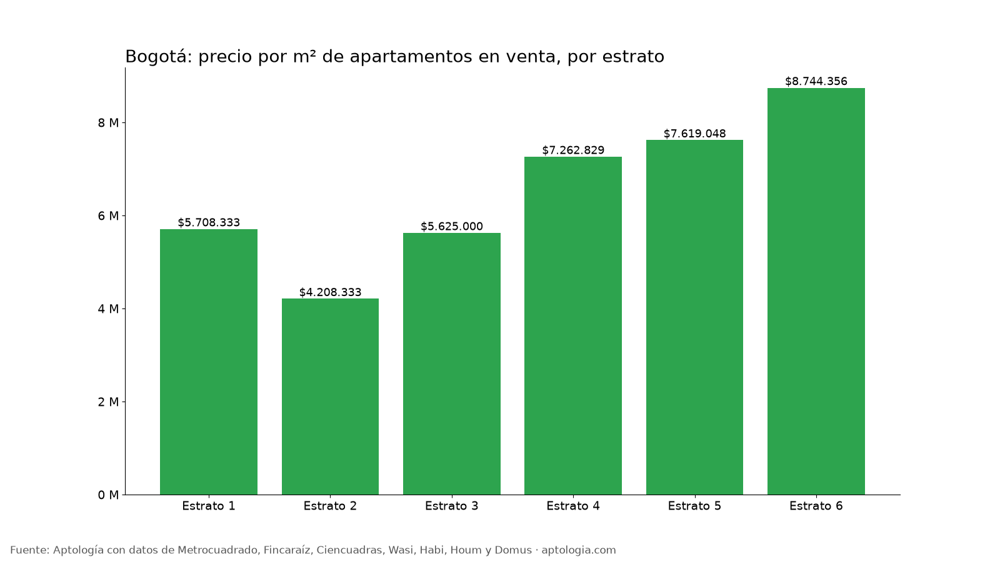

# Precio de venta de apartamentos en Bogotá por estrato y habitaciones (octubre 2026)

**En Bogotá, un apartamento en venta de estrato 3 pide en la mediana $285 millones ($5.625.000 por m²), uno de estrato 4 $550 millones y uno de estrato 6 $1,53 mil millones.** El metro cuadrado de estrato 6 cuesta 1,6 veces el de estrato 3.

*Resumen: analizamos 36.322 apartamentos en venta únicos con estrato informado en Bogotá.*

**Actualizado:** 18 de octubre de 2026 (datos del 18 de octubre de 2026) · **Próxima actualización:** mensual.

## Precio de venta por estrato

| Estrato | Precio mediano | Por m² | Área mediana | 1 hab. | 2 hab. | 3 hab. | Años de salario mínimo | Avisos |
|---|---|---|---|---|---|---|---|---|
| 1 | $242 millones | $5.708.333 | 48 m² | $325 millones | $212 millones | $264 millones | 11,5 | 227 |
| 2 | $200 millones | $4.208.333 | 47 m² | $236 millones | $191 millones | $203 millones | 9,5 | 1.587 |
| 3 | $285 millones | $5.625.000 | 52 m² | $270 millones | $260 millones | $310 millones | 13,6 | 6.561 |
| 4 | $550 millones | $7.262.829 | 77 m² | $353 millones | $500 millones | $620 millones | 26,2 | 7.637 |
| 5 | $857 millones | $7.619.048 | 118 m² | $480 millones | $700 millones | $950 millones | 40,8 | 6.091 |
| 6 | $1,53 mil millones | $8.744.356 | 186 m² | $600 millones | $1,10 mil millones | $1,60 mil millones | 72,8 | 14.219 |

*Años de salario mínimo: precio mediano ÷ (12 × $1.750.905, salario mínimo de 2026).*

**Cómo usarlo para decidir:** el estrato explica buena parte del precio, pero no todo: dentro de un mismo estrato el metro cuadrado cambia mucho por localidad y antigüedad. Recuerda que el estrato también define tarifas de servicios públicos y, a menudo, la administración.

## Preguntas frecuentes

**¿Cuánto cuesta un apartamento estrato 3 en Bogotá?**
La mediana del precio pedido es $285 millones; un 2 habitaciones, $260 millones.

**¿Cuánto cuesta un apartamento estrato 4 en Bogotá?**
La mediana es $550 millones ($7.262.829 por m²).

**¿Cuántos años de salario mínimo cuesta un apartamento en Bogotá?**
En estrato 3, 13,6 años de salario mínimo completo; en estrato 4, 26,2.

## Metodología

- **Fuente:** avisos vivos de vivienda recogidos por la ingesta de Aptología en Metrocuadrado, Fincaraíz, Ciencuadras, Wasi, Habi, Houm y Domus, del 11 al 18 de octubre de 2026. Corte: 18 de octubre de 2026.
- **Depuración:** un mismo inmueble publicado varias veces se cuenta una sola vez (agrupación por portal y, entre portales, por precio, área, habitaciones y coordenadas). Se descartan precios y áreas fuera de rango y, en arriendo, se resta la administración cuando el portal la incluye en el canon.
- **Qué se mide:** precios pedidos (publicados), no precios de cierre.
- **Estrato:** el que declara el aviso (1 a 6). Solo estratos con 80 avisos o más; por habitaciones, solo celdas con 20 avisos o más.
- **Limitaciones:** son precios pedidos en portales, que pueden diferir del valor final de arriendo o venta. La cobertura es mayor en el norte de Bogotá y en estratos 4 a 6, porque ahí se concentra la oferta publicada. Los barrios y la localidad vienen de lo que escribe cada portal; cuando falta la localidad se asigna por los avisos vecinos más cercanos.
- **Datos abiertos:** [datos.csv](datos.csv), licencia CC BY 4.0.

## Cómo citar

Pinzón Pineda, D. M. (2026). *Precio de venta de apartamentos en Bogotá por estrato y habitaciones (octubre 2026)*. Aptología. https://www.aptologia.com/estudios/precio-de-venta-apartamentos-por-estrato-bogota-2026. Datos: datos.csv, licencia CC BY 4.0.
