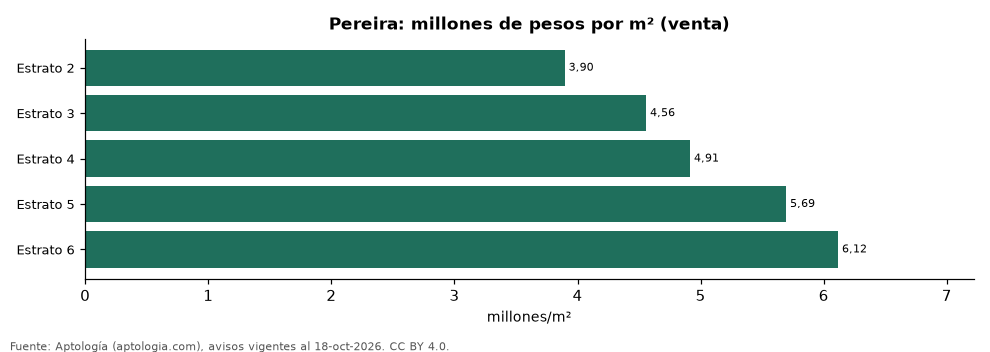

# Precio de los apartamentos en venta en Pereira por estrato: m², tamaño y habitaciones (octubre 2026)

**En Pereira el metro cuadrado de un apartamento en venta cuesta en la mediana 3,90 millones de pesos en estrato 2 y 6,12 millones de pesos en estrato 6, 1,6 veces más.** El precio total mediano va de 188 millones de pesos a 600 millones de pesos según el estrato.

*Resumen: analizamos 4.391 apartamentos en venta en Pereira con estrato declarado.*

**Actualizado:** 18 de octubre de 2026 (datos del 18 de octubre de 2026) · **Próxima actualización:** mensual.

## Resumen

| Indicador | Valor |
|---|---|
| m², estrato 2 | 3,90 millones de pesos |
| m², estrato 6 | 6,12 millones de pesos |
| Diferencia | 1,6 veces |
| Avisos | 4.391 |

## Precio de venta por estrato

| Estrato | Precio (mediana) | Millones por m² | Área mediana (m²) | 1 hab. | 2 hab. | 3 o más hab. | Avisos |
|---|---|---|---|---|---|---|---|
| 2 | 188 millones de pesos | 3,90 | 47 | — | — | 185 millones de pesos | 58 |
| 3 | 260 millones de pesos | 4,56 | 58 | — | 243 millones de pesos | 260 millones de pesos | 283 |
| 4 | 300 millones de pesos | 4,91 | 64 | — | 280 millones de pesos | 310 millones de pesos | 873 |
| 5 | 422 millones de pesos | 5,69 | 78 | 350 millones de pesos | 390 millones de pesos | 450 millones de pesos | 1.330 |
| 6 | 600 millones de pesos | 6,12 | 101 | 395 millones de pesos | 520 millones de pesos | 680 millones de pesos | 1.830 |

Medianas del precio pedido; las columnas por habitaciones muestran el precio total mediano; — indica menos de 30 avisos.

## Preguntas frecuentes

**¿Cuánto vale el metro cuadrado en Pereira por estrato?**
De 3,90 millones de pesos (estrato 2) a 6,12 millones de pesos (estrato 6) en la mediana de octubre de 2026.

**¿Cuánto cuesta un apartamento en estrato 4 en Pereira?**
300 millones de pesos en la mediana.

## Metodología

- **Fuente:** exportes nocturnos de la base de datos de Aptología (aptologia.com) del 18 de octubre de 2026: avisos vigentes de vivienda en portales inmobiliarios de 13 países, recogidos por Aptología y vistos en línea entre el 11 y el 18 de octubre de 2026. Corte: 18 de octubre de 2026.
- **Depuración:** se eliminan duplicados exactos (misma ciudad, zona, tipo, precio, moneda, área, habitaciones y baños) y los precios fuera del percentil 1–99 de cada país, operación, moneda y tipo; el precio por m² usa solo avisos con área declarada entre 12 y 2.000 m² y también se recorta al P1–P99.
- **Qué se mide:** precios pedidos (publicados), no precios de cierre. En arriendo, el canon mensual sin administración, gastos comunes ni condominio.
- **Muestra mínima:** cada cifra publicada se apoya en al menos 30 avisos; las celdas con menos se omiten.
- **Colombia:** Precios en pesos colombianos, sin conversión de moneda.
- **Limitaciones:** la cobertura depende de los portales que recorre Aptología en cada país y es mayor en las ciudades grandes y en los segmentos medio-alto y alto; el área es la que declara el aviso, sin verificar; los nombres de zona vienen de los portales.
- **Privacidad:** solo se publican agregados; no se publica ningún dato personal, enlace a avisos ni nombre de anunciante.
- **Datos abiertos:** [datos.csv](datos.csv), licencia CC BY 4.0.

## Cómo citar

Pinzón Pineda, D. M. (2026). *Precio de los apartamentos en venta en Pereira por estrato: m², tamaño y habitaciones (octubre 2026)*. Aptología (aptologia.com). https://github.com/elbroker/aptologia-datos/tree/main/estudios/precio-de-venta-apartamentos-por-estrato-pereira-2026. Datos: datos.csv, licencia CC BY 4.0.
