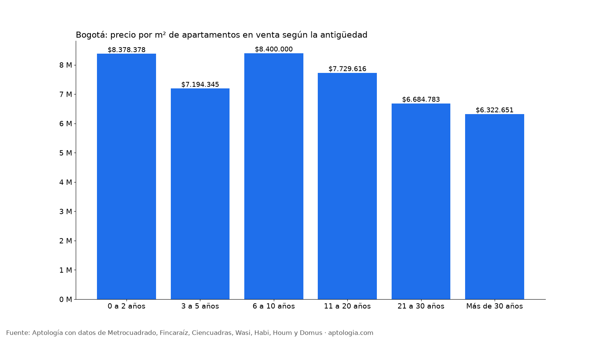
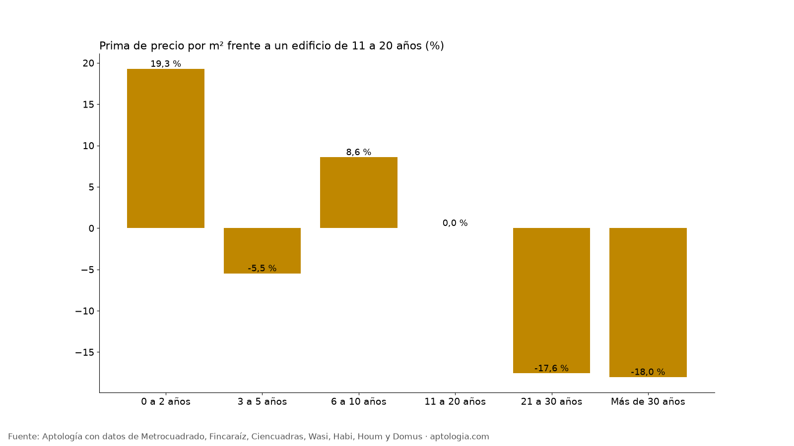

# Precio de venta de apartamentos en Bogotá según la antigüedad del edificio: nuevo vs. usado (octubre 2026)

**En Bogotá, un apartamento en venta de 0 a 2 años pide $8.378.378 por m² en la mediana, y uno de más de 30 años $6.322.651.** Comparando apartamentos del mismo estrato, localidad, tamaño y habitaciones, el nuevo cuesta 19,3 % más por m² que uno de 11 a 20 años, y el de más de 30 años 18,0 % menos.

*Resumen: analizamos 34.701 apartamentos en venta únicos en Bogotá con antigüedad informada.*

**Actualizado:** 18 de octubre de 2026 (datos del 18 de octubre de 2026) · **Próxima actualización:** mensual.

## Precio según la antigüedad del edificio

| Antigüedad | Precio por m² | Precio mediano | Área mediana | Prima emparejada vs. 11–20 años | Avisos |
|---|---|---|---|---|---|
| 0 a 2 años | $8.378.378 | $499 millones | 60 m² | +19,3 % | 5.146 |
| 3 a 5 años | $7.194.345 | $720 millones | 98 m² | -5,5 % | 15.134 |
| 6 a 10 años | $8.400.000 | $799 millones | 94 m² | +8,6 % | 3.064 |
| 11 a 20 años | $7.729.616 | $900 millones | 120 m² | 0,0 % | 4.710 |
| 21 a 30 años | $6.684.783 | $900 millones | 142 m² | -17,6 % | 6.293 |
| Más de 30 años | $6.322.651 | $741 millones | 120 m² | -18,0 % | 354 |

La mediana simple mezcla barrios distintos (los edificios nuevos se concentran en ciertas zonas); la prima emparejada compara apartamentos parecidos y es la mejor medida del efecto de la edad.

**Cómo usarlo para decidir:** un edificio de más edad puede dar más metros por el mismo dinero, pero revisa el estado de redes, fachada, ascensores y el reglamento sismorresistente: lo que ahorras en precio puede irse en reparaciones y cuotas extraordinarias.

## Preguntas frecuentes

**¿Cuánto más caro es un apartamento nuevo en Bogotá?**
Frente a uno comparable de 11 a 20 años, el de 0 a 2 años pide 19,3 % por m² de diferencia (comparación emparejada, datos del 18 de octubre de 2026).

**¿Cuánto vale el metro cuadrado de un apartamento usado en Bogotá?**
Entre 11 y 20 años de antigüedad, la mediana es $7.729.616 por m².

**¿Los apartamentos viejos son más baratos en Bogotá?**
Por m², uno de más de 30 años pide $6.322.651 en la mediana; comparado con apartamentos parecidos de 11 a 20 años, la diferencia es -18,0 %.

## Metodología

- **Fuente:** avisos vivos de vivienda recogidos por la ingesta de Aptología en Metrocuadrado, Fincaraíz, Ciencuadras, Wasi, Habi, Houm y Domus, del 11 al 18 de octubre de 2026. Corte: 18 de octubre de 2026.
- **Depuración:** un mismo inmueble publicado varias veces se cuenta una sola vez (agrupación por portal y, entre portales, por precio, área, habitaciones y coordenadas). Se descartan precios y áreas fuera de rango y, en arriendo, se resta la administración cuando el portal la incluye en el canon.
- **Qué se mide:** precios pedidos (publicados), no precios de cierre.
- **Antigüedad:** años declarados en el aviso. Prima emparejada: mediana ponderada de las diferencias de precio por m² frente a apartamentos de 11 a 20 años dentro de grupos del mismo estrato, localidad, habitaciones y rango de área.
- **Limitaciones:** son precios pedidos en portales, que pueden diferir del valor final de arriendo o venta. La cobertura es mayor en el norte de Bogotá y en estratos 4 a 6, porque ahí se concentra la oferta publicada. Los barrios y la localidad vienen de lo que escribe cada portal; cuando falta la localidad se asigna por los avisos vecinos más cercanos.
- **Datos abiertos:** [datos.csv](datos.csv), licencia CC BY 4.0.

## Cómo citar

Pinzón Pineda, D. M. (2026). *Precio de venta de apartamentos en Bogotá según la antigüedad del edificio: nuevo vs. usado (octubre 2026)*. Aptología. https://www.aptologia.com/estudios/precio-de-venta-por-antiguedad-bogota-2026. Datos: datos.csv, licencia CC BY 4.0.
