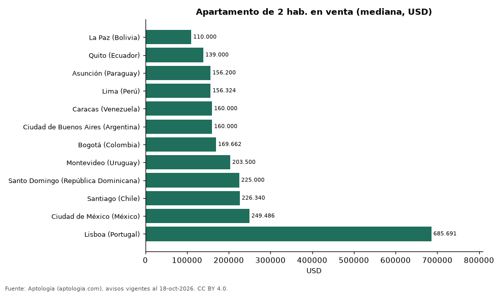

# Cuánto cuesta comprar un apartamento de 1, 2 o 3 habitaciones en 12 capitales de Latinoamérica y Portugal, y cuánto vale cada habitación extra (octubre 2026)

**Un apartamento de 2 habitaciones en venta se pide en USD 110.000 en La Paz (Bolivia), la más barata de 12 capitales, y en USD 685.691 en Lisboa (Portugal).** Pasar de 1 a 2 habitaciones encarece la compra hasta USD 166.364 en Lisboa (Portugal); en Caracas (Venezuela) el de 1 habitación mediano es incluso más caro, porque se concentra en zonas de mayor precio.

*Resumen: comparamos el precio mediano de 83.421 apartamentos en venta de 1, 2 y 3 o más habitaciones en 12 capitales.*

**Actualizado:** 18 de octubre de 2026 (datos del 18 de octubre de 2026) · **Próxima actualización:** mensual.

## Resumen

| Indicador | Valor |
|---|---|
| La Paz (Bolivia) | USD 110.000 |
| Quito (Ecuador) | USD 139.000 |
| Asunción (Paraguay) | USD 156.200 |
| Lima (Perú) | USD 156.324 |
| Caracas (Venezuela) | USD 160.000 |
| Ciudad de Buenos Aires (Argentina) | USD 160.000 |
| Bogotá (Colombia) | USD 169.662 |
| Montevideo (Uruguay) | USD 203.500 |
| Santo Domingo (República Dominicana) | USD 225.000 |
| Santiago (Chile) | USD 226.340 |
| Ciudad de México (México) | USD 249.486 |
| Lisboa (Portugal) | USD 685.691 |

## Precio mediano por habitaciones y diferencia

| Capital | 1 hab. | 2 hab. | 3 o más hab. | Habitación extra (1→2) | Habitación extra (2→3+) |
|---|---|---|---|---|---|
| La Paz (Bolivia) | USD 69.000 | USD 110.000 | USD 150.000 | +USD 41.000 | +USD 40.000 |
| Quito (Ecuador) | USD 122.500 | USD 139.000 | USD 155.000 | +USD 16.500 | +USD 16.000 |
| Asunción (Paraguay) | USD 95.000 | USD 156.200 | USD 279.000 | +USD 61.200 | +USD 122.800 |
| Lima (Perú) | USD 110.609 | USD 156.324 | USD 234.079 | +USD 45.715 | +USD 77.755 |
| Caracas (Venezuela) | USD 240.260 | USD 160.000 | USD 250.000 | USD -80.260 | +USD 90.000 |
| Ciudad de Buenos Aires (Argentina) | USD 115.000 | USD 160.000 | USD 285.000 | +USD 45.000 | +USD 125.000 |
| Bogotá (Colombia) | USD 131.959 | USD 169.662 | USD 307.905 | +USD 37.703 | +USD 138.243 |
| Montevideo (Uruguay) | USD 156.900 | USD 203.500 | USD 398.000 | +USD 46.600 | +USD 194.500 |
| Santo Domingo (República Dominicana) | USD 167.046 | USD 225.000 | USD 320.000 | +USD 57.954 | +USD 95.000 |
| Santiago (Chile) | USD 135.553 | USD 226.340 | USD 439.686 | +USD 90.787 | +USD 213.346 |
| Ciudad de México (México) | USD 191.835 | USD 249.486 | USD 379.086 | +USD 57.651 | +USD 129.600 |
| Lisboa (Portugal) | USD 519.326 | USD 685.691 | USD 1.011.675 | +USD 166.364 | +USD 325.984 |

Precio pedido en la moneda mayoritaria de cada capital, convertido a dólares; sin emparejar por barrio.

## Preguntas frecuentes

**¿Cuánto cuesta un apartamento de 2 habitaciones en Bogotá en dólares?**
USD 169.662 en la mediana de avisos (octubre de 2026).

**¿Cuál es la capital más barata para comprar 2 habitaciones?**
La Paz (Bolivia): USD 110.000.

## Metodología

- **Fuente:** exportes nocturnos de la base de datos de Aptología (aptologia.com) del 18 de octubre de 2026: avisos vigentes de vivienda en portales inmobiliarios de 13 países, recogidos por Aptología y vistos en línea entre el 11 y el 18 de octubre de 2026. Corte: 18 de octubre de 2026.
- **Depuración:** se eliminan duplicados exactos (misma ciudad, zona, tipo, precio, moneda, área, habitaciones y baños) y los precios fuera del percentil 1–99 de cada país, operación, moneda y tipo; el precio por m² usa solo avisos con área declarada entre 12 y 2.000 m² y también se recorta al P1–P99.
- **Qué se mide:** precios pedidos (publicados), no precios de cierre. En arriendo, el canon mensual sin administración, gastos comunes ni condominio.
- **Muestra mínima:** cada cifra publicada se apoya en al menos 30 avisos; las celdas con menos se omiten.
- **Monedas:** nunca se mezclan avisos de monedas distintas sin convertirlos. Conversión a dólares con la tasa de mercado de ExchangeRate-API (open.er-api.com, actualización del 18 Oct 2026): 1 USD = 3.182,80 COP, 1 USD = 18,47 M.N, 1 USD = 5,09 BRL, 1 USD = 3,44 PEN, 1 USD = 982,44 CLP, 1 USD = 1.514,57 ARS, 1 USD = 40,20 UYU, 1 USD = 5.705,37 PYG, 1 USD = 61,27 DOP, 1 USD = 0,89 EUR, 1 USD = 11,72 BOB; la UF chilena a 41.178,64 CLP (mindicador,cl. 18-oct-2026). Los avisos publicados en dólares se usan tal cual.
- **Monedas:** en cada ciudad y operación se usa solo la moneda mayoritaria de los avisos (los avisos en otra moneda se excluyen) y la mediana se convierte a dólares con la tasa citada; nunca se promedian avisos de monedas distintas.
- **Limitaciones:** la cobertura depende de los portales que recorre Aptología en cada país y es mayor en las ciudades grandes y en los segmentos medio-alto y alto; el área es la que declara el aviso, sin verificar; los nombres de zona vienen de los portales.
- **Privacidad:** solo se publican agregados; no se publica ningún dato personal, enlace a avisos ni nombre de anunciante.
- **Datos abiertos:** [datos.csv](datos.csv), licencia CC BY 4.0.

## Cómo citar

Pinzón Pineda, D. M. (2026). *Cuánto cuesta comprar un apartamento de 1, 2 o 3 habitaciones en 12 capitales de Latinoamérica y Portugal, y cuánto vale cada habitación extra (octubre 2026)*. Aptología (aptologia.com). https://github.com/elbroker/aptologia-datos/tree/main/estudios/precio-de-venta-por-habitaciones-capitales-latinoamerica-2026. Datos: datos.csv, licencia CC BY 4.0.
