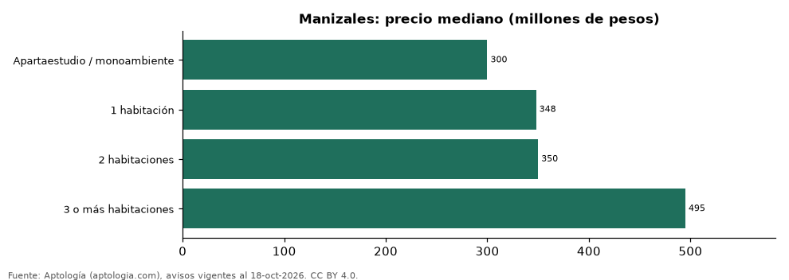

# Precio de apartamentos en venta en Manizales por número de habitaciones: cuánto cuesta cada tamaño (octubre 2026)

**En Manizales, un apartamento de 1 habitación cuesta 348 millones de pesos en la mediana, uno de 2 habitaciones 350 millones de pesos (+0,6 %) y uno de 3 o más 495 millones de pesos (+41,4 %).**

*Resumen: analizamos 3.049 avisos de apartamentos en venta en Manizales con número de habitaciones declarado.*

**Actualizado:** 18 de octubre de 2026 (datos del 18 de octubre de 2026) · **Próxima actualización:** mensual.

## Resumen

| Indicador | Valor |
|---|---|
| 1 habitación | 348 millones de pesos |
| 2 habitaciones | 350 millones de pesos |
| 3 o más habitaciones | 495 millones de pesos |
| Avisos | 3.049 |

## Precio por número de habitaciones

| Tipo | Precio (mediana) | Rango típico (P25–P75) | Área mediana (m²) | Por m² (mediana) | Avisos |
|---|---|---|---|---|---|
| Apartaestudio / monoambiente | 300 millones de pesos | 250 millones de pesos – 370 millones de pesos | 41 | 7,37 millones de pesos | 234 |
| 1 habitación | 348 millones de pesos | 245 millones de pesos – 456 millones de pesos | 45 | 7,37 millones de pesos | 104 |
| 2 habitaciones | 350 millones de pesos | 272 millones de pesos – 490 millones de pesos | 61 | 6,17 millones de pesos | 767 |
| 3 o más habitaciones | 495 millones de pesos | 360 millones de pesos – 670 millones de pesos | 90 | 5,36 millones de pesos | 1.944 |

Medianas del precio pedido; el rango típico va del percentil 25 al 75.

## Preguntas frecuentes

**¿Cuánto cuesta comprar un apartamento de 2 habitaciones en Manizales?**
350 millones de pesos en la mediana (octubre de 2026); la mitad central de la oferta está entre 272 millones de pesos y 490 millones de pesos.

**¿Y uno de 3 o más habitaciones?**
495 millones de pesos en la mediana.

## Metodología

- **Fuente:** exportes nocturnos de la base de datos de Aptología (aptologia.com) del 18 de octubre de 2026: avisos vigentes de vivienda en portales inmobiliarios de 13 países, recogidos por Aptología y vistos en línea entre el 11 y el 18 de octubre de 2026. Corte: 18 de octubre de 2026.
- **Depuración:** se eliminan duplicados exactos (misma ciudad, zona, tipo, precio, moneda, área, habitaciones y baños) y los precios fuera del percentil 1–99 de cada país, operación, moneda y tipo; el precio por m² usa solo avisos con área declarada entre 12 y 2.000 m² y también se recorta al P1–P99.
- **Qué se mide:** precios pedidos (publicados), no precios de cierre. En arriendo, el canon mensual sin administración, gastos comunes ni condominio.
- **Muestra mínima:** cada cifra publicada se apoya en al menos 30 avisos; las celdas con menos se omiten.
- **Colombia:** Precios en pesos colombianos, sin conversión de moneda.
- **Cordura:** solo se publica si la mediana crece de 1 a 2 y de 2 a 3 o más habitaciones.
- **Limitaciones:** la cobertura depende de los portales que recorre Aptología en cada país y es mayor en las ciudades grandes y en los segmentos medio-alto y alto; el área es la que declara el aviso, sin verificar; los nombres de zona vienen de los portales.
- **Privacidad:** solo se publican agregados; no se publica ningún dato personal, enlace a avisos ni nombre de anunciante.
- **Datos abiertos:** [datos.csv](datos.csv), licencia CC BY 4.0.

## Cómo citar

Pinzón Pineda, D. M. (2026). *Precio de apartamentos en venta en Manizales por número de habitaciones: cuánto cuesta cada tamaño (octubre 2026)*. Aptología (aptologia.com). https://github.com/elbroker/aptologia-datos/tree/main/estudios/precio-de-venta-por-numero-de-habitaciones-manizales-2026. Datos: datos.csv, licencia CC BY 4.0.
