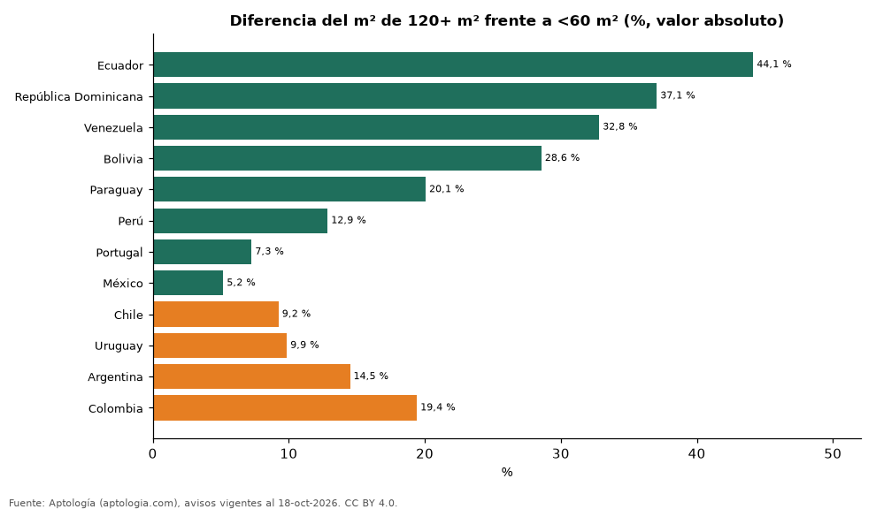

# Apartamentos grandes o pequeños: cómo cambia el precio por m² según el tamaño en 12 países de Latinoamérica y Portugal (octubre 2026)

**En 8 de 12 países el metro cuadrado de un apartamento de 120 m² o más se pide más barato que el de uno de menos de 60 m²; la mayor diferencia está en Ecuador (-44,1 %).** En Colombia, en cambio, el grande cuesta +19,4 % por m². En Colombia la diferencia es +19,4 %.

*Resumen: comparamos el precio por m² de 179.615 apartamentos en venta en tres tramos de tamaño, dentro de cada país y en su propia moneda.*

**Actualizado:** 18 de octubre de 2026 (datos del 18 de octubre de 2026) · **Próxima actualización:** mensual.

## Resumen

| Indicador | Valor |
|---|---|
| Países con m² más barato en los grandes | 8 de 12 |
| Mayor descuento por tamaño | Ecuador: -44,1 % |
| Colombia | +19,4 % |

## Precio por m² por tramo de tamaño (moneda de cada país)

| País | Moneda | Menos de 60 m² | 60 a 119 m² | 120 m² o más | Grande vs. pequeño |
|---|---|---|---|---|---|
| Ecuador | USD | 1.801 | 1.244 | 1.006 | -44,1 % |
| República Dominicana | USD | 2.772 | 2.171 | 1.745 | -37,1 % |
| Venezuela | USD | 1.925 | 1.488 | 1.293 | -32,8 % |
| Bolivia | USD | 1.400 | 1.162 | 1.000 | -28,6 % |
| Paraguay | USD | 2.020 | 1.824 | 1.615 | -20,1 % |
| Perú | PEN | 7.704 | 7.096 | 6.713 | -12,9 % |
| Portugal | EUR | 7.333 | 6.438 | 6.800 | -7,3 % |
| México | MXN | 54.275 | 54.545 | 51.460 | -5,2 % |
| Chile | UF | 71 | 83 | 78 | +9,2 % |
| Uruguay | USD | 3.286 | 3.150 | 3.610 | +9,9 % |
| Argentina | USD | 2.556 | 2.458 | 2.926 | +14,5 % |
| Colombia | COP | 5.729.167 | 6.527.778 | 6.842.105 | +19,4 % |

Medianas en la moneda mayoritaria de cada país (sin convertir: la comparación es en porcentaje dentro de cada país).

## Preguntas frecuentes

**¿Es más barato el m² de un apartamento grande en Latinoamérica?**
En 8 de 12 países sí; la mayor diferencia es en Ecuador (-44,1 %).

**¿Y en Colombia?**
El m² de un apartamento de 120 m² o más es +19,4 % frente a uno de menos de 60 m².

## Metodología

- **Fuente:** exportes nocturnos de la base de datos de Aptología (aptologia.com) del 18 de octubre de 2026: avisos vigentes de vivienda en portales inmobiliarios de 13 países, recogidos por Aptología y vistos en línea entre el 11 y el 18 de octubre de 2026. Corte: 18 de octubre de 2026.
- **Depuración:** se eliminan duplicados exactos (misma ciudad, zona, tipo, precio, moneda, área, habitaciones y baños) y los precios fuera del percentil 1–99 de cada país, operación, moneda y tipo; el precio por m² usa solo avisos con área declarada entre 12 y 2.000 m² y también se recorta al P1–P99.
- **Qué se mide:** precios pedidos (publicados), no precios de cierre. En arriendo, el canon mensual sin administración, gastos comunes ni condominio.
- **Muestra mínima:** cada cifra publicada se apoya en al menos 30 avisos; las celdas con menos se omiten.
- **Monedas:** cada país se analiza en su moneda mayoritaria de venta; no se mezclan monedas ni se convierten.
- **Limitaciones:** la cobertura depende de los portales que recorre Aptología en cada país y es mayor en las ciudades grandes y en los segmentos medio-alto y alto; el área es la que declara el aviso, sin verificar; los nombres de zona vienen de los portales.
- **Privacidad:** solo se publican agregados; no se publica ningún dato personal, enlace a avisos ni nombre de anunciante.
- **Datos abiertos:** [datos.csv](datos.csv), licencia CC BY 4.0.

## Cómo citar

Pinzón Pineda, D. M. (2026). *Apartamentos grandes o pequeños: cómo cambia el precio por m² según el tamaño en 12 países de Latinoamérica y Portugal (octubre 2026)*. Aptología (aptologia.com). https://github.com/elbroker/aptologia-datos/tree/main/estudios/precio-m2-apartamentos-grandes-vs-pequenos-latinoamerica-2026. Datos: datos.csv, licencia CC BY 4.0.
