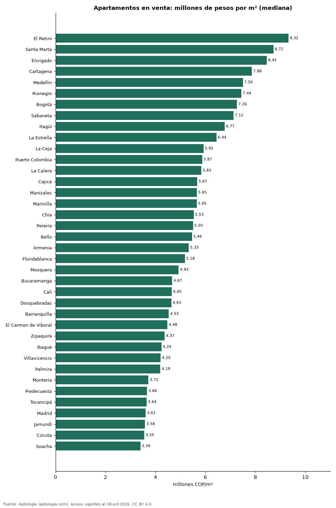

# Precio del metro cuadrado de apartamentos en venta en 38 ciudades de Colombia (octubre 2026)

**El metro cuadrado de apartamento más caro de Colombia se pide en El Retiro: 9,32 millones de pesos en la mediana; el más barato de la muestra, en Soacha, con 3,39 millones de pesos.** Bogotá ocupa el puesto 7 de 38 con 7,26 millones de pesos por m².

*Resumen: analizamos 120.331 apartamentos en venta con área declarada en 38 ciudades y municipios colombianos.*

**Actualizado:** 18 de octubre de 2026 (datos del 18 de octubre de 2026) · **Próxima actualización:** mensual.

## Resumen

| Indicador | Valor |
|---|---|
| Más caro | El Retiro: 9,32 millones de pesos/m² |
| Más barato | Soacha: 3,39 millones de pesos/m² |
| Bogotá | 7,26 millones de pesos/m² (puesto 7) |
| Ciudades | 38 |

## Ranking de ciudades (30 avisos o más)

| Ciudad | Pesos por m² (mediana) | Avisos con área |
|---|---|---|
| El Retiro | 9.321.839 | 618 |
| Santa Marta | 8.720.930 | 3.779 |
| Envigado | 8.452.381 | 5.735 |
| Cartagena | 7.857.143 | 5.774 |
| Medellín | 7.500.000 | 20.515 |
| Rionegro | 7.437.500 | 3.023 |
| Bogotá | 7.261.905 | 31.265 |
| Sabaneta | 7.121.212 | 4.375 |
| Itagüí | 6.766.968 | 2.012 |
| La Estrella | 6.438.356 | 561 |
| La Ceja | 5.922.147 | 312 |
| Puerto Colombia | 5.867.102 | 144 |
| La Calera | 5.833.333 | 139 |
| Cajicá | 5.671.642 | 1.517 |
| Manizales | 5.653.956 | 2.788 |
| Marinilla | 5.649.750 | 164 |
| Chía | 5.529.412 | 1.507 |
| Pereira | 5.500.000 | 4.376 |
| Bello | 5.461.538 | 2.319 |
| Armenia | 5.332.556 | 2.278 |
| Floridablanca | 5.176.224 | 919 |
| Mosquera | 4.926.471 | 817 |
| Bucaramanga | 4.666.667 | 2.439 |
| Cali | 4.650.000 | 9.365 |
| Dosquebradas | 4.634.146 | 607 |
| Barranquilla | 4.531.707 | 7.532 |
| El Carmen de Viboral | 4.475.422 | 90 |
| Zipaquirá | 4.366.197 | 819 |
| Ibagué | 4.239.130 | 1.217 |
| Villavicencio | 4.203.958 | 347 |
| Palmira | 4.194.668 | 112 |
| Montería | 3.718.519 | 288 |
| Piedecuesta | 3.664.236 | 246 |
| Tocancipá | 3.644.068 | 264 |
| Madrid | 3.607.843 | 475 |
| Jamundí | 3.582.207 | 466 |
| Cúcuta | 3.551.857 | 561 |
| Soacha | 3.393.617 | 566 |

Precio pedido mediano por metro cuadrado de apartamentos en venta.

## Preguntas frecuentes

**¿Cuál es la ciudad con el metro cuadrado más caro de Colombia?**
El Retiro, con una mediana de 9.321.839 pesos por m² en apartamentos en venta (octubre de 2026).

**¿Cuánto vale el metro cuadrado en Bogotá?**
7.261.905 pesos en la mediana de apartamentos en venta.

**¿Dónde es más barato el metro cuadrado en Colombia?**
Entre las ciudades con 30 avisos o más, en Soacha: 3.393.617 pesos.

## Metodología

- **Fuente:** exportes nocturnos de la base de datos de Aptología (aptologia.com) del 18 de octubre de 2026: avisos vigentes de vivienda en portales inmobiliarios de 13 países, recogidos por Aptología y vistos en línea entre el 11 y el 18 de octubre de 2026. Corte: 18 de octubre de 2026.
- **Depuración:** se eliminan duplicados exactos (misma ciudad, zona, tipo, precio, moneda, área, habitaciones y baños) y los precios fuera del percentil 1–99 de cada país, operación, moneda y tipo; el precio por m² usa solo avisos con área declarada entre 12 y 2.000 m² y también se recorta al P1–P99.
- **Qué se mide:** precios pedidos (publicados), no precios de cierre. En arriendo, el canon mensual sin administración, gastos comunes ni condominio.
- **Muestra mínima:** cada cifra publicada se apoya en al menos 30 avisos; las celdas con menos se omiten.
- **Colombia:** Precios en pesos colombianos, sin conversión de moneda. Los indicadores de amoblado, mascotas, conjunto cerrado, balcón y aviso directo del dueño solo existen en arriendo y vienen de los portales.
- **Limitaciones:** la cobertura depende de los portales que recorre Aptología en cada país y es mayor en las ciudades grandes y en los segmentos medio-alto y alto; el área es la que declara el aviso, sin verificar; los nombres de zona vienen de los portales.
- **Privacidad:** solo se publican agregados; no se publica ningún dato personal, enlace a avisos ni nombre de anunciante.
- **Datos abiertos:** [datos.csv](datos.csv), licencia CC BY 4.0.

## Cómo citar

Pinzón Pineda, D. M. (2026). *Precio del metro cuadrado de apartamentos en venta en 38 ciudades de Colombia (octubre 2026)*. Aptología (aptologia.com). https://github.com/elbroker/aptologia-datos/tree/main/estudios/precio-m2-apartamentos-venta-ciudades-colombia-2026. Datos: datos.csv, licencia CC BY 4.0.
