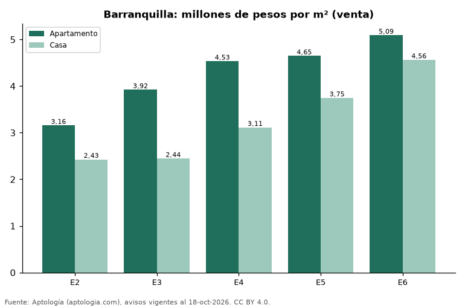

# Precio del m² en Barranquilla por estrato: apartamentos frente a casas (venta, octubre 2026)

**En Barranquilla, el m² de un apartamento en venta va de 3,16 millones de pesos en estrato 2 a 5,09 millones de pesos en estrato 6. En estrato 3, el m² de una casa es 37,7 % más barato que el de un apartamento.**

*Resumen: analizamos 10.807 apartamentos y casas en venta en Barranquilla con estrato y área declarados.*

**Actualizado:** 18 de octubre de 2026 (datos del 18 de octubre de 2026) · **Próxima actualización:** mensual.

## Resumen

| Indicador | Valor |
|---|---|
| Apto, estrato 2 | 3,16 millones de pesos |
| Apto, estrato 6 | 5,09 millones de pesos |
| Casa vs. apto (estrato 3) | -37,7 % |
| Avisos | 10.807 |

## Precio por m² por estrato y tipo de vivienda (venta)

| Estrato | Apartamentos por m² | Casas por m² | Casa vs. apartamento | Avisos (apto / casa) |
|---|---|---|---|---|
| 2 | 3,16 millones de pesos | 2,43 millones de pesos | -23,1 % | 138 / 119 |
| 3 | 3,92 millones de pesos | 2,44 millones de pesos | -37,7 % | 884 / 627 |
| 4 | 4,53 millones de pesos | 3,11 millones de pesos | -31,4 % | 2.252 / 1.030 |
| 5 | 4,65 millones de pesos | 3,75 millones de pesos | -19,4 % | 1.974 / 795 |
| 6 | 5,09 millones de pesos | 4,56 millones de pesos | -10,4 % | 2.119 / 833 |

Medianas del precio pedido por m²; — indica menos de 30 avisos.

## Preguntas frecuentes

**¿Es más barato el m² de una casa que el de un apartamento en Barranquilla?**
estrato 2: casa -23,1 %; estrato 3: casa -37,7 %; estrato 4: casa -31,4 %; estrato 5: casa -19,4 %; estrato 6: casa -10,4 % (medianas por m², octubre de 2026).

**¿Cuánto vale el m² en estrato 6 en Barranquilla?**
5,09 millones de pesos para apartamentos.

## Metodología

- **Fuente:** exportes nocturnos de la base de datos de Aptología (aptologia.com) del 18 de octubre de 2026: avisos vigentes de vivienda en portales inmobiliarios de 13 países, recogidos por Aptología y vistos en línea entre el 11 y el 18 de octubre de 2026. Corte: 18 de octubre de 2026.
- **Depuración:** se eliminan duplicados exactos (misma ciudad, zona, tipo, precio, moneda, área, habitaciones y baños) y los precios fuera del percentil 1–99 de cada país, operación, moneda y tipo; el precio por m² usa solo avisos con área declarada entre 12 y 2.000 m² y también se recorta al P1–P99.
- **Qué se mide:** precios pedidos (publicados), no precios de cierre. En arriendo, el canon mensual sin administración, gastos comunes ni condominio.
- **Muestra mínima:** cada cifra publicada se apoya en al menos 30 avisos; las celdas con menos se omiten.
- **Colombia:** Precios en pesos colombianos, sin conversión de moneda.
- **Cordura:** solo se publica si el m² mediano de los apartamentos no baja al subir el estrato.
- **Limitaciones:** la cobertura depende de los portales que recorre Aptología en cada país y es mayor en las ciudades grandes y en los segmentos medio-alto y alto; el área es la que declara el aviso, sin verificar; los nombres de zona vienen de los portales.
- **Privacidad:** solo se publican agregados; no se publica ningún dato personal, enlace a avisos ni nombre de anunciante.
- **Datos abiertos:** [datos.csv](datos.csv), licencia CC BY 4.0.

## Cómo citar

Pinzón Pineda, D. M. (2026). *Precio del m² en Barranquilla por estrato: apartamentos frente a casas (venta, octubre 2026)*. Aptología (aptologia.com). https://github.com/elbroker/aptologia-datos/tree/main/estudios/precio-m2-por-estrato-apartamentos-y-casas-venta-barranquilla-2026. Datos: datos.csv, licencia CC BY 4.0.
