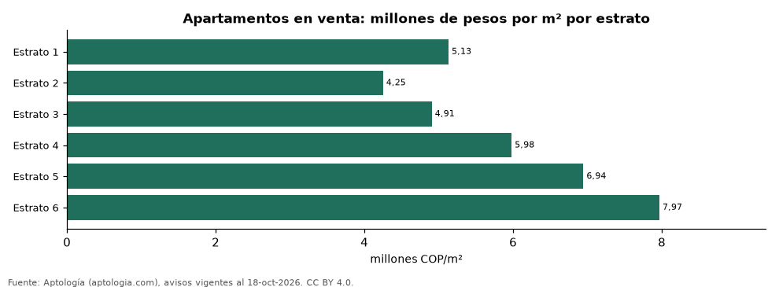

# Precio del metro cuadrado por estrato en Colombia y sus principales ciudades (octubre 2026)

**El metro cuadrado de un apartamento en estrato 6 se pide en Colombia a 7,97 millones de pesos en la mediana, 1,6 veces el de estrato 3 (4,91 millones de pesos).** En Bogotá el estrato 6 marca 8,40 millones de pesos por m² y el estrato 3, 5,62 millones de pesos.

*Resumen: analizamos 117.334 apartamentos en venta con estrato y área declarados.*

**Actualizado:** 18 de octubre de 2026 (datos del 18 de octubre de 2026) · **Próxima actualización:** mensual.

## Resumen

| Indicador | Valor |
|---|---|
| Estrato 6 (Colombia) | 7,97 millones de pesos/m² |
| Estrato 3 (Colombia) | 4,91 millones de pesos/m² |
| Relación 6 / 3 | 1,6 veces |
| Avisos | 117.334 |

## Colombia por estrato

| Estrato | Pesos por m² (mediana) | Avisos |
|---|---|---|
| 1 | 5.131.579 | 539 |
| 2 | 4.250.000 | 2.629 |
| 3 | 4.905.660 | 19.150 |
| 4 | 5.980.000 | 32.915 |
| 5 | 6.944.444 | 27.735 |
| 6 | 7.967.033 | 34.366 |

## Millones de pesos por m² por ciudad y estrato

| Ciudad | Estrato 1 | Estrato 2 | Estrato 3 | Estrato 4 | Estrato 5 | Estrato 6 |
|---|---|---|---|---|---|---|
| Bogotá | 6,25 | 4,32 | 5,62 | 7,23 | 7,56 | 8,40 |
| Medellín | 3,81 | 4,24 | 5,08 | 6,72 | 7,40 | 8,65 |
| Cali | 5,24 | 3,73 | 3,49 | 4,12 | 4,82 | 6,22 |
| Barranquilla | — | 3,16 | 3,92 | 4,53 | 4,65 | 5,09 |
| Cartagena | — | — | 4,57 | 5,45 | 7,43 | 10,06 |
| Bucaramanga | — | — | 4,17 | 4,54 | 5,47 | 5,48 |
| Pereira | — | 3,90 | 4,56 | 4,91 | 5,69 | 6,12 |

Mediana; — indica menos de 30 avisos.

## Preguntas frecuentes

**¿Cuánto cuesta el metro cuadrado en estrato 6 en Colombia?**
7.967.033 pesos en la mediana de apartamentos en venta.

**¿Cuánto cuesta el metro cuadrado en estrato 3 en Bogotá?**
5.616.438 pesos en la mediana.

## Metodología

- **Fuente:** exportes nocturnos de la base de datos de Aptología (aptologia.com) del 18 de octubre de 2026: avisos vigentes de vivienda en portales inmobiliarios de 13 países, recogidos por Aptología y vistos en línea entre el 11 y el 18 de octubre de 2026. Corte: 18 de octubre de 2026.
- **Depuración:** se eliminan duplicados exactos (misma ciudad, zona, tipo, precio, moneda, área, habitaciones y baños) y los precios fuera del percentil 1–99 de cada país, operación, moneda y tipo; el precio por m² usa solo avisos con área declarada entre 12 y 2.000 m² y también se recorta al P1–P99.
- **Qué se mide:** precios pedidos (publicados), no precios de cierre. En arriendo, el canon mensual sin administración, gastos comunes ni condominio.
- **Muestra mínima:** cada cifra publicada se apoya en al menos 30 avisos; las celdas con menos se omiten.
- **Colombia:** Precios en pesos colombianos, sin conversión de moneda. Los indicadores de amoblado, mascotas, conjunto cerrado, balcón y aviso directo del dueño solo existen en arriendo y vienen de los portales.
- **Limitaciones:** la cobertura depende de los portales que recorre Aptología en cada país y es mayor en las ciudades grandes y en los segmentos medio-alto y alto; el área es la que declara el aviso, sin verificar; los nombres de zona vienen de los portales.
- **Privacidad:** solo se publican agregados; no se publica ningún dato personal, enlace a avisos ni nombre de anunciante.
- **Datos abiertos:** [datos.csv](datos.csv), licencia CC BY 4.0.

## Cómo citar

Pinzón Pineda, D. M. (2026). *Precio del metro cuadrado por estrato en Colombia y sus principales ciudades (octubre 2026)*. Aptología (aptologia.com). https://github.com/elbroker/aptologia-datos/tree/main/estudios/precio-m2-por-estrato-colombia-2026. Datos: datos.csv, licencia CC BY 4.0.
