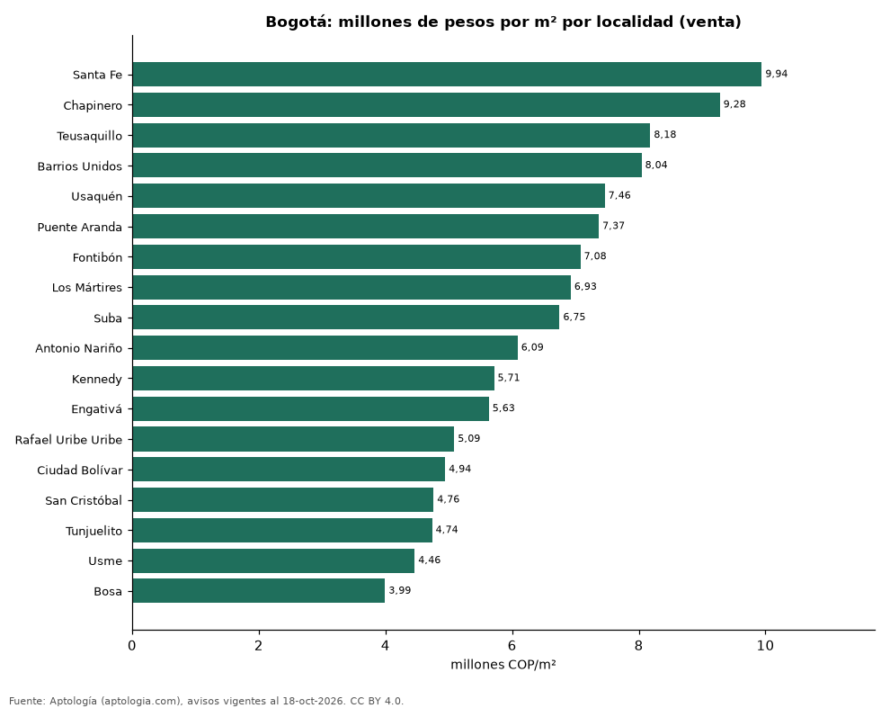

# Precio del metro cuadrado por localidad en Bogotá: venta y arriendo en 18 localidades (octubre 2026)

**La localidad con el metro cuadrado más caro de Bogotá es Santa Fe, con 9,94 millones de pesos en la mediana de apartamentos en venta; la más barata de la muestra es Bosa, con 3,99 millones de pesos.** En arriendo, el m² más caro está en Chapinero (64.103 pesos al mes) y el más barato en Rafael Uribe Uribe (24.444 pesos).

*Resumen: asignamos 28.491 apartamentos con área a su localidad según el barrio del aviso (el 64,6 % de los avisos de Bogotá tiene barrio asignable).*

**Actualizado:** 18 de octubre de 2026 (datos del 18 de octubre de 2026) · **Próxima actualización:** mensual.

## Resumen

| Indicador | Valor |
|---|---|
| Más cara (venta) | Santa Fe: 9,94 millones de pesos/m² |
| Más barata (venta) | Bosa: 3,99 millones de pesos/m² |
| Más cara (arriendo) | Chapinero: 64.103 pesos/m² |
| Localidades | 18 |

## Localidades

| Localidad | Venta: pesos por m² | Arriendo: pesos por m² al mes | Avisos (venta / arriendo) |
|---|---|---|---|
| Santa Fe | 9.942.085 | 56.859 | 203 / 212 |
| Chapinero | 9.279.070 | 64.103 | 2.861 / 1.540 |
| Teusaquillo | 8.181.818 | 49.136 | 938 / 434 |
| Barrios Unidos | 8.043.478 | 47.962 | 289 / 200 |
| Usaquén | 7.462.687 | 51.724 | 8.851 / 3.169 |
| Puente Aranda | 7.369.671 | 37.939 | 296 / 174 |
| Fontibón | 7.078.252 | 40.930 | 494 / 263 |
| Los Mártires | 6.925.463 | 42.424 | 182 / 113 |
| Suba | 6.749.233 | 40.278 | 3.774 / 1.197 |
| Antonio Nariño | 6.086.562 | 26.316 | 122 / 65 |
| Kennedy | 5.714.286 | 31.181 | 813 / 336 |
| Engativá | 5.632.402 | 30.267 | 538 / 224 |
| Rafael Uribe Uribe | 5.086.957 | 24.444 | 213 / 49 |
| Ciudad Bolívar | 4.943.820 | 28.333 | 241 / 61 |
| San Cristóbal | 4.760.000 | 28.781 | 129 / 30 |
| Tunjuelito | 4.736.259 | — | 32 / s. d. |
| Usme | 4.461.905 | — | 50 / s. d. |
| Bosa | 3.994.681 | 24.456 | 314 / 84 |

Medianas de apartamentos; — indica menos de 30 avisos.

## Preguntas frecuentes

**¿Cuál es la localidad más cara de Bogotá?**
Santa Fe, con 9.942.085 pesos por m² en apartamentos en venta (octubre de 2026).

**¿Dónde es más barato comprar apartamento en Bogotá?**
Entre las localidades con 30 avisos o más, en Bosa: 3.994.681 pesos por m².

## Metodología

- **Fuente:** exportes nocturnos de la base de datos de Aptología (aptologia.com) del 18 de octubre de 2026: avisos vigentes de vivienda en portales inmobiliarios de 13 países, recogidos por Aptología y vistos en línea entre el 11 y el 18 de octubre de 2026. Corte: 18 de octubre de 2026.
- **Depuración:** se eliminan duplicados exactos (misma ciudad, zona, tipo, precio, moneda, área, habitaciones y baños) y los precios fuera del percentil 1–99 de cada país, operación, moneda y tipo; el precio por m² usa solo avisos con área declarada entre 12 y 2.000 m² y también se recorta al P1–P99.
- **Qué se mide:** precios pedidos (publicados), no precios de cierre. En arriendo, el canon mensual sin administración, gastos comunes ni condominio.
- **Muestra mínima:** cada cifra publicada se apoya en al menos 30 avisos; las celdas con menos se omiten.
- **Colombia:** Precios en pesos colombianos, sin conversión de moneda. Los indicadores de amoblado, mascotas, conjunto cerrado, balcón y aviso directo del dueño solo existen en arriendo y vienen de los portales.
- **Localidad:** cruce del barrio del aviso con la tabla barrio–localidad de Aptología (co_barrio_localidad).
- **Limitaciones:** la cobertura depende de los portales que recorre Aptología en cada país y es mayor en las ciudades grandes y en los segmentos medio-alto y alto; el área es la que declara el aviso, sin verificar; los nombres de zona vienen de los portales.
- **Privacidad:** solo se publican agregados; no se publica ningún dato personal, enlace a avisos ni nombre de anunciante.
- **Datos abiertos:** [datos.csv](datos.csv), licencia CC BY 4.0.

## Cómo citar

Pinzón Pineda, D. M. (2026). *Precio del metro cuadrado por localidad en Bogotá: venta y arriendo en 18 localidades (octubre 2026)*. Aptología (aptologia.com). https://github.com/elbroker/aptologia-datos/tree/main/estudios/precio-m2-por-localidad-bogota-2026. Datos: datos.csv, licencia CC BY 4.0.
