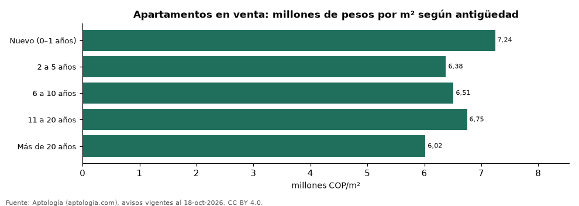

# Cuánto pierde de valor un apartamento con los años en Colombia: precio por m² según antigüedad (octubre 2026)

**Un apartamento de más de 20 años se pide en Colombia un 27,0 % más barato por metro cuadrado que uno nuevo de la misma ciudad y estrato.** Sin emparejar, la mediana va de 7,24 millones de pesos por m² en nuevos a 6,02 millones de pesos en los de más de 20 años.

*Resumen: analizamos 115.498 apartamentos en venta con antigüedad y área declaradas; la comparación emparejada usa 41 combinaciones de ciudad y estrato con 30 avisos o más en cada extremo.*

**Actualizado:** 18 de octubre de 2026 (datos del 18 de octubre de 2026) · **Próxima actualización:** mensual.

## Resumen

| Indicador | Valor |
|---|---|
| Descuento más de 20 años vs. nuevo (emparejado) | 27,0 % |
| Nuevo (mediana) | 7,24 millones de pesos/m² |
| Más de 20 años (mediana) | 6,02 millones de pesos/m² |
| Avisos | 115.498 |

## Precio por m² por antigüedad

| Antigüedad | Pesos por m² (mediana) | Avisos |
|---|---|---|
| Nuevo (0–1 años) | 7.242.424 | 11.907 |
| 2 a 5 años | 6.379.310 | 63.051 |
| 6 a 10 años | 6.512.393 | 12.870 |
| 11 a 20 años | 6.750.000 | 11.593 |
| Más de 20 años | 6.018.519 | 16.077 |

Los portales informan la antigüedad en rangos; se agrupa en cinco tramos.

## Preguntas frecuentes

**¿Cuánto vale menos un apartamento viejo en Colombia?**
Uno de más de 20 años se pide un 27,0 % más barato por m² que uno nuevo en la misma ciudad y estrato.

**¿Cuánto cuesta el m² de un apartamento nuevo en Colombia?**
7.242.424 pesos en la mediana de la oferta de octubre de 2026.

## Metodología

- **Fuente:** exportes nocturnos de la base de datos de Aptología (aptologia.com) del 18 de octubre de 2026: avisos vigentes de vivienda en portales inmobiliarios de 13 países, recogidos por Aptología y vistos en línea entre el 11 y el 18 de octubre de 2026. Corte: 18 de octubre de 2026.
- **Depuración:** se eliminan duplicados exactos (misma ciudad, zona, tipo, precio, moneda, área, habitaciones y baños) y los precios fuera del percentil 1–99 de cada país, operación, moneda y tipo; el precio por m² usa solo avisos con área declarada entre 12 y 2.000 m² y también se recorta al P1–P99.
- **Qué se mide:** precios pedidos (publicados), no precios de cierre. En arriendo, el canon mensual sin administración, gastos comunes ni condominio.
- **Muestra mínima:** cada cifra publicada se apoya en al menos 30 avisos; las celdas con menos se omiten.
- **Colombia:** Precios en pesos colombianos, sin conversión de moneda. Los indicadores de amoblado, mascotas, conjunto cerrado, balcón y aviso directo del dueño solo existen en arriendo y vienen de los portales.
- **Antigüedad:** campo `antig` del portal (solo en venta), que llega en rangos (0, 1, 2–5, 8, 15, 25 o más años); el tramo es aproximado.
- **Limitaciones:** la cobertura depende de los portales que recorre Aptología en cada país y es mayor en las ciudades grandes y en los segmentos medio-alto y alto; el área es la que declara el aviso, sin verificar; los nombres de zona vienen de los portales.
- **Privacidad:** solo se publican agregados; no se publica ningún dato personal, enlace a avisos ni nombre de anunciante.
- **Datos abiertos:** [datos.csv](datos.csv), licencia CC BY 4.0.

## Cómo citar

Pinzón Pineda, D. M. (2026). *Cuánto pierde de valor un apartamento con los años en Colombia: precio por m² según antigüedad (octubre 2026)*. Aptología (aptologia.com). https://github.com/elbroker/aptologia-datos/tree/main/estudios/precio-m2-segun-antiguedad-apartamentos-colombia-2026. Datos: datos.csv, licencia CC BY 4.0.
