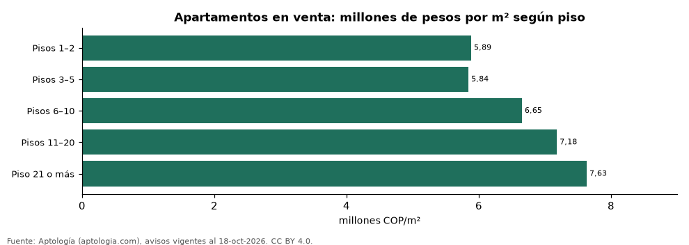

# ¿Vale más un apartamento en piso alto? Precio por m² según el piso en Colombia (octubre 2026)

**Un apartamento del piso 11 en adelante se pide en Colombia un 20,8 % más caro por metro cuadrado que uno en pisos 1 y 2 de la misma ciudad y estrato.** La comparación usa 56 combinaciones de ciudad y estrato con 30 avisos o más en cada grupo.

*Resumen: analizamos 77.902 apartamentos en venta con piso y área declarados.*

**Actualizado:** 18 de octubre de 2026 (datos del 18 de octubre de 2026) · **Próxima actualización:** mensual.

## Resumen

| Indicador | Valor |
|---|---|
| Piso 11+ vs. pisos 1–2 (emparejado) | +20,8 % |
| Combinaciones ciudad-estrato | 56 |
| Avisos | 77.902 |

## Precio por m² por altura (sin emparejar)

| Altura | Pesos por m² (mediana) | Avisos |
|---|---|---|
| Pisos 1–2 | 5.885.430 | 17.675 |
| Pisos 3–5 | 5.844.156 | 27.218 |
| Pisos 6–10 | 6.651.786 | 18.783 |
| Pisos 11–20 | 7.181.818 | 12.641 |
| Piso 21 o más | 7.631.579 | 1.585 |

Sin emparejar, las diferencias mezclan ciudades y estratos: los edificios altos se concentran en zonas caras.

## Preguntas frecuentes

**¿Es más caro un apartamento en piso alto?**
Sí: del piso 11 en adelante se pide un 20,8 % más por m² que en pisos 1–2, en la misma ciudad y estrato.

## Metodología

- **Fuente:** exportes nocturnos de la base de datos de Aptología (aptologia.com) del 18 de octubre de 2026: avisos vigentes de vivienda en portales inmobiliarios de 13 países, recogidos por Aptología y vistos en línea entre el 11 y el 18 de octubre de 2026. Corte: 18 de octubre de 2026.
- **Depuración:** se eliminan duplicados exactos (misma ciudad, zona, tipo, precio, moneda, área, habitaciones y baños) y los precios fuera del percentil 1–99 de cada país, operación, moneda y tipo; el precio por m² usa solo avisos con área declarada entre 12 y 2.000 m² y también se recorta al P1–P99.
- **Qué se mide:** precios pedidos (publicados), no precios de cierre. En arriendo, el canon mensual sin administración, gastos comunes ni condominio.
- **Muestra mínima:** cada cifra publicada se apoya en al menos 30 avisos; las celdas con menos se omiten.
- **Colombia:** Precios en pesos colombianos, sin conversión de moneda. Los indicadores de amoblado, mascotas, conjunto cerrado, balcón y aviso directo del dueño solo existen en arriendo y vienen de los portales.
- **Piso:** el que declara el aviso; se usan pisos 1 a 60.
- **Limitaciones:** la cobertura depende de los portales que recorre Aptología en cada país y es mayor en las ciudades grandes y en los segmentos medio-alto y alto; el área es la que declara el aviso, sin verificar; los nombres de zona vienen de los portales.
- **Privacidad:** solo se publican agregados; no se publica ningún dato personal, enlace a avisos ni nombre de anunciante.
- **Datos abiertos:** [datos.csv](datos.csv), licencia CC BY 4.0.

## Cómo citar

Pinzón Pineda, D. M. (2026). *¿Vale más un apartamento en piso alto? Precio por m² según el piso en Colombia (octubre 2026)*. Aptología (aptologia.com). https://github.com/elbroker/aptologia-datos/tree/main/estudios/precio-m2-segun-piso-apartamentos-colombia-2026. Datos: datos.csv, licencia CC BY 4.0.
