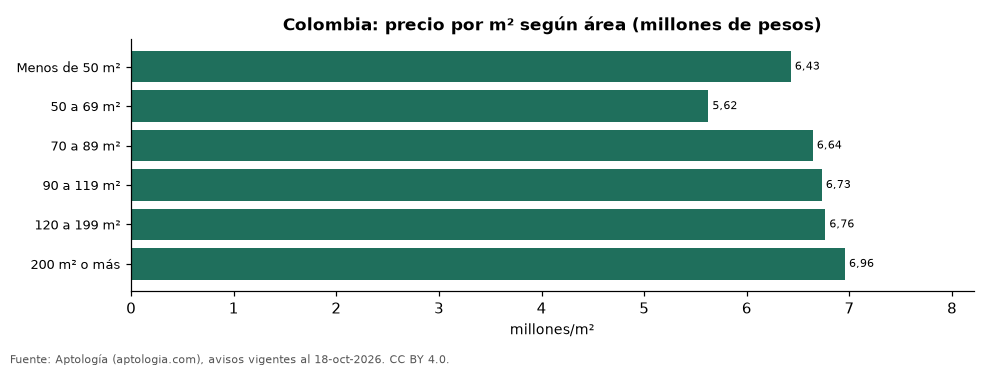

# ¿Sale más barato el metro cuadrado de un apartamento grande? Precio por m² según el tamaño en Colombia (octubre 2026)

**En Colombia el metro cuadrado de un apartamento en venta de menos de 50 m² se pide en 6,43 millones de pesos en la mediana y el de uno de 200 m² o más en 6,96 millones de pesos; el tramo más caro por m² es el de 200 m² o más (6,96 millones de pesos).** El precio por m² no baja de forma pareja con el tamaño: los apartamentos grandes se concentran en barrios y estratos altos, lo que compensa el descuento por tamaño.

*Resumen: agrupamos 120.352 apartamentos en venta con área declarada en seis tramos de tamaño.*

**Actualizado:** 18 de octubre de 2026 (datos del 18 de octubre de 2026) · **Próxima actualización:** mensual.

## Resumen

| Indicador | Valor |
|---|---|
| Menos de 50 m² | 6,43 millones de pesos |
| 50 a 69 m² | 5,62 millones de pesos |
| 70 a 89 m² | 6,64 millones de pesos |
| 90 a 119 m² | 6,73 millones de pesos |
| 120 a 199 m² | 6,76 millones de pesos |
| 200 m² o más | 6,96 millones de pesos |

## Colombia: precio por m² por tramo de tamaño

| Tamaño | Millones de pesos por m² | Avisos |
|---|---|---|
| Menos de 50 m² | 6,43 | 10.413 |
| 50 a 69 m² | 5,62 | 29.458 |
| 70 a 89 m² | 6,64 | 23.299 |
| 90 a 119 m² | 6,73 | 20.387 |
| 120 a 199 m² | 6,76 | 23.330 |
| 200 m² o más | 6,96 | 13.465 |

Mediana del precio pedido por m² en cada tramo de área declarada.

## Las cinco ciudades más grandes (millones de pesos por m²)

| Ciudad | Menos de 50 m² | 50 a 69 m² | 70 a 89 m² | 90 a 119 m² | 120 a 199 m² | 200 m² o más |
|---|---|---|---|---|---|---|
| Bogotá | 6,89 | 6,46 | 7,18 | 7,22 | 7,50 | 7,91 |
| Medellín | 6,50 | 7,18 | 8,21 | 7,97 | 7,32 | 6,78 |
| Cali | 5,28 | 4,11 | 4,71 | 5,16 | 5,50 | 5,17 |
| Barranquilla | 4,98 | 4,64 | 4,71 | 4,45 | 4,22 | 4,40 |
| Cartagena | 9,59 | 7,17 | 8,26 | 7,73 | 7,46 | 8,89 |

— indica menos de 30 avisos.

## Preguntas frecuentes

**¿Es más barato por metro cuadrado un apartamento grande?**
No necesariamente: en Colombia el m² de los de menos de 50 m² está en 6,43 millones de pesos y el de los de 200 m² o más en 6,96 millones de pesos, porque los grandes están en zonas más caras.

**¿Qué tamaño de apartamento tiene el m² más caro?**
El tramo de 200 m² o más, con 6,96 millones de pesos por m².

## Metodología

- **Fuente:** exportes nocturnos de la base de datos de Aptología (aptologia.com) del 18 de octubre de 2026: avisos vigentes de vivienda en portales inmobiliarios de 13 países, recogidos por Aptología y vistos en línea entre el 11 y el 18 de octubre de 2026. Corte: 18 de octubre de 2026.
- **Depuración:** se eliminan duplicados exactos (misma ciudad, zona, tipo, precio, moneda, área, habitaciones y baños) y los precios fuera del percentil 1–99 de cada país, operación, moneda y tipo; el precio por m² usa solo avisos con área declarada entre 12 y 2.000 m² y también se recorta al P1–P99.
- **Qué se mide:** precios pedidos (publicados), no precios de cierre. En arriendo, el canon mensual sin administración, gastos comunes ni condominio.
- **Muestra mínima:** cada cifra publicada se apoya en al menos 30 avisos; las celdas con menos se omiten.
- **Colombia:** Precios en pesos colombianos, sin conversión de moneda.
- **Limitaciones:** la cobertura depende de los portales que recorre Aptología en cada país y es mayor en las ciudades grandes y en los segmentos medio-alto y alto; el área es la que declara el aviso, sin verificar; los nombres de zona vienen de los portales.
- **Privacidad:** solo se publican agregados; no se publica ningún dato personal, enlace a avisos ni nombre de anunciante.
- **Datos abiertos:** [datos.csv](datos.csv), licencia CC BY 4.0.

## Cómo citar

Pinzón Pineda, D. M. (2026). *¿Sale más barato el metro cuadrado de un apartamento grande? Precio por m² según el tamaño en Colombia (octubre 2026)*. Aptología (aptologia.com). https://github.com/elbroker/aptologia-datos/tree/main/estudios/precio-m2-segun-tamano-apartamento-colombia-2026. Datos: datos.csv, licencia CC BY 4.0.
