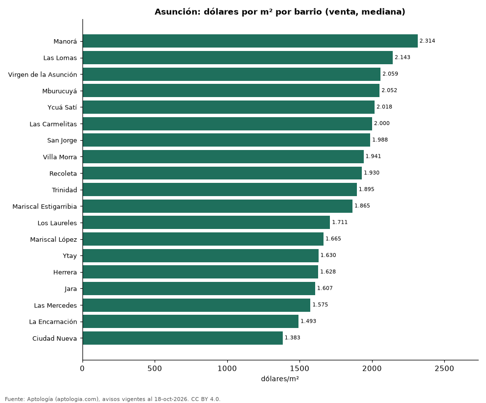

# Precio de la vivienda por barrio en Asunción: venta y arriendo en 23 barrios (octubre 2026)

**El barrio con el metro cuadrado más caro de Asunción es Manorá, con USD 2.314 en la mediana de apartamentos en venta; el más barato de la muestra es Ciudad Nueva, con USD 1.383.** En arriendo, el canon mediano más alto se pide en Ycuá Satí (6.500.000 guaraníes (USD 1.139) al mes) y el más bajo en Sajonia (3.500.000 guaraníes (USD 613)).

*Resumen: analizamos 5.168 avisos de apartamentos en 23 barrios de Asunción con 30 avisos o más.*

**Actualizado:** 18 de octubre de 2026 (datos del 18 de octubre de 2026) · **Próxima actualización:** mensual.

## Resumen

| Indicador | Valor |
|---|---|
| Más caro (venta por m²) | Manorá: USD 2.314 |
| Más barato (venta por m²) | Ciudad Nueva: USD 1.383 |
| Asunción (venta por m², mediana) | USD 1.869 |
| Arriendo más alto | Ycuá Satí: 6.500.000 guaraníes (USD 1.139) |
| Barrios | 23 |

## Barrios de Asunción

| Barrio | Venta: dólares por m² | Arriendo: guaraníes al mes | Avisos (venta / arriendo) |
|---|---|---|---|
| Manorá | 2.314 | — | 88 / s. d. |
| Las Lomas | 2.143 | 5.900.000 | 539 / 139 |
| Virgen de la Asunción | 2.059 | — | 36 / s. d. |
| Mburucuyá | 2.052 | 6.000.000 | 266 / 180 |
| Ycuá Satí | 2.018 | 6.500.000 | 303 / 125 |
| Las Carmelitas | 2.000 | 5.925.000 | 167 / 78 |
| San Jorge | 1.988 | 4.900.000 | 78 / 36 |
| Villa Morra | 1.941 | 5.500.000 | 411 / 229 |
| Recoleta | 1.930 | 5.200.000 | 407 / 131 |
| Trinidad | 1.895 | 4.700.000 | 110 / 39 |
| Mariscal Estigarribia | 1.865 | 6.000.000 | 56 / 56 |
| Los Laureles | 1.711 | 5.225.000 | 71 / 114 |
| Mariscal López | 1.665 | 4.950.000 | 40 / 33 |
| Ytay | 1.630 | 4.500.000 | 79 / 45 |
| Herrera | 1.628 | 5.200.000 | 141 / 148 |
| Jara | 1.607 | 4.500.000 | 141 / 113 |
| Las Mercedes | 1.575 | 5.200.000 | 281 / 229 |
| La Encarnación | 1.493 | — | 32 / s. d. |
| Ciudad Nueva | 1.383 | 5.000.000 | 34 / 30 |
| Centro | — | 3.800.000 | s. d. / 41 |
| Sajonia | — | 3.500.000 | s. d. / 48 |
| San Vicente | — | 3.500.000 | s. d. / 40 |
| Villa Aurelia | — | 5.000.000 | s. d. / 34 |

Medianas de apartamentos; — indica menos de 30 avisos. El canon es el mensual sin gastos comunes, condominio ni administración.

## Preguntas frecuentes

**¿Cuál es el barrio más caro de Asunción?**
Manorá, con USD 2.314 por m² en apartamentos en venta (octubre de 2026).

**¿Dónde es más barato comprar apartamento en Asunción?**
Entre los barrios con 30 avisos o más, en Ciudad Nueva: USD 1.383 por m².

**¿Dónde es más caro arrendar en Asunción?**
En Ycuá Satí, con un canon mediano de 6.500.000 guaraníes (USD 1.139) al mes.

## Metodología

- **Fuente:** exportes nocturnos de la base de datos de Aptología (aptologia.com) del 18 de octubre de 2026: avisos vigentes de vivienda en portales inmobiliarios de 13 países, recogidos por Aptología y vistos en línea entre el 11 y el 18 de octubre de 2026. Corte: 18 de octubre de 2026.
- **Depuración:** se eliminan duplicados exactos (misma ciudad, zona, tipo, precio, moneda, área, habitaciones y baños) y los precios fuera del percentil 1–99 de cada país, operación, moneda y tipo; el precio por m² usa solo avisos con área declarada entre 12 y 2.000 m² y también se recorta al P1–P99.
- **Qué se mide:** precios pedidos (publicados), no precios de cierre. En arriendo, el canon mensual sin administración, gastos comunes ni condominio.
- **Muestra mínima:** cada cifra publicada se apoya en al menos 30 avisos; las celdas con menos se omiten.
- **Monedas:** nunca se mezclan avisos de monedas distintas sin convertirlos. Conversión a dólares con la tasa de mercado de ExchangeRate-API (open.er-api.com, actualización del 18 Oct 2026): 1 USD = 3.182,80 COP, 1 USD = 18,47 M.N, 1 USD = 5,09 BRL, 1 USD = 3,44 PEN, 1 USD = 982,44 CLP, 1 USD = 1.514,57 ARS, 1 USD = 40,20 UYU, 1 USD = 5.705,37 PYG, 1 USD = 61,27 DOP, 1 USD = 0,89 EUR, 1 USD = 11,72 BOB; la UF chilena a 41.178,64 CLP (mindicador,cl. 18-oct-2026). Los avisos publicados en dólares se usan tal cual.
- **Monedas:** Venta en dólares y arriendo en guaraníes, la moneda en que se publica la mayoría de los avisos de cada operación; los avisos en otra moneda se excluyen. Las equivalencias en dólares entre paréntesis usan la tasa citada.
- **Limitaciones:** la cobertura depende de los portales que recorre Aptología en cada país y es mayor en las ciudades grandes y en los segmentos medio-alto y alto; el área es la que declara el aviso, sin verificar; los nombres de zona vienen de los portales.
- **Privacidad:** solo se publican agregados; no se publica ningún dato personal, enlace a avisos ni nombre de anunciante.
- **Datos abiertos:** [datos.csv](datos.csv), licencia CC BY 4.0.

## Cómo citar

Pinzón Pineda, D. M. (2026). *Precio de la vivienda por barrio en Asunción: venta y arriendo en 23 barrios (octubre 2026)*. Aptología (aptologia.com). https://github.com/elbroker/aptologia-datos/tree/main/estudios/precio-vivienda-asuncion-por-barrio-2026. Datos: datos.csv, licencia CC BY 4.0.
