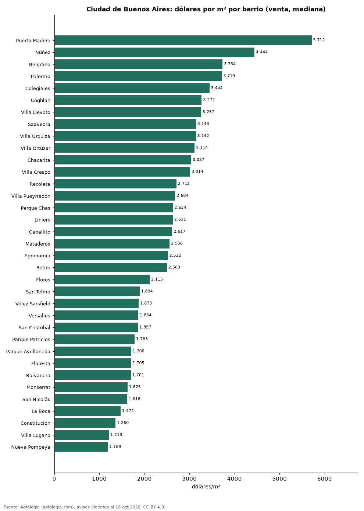

# Precio de la vivienda por barrio en Ciudad de Buenos Aires: venta y arriendo en 46 barrios (octubre 2026)

**El barrio con el metro cuadrado más caro de Ciudad de Buenos Aires es Puerto Madero, con USD 5.712 en la mediana de apartamentos en venta; el más barato de la muestra es Nueva Pompeya, con USD 1.189.** En arriendo, el canon mediano más alto se pide en Caballito (1.200.000 pesos argentinos (USD 792) al mes) y el más bajo en Villa Lugano (680.000 pesos argentinos (USD 449)).

*Resumen: analizamos 10.977 avisos de apartamentos en 46 barrios de Ciudad de Buenos Aires con 30 avisos o más.*

**Actualizado:** 18 de octubre de 2026 (datos del 18 de octubre de 2026) · **Próxima actualización:** mensual.

## Resumen

| Indicador | Valor |
|---|---|
| Más caro (venta por m²) | Puerto Madero: USD 5.712 |
| Más barato (venta por m²) | Nueva Pompeya: USD 1.189 |
| Ciudad de Buenos Aires (venta por m², mediana) | USD 2.558 |
| Arriendo más alto | Caballito: 1.200.000 pesos argentinos (USD 792) |
| Barrios | 46 |

## Barrios de Ciudad de Buenos Aires

| Barrio | Venta: dólares por m² | Arriendo: pesos argentinos al mes | Avisos (venta / arriendo) |
|---|---|---|---|
| Puerto Madero | 5.712 | — | 114 / s. d. |
| Núñez | 4.444 | 1.150.000 | 123 / 75 |
| Belgrano | 3.734 | 1.150.000 | 653 / 162 |
| Palermo | 3.719 | 1.100.000 | 1.021 / 268 |
| Colegiales | 3.444 | 900.000 | 153 / 75 |
| Coghlan | 3.272 | 880.000 | 146 / 36 |
| Villa Devoto | 3.257 | 900.000 | 169 / 96 |
| Saavedra | 3.143 | 1.000.000 | 127 / 58 |
| Villa Urquiza | 3.142 | 1.100.000 | 154 / 106 |
| Villa Ortúzar | 3.114 | 900.000 | 137 / 34 |
| Chacarita | 3.037 | 750.000 | 128 / 42 |
| Villa Crespo | 3.014 | 1.050.000 | 154 / 91 |
| Recoleta | 2.712 | 1.000.000 | 341 / 181 |
| Villa Pueyrredón | 2.684 | 800.000 | 142 / 59 |
| Parque Chas | 2.634 | — | 102 / s. d. |
| Liniers | 2.631 | 740.000 | 156 / 66 |
| Caballito | 2.617 | 1.200.000 | 72 / 138 |
| Mataderos | 2.558 | 800.000 | 141 / 54 |
| Agronomía | 2.522 | — | 85 / s. d. |
| Retiro | 2.500 | 825.000 | 198 / 54 |
| Villa del Parque | 2.444 | 850.000 | 148 / 89 |
| Monte Castro | 2.442 | 800.000 | 129 / 40 |
| Villa Real | 2.405 | — | 51 / s. d. |
| Villa Luro | 2.387 | 780.000 | 145 / 68 |
| Parque Chacabuco | 2.357 | 850.000 | 155 / 57 |
| Boedo | 2.317 | 790.000 | 149 / 70 |
| Barracas | 2.285 | 910.000 | 152 / 60 |
| La Paternal | 2.171 | 790.000 | 136 / 37 |
| Almagro | 2.167 | 982.500 | 167 / 120 |
| Villa General Mitre | 2.128 | — | 35 / s. d. |
| Villa Santa Rita | 2.126 | — | 113 / s. d. |
| Flores | 2.115 | 890.000 | 195 / 124 |
| San Telmo | 1.894 | 850.000 | 161 / 60 |
| Vélez Sarsfield | 1.873 | — | 84 / s. d. |
| Versalles | 1.864 | — | 77 / s. d. |
| San Cristóbal | 1.857 | 715.000 | 159 / 74 |
| Parque Patricios | 1.783 | 730.000 | 141 / 36 |
| Parque Avellaneda | 1.706 | — | 106 / s. d. |
| Floresta | 1.705 | 700.000 | 159 / 75 |
| Balvanera | 1.701 | 800.000 | 471 / 157 |
| Monserrat | 1.625 | 790.000 | 192 / 63 |
| San Nicolás | 1.618 | 750.000 | 200 / 92 |
| La Boca | 1.472 | 700.000 | 124 / 31 |
| Constitución | 1.360 | — | 143 / s. d. |
| Villa Lugano | 1.213 | 680.000 | 113 / 61 |
| Nueva Pompeya | 1.189 | — | 47 / s. d. |

Medianas de apartamentos; — indica menos de 30 avisos. El canon es el mensual sin gastos comunes, condominio ni administración.

## Preguntas frecuentes

**¿Cuál es el barrio más caro de Ciudad de Buenos Aires?**
Puerto Madero, con USD 5.712 por m² en apartamentos en venta (octubre de 2026).

**¿Dónde es más barato comprar apartamento en Ciudad de Buenos Aires?**
Entre los barrios con 30 avisos o más, en Nueva Pompeya: USD 1.189 por m².

**¿Dónde es más caro arrendar en Ciudad de Buenos Aires?**
En Caballito, con un canon mediano de 1.200.000 pesos argentinos (USD 792) al mes.

## Metodología

- **Fuente:** exportes nocturnos de la base de datos de Aptología (aptologia.com) del 18 de octubre de 2026: avisos vigentes de vivienda en portales inmobiliarios de 13 países, recogidos por Aptología y vistos en línea entre el 11 y el 18 de octubre de 2026. Corte: 18 de octubre de 2026.
- **Depuración:** se eliminan duplicados exactos (misma ciudad, zona, tipo, precio, moneda, área, habitaciones y baños) y los precios fuera del percentil 1–99 de cada país, operación, moneda y tipo; el precio por m² usa solo avisos con área declarada entre 12 y 2.000 m² y también se recorta al P1–P99.
- **Qué se mide:** precios pedidos (publicados), no precios de cierre. En arriendo, el canon mensual sin administración, gastos comunes ni condominio.
- **Muestra mínima:** cada cifra publicada se apoya en al menos 30 avisos; las celdas con menos se omiten.
- **Monedas:** nunca se mezclan avisos de monedas distintas sin convertirlos. Conversión a dólares con la tasa de mercado de ExchangeRate-API (open.er-api.com, actualización del 18 Oct 2026): 1 USD = 3.182,80 COP, 1 USD = 18,47 M.N, 1 USD = 5,09 BRL, 1 USD = 3,44 PEN, 1 USD = 982,44 CLP, 1 USD = 1.514,57 ARS, 1 USD = 40,20 UYU, 1 USD = 5.705,37 PYG, 1 USD = 61,27 DOP, 1 USD = 0,89 EUR, 1 USD = 11,72 BOB; la UF chilena a 41.178,64 CLP (mindicador,cl. 18-oct-2026). Los avisos publicados en dólares se usan tal cual.
- **Monedas:** Venta en dólares y arriendo en pesos argentinos, la moneda en que se publica la mayoría de los avisos de cada operación; los avisos en otra moneda se excluyen. Las equivalencias en dólares entre paréntesis usan la tasa citada.
- **Limitaciones:** la cobertura depende de los portales que recorre Aptología en cada país y es mayor en las ciudades grandes y en los segmentos medio-alto y alto; el área es la que declara el aviso, sin verificar; los nombres de zona vienen de los portales.
- **Privacidad:** solo se publican agregados; no se publica ningún dato personal, enlace a avisos ni nombre de anunciante.
- **Datos abiertos:** [datos.csv](datos.csv), licencia CC BY 4.0.

## Cómo citar

Pinzón Pineda, D. M. (2026). *Precio de la vivienda por barrio en Ciudad de Buenos Aires: venta y arriendo en 46 barrios (octubre 2026)*. Aptología (aptologia.com). https://github.com/elbroker/aptologia-datos/tree/main/estudios/precio-vivienda-buenos-aires-por-barrio-2026. Datos: datos.csv, licencia CC BY 4.0.
