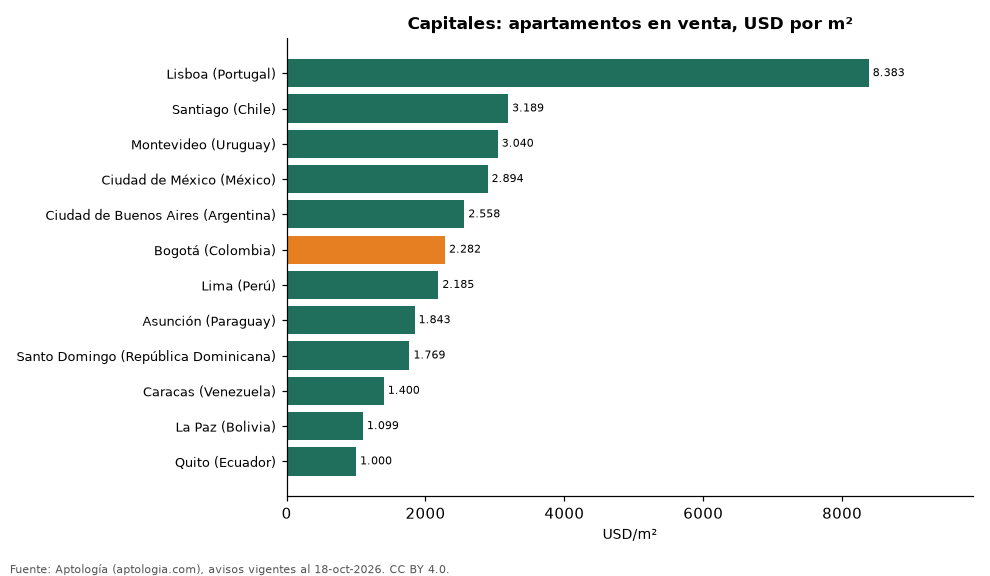
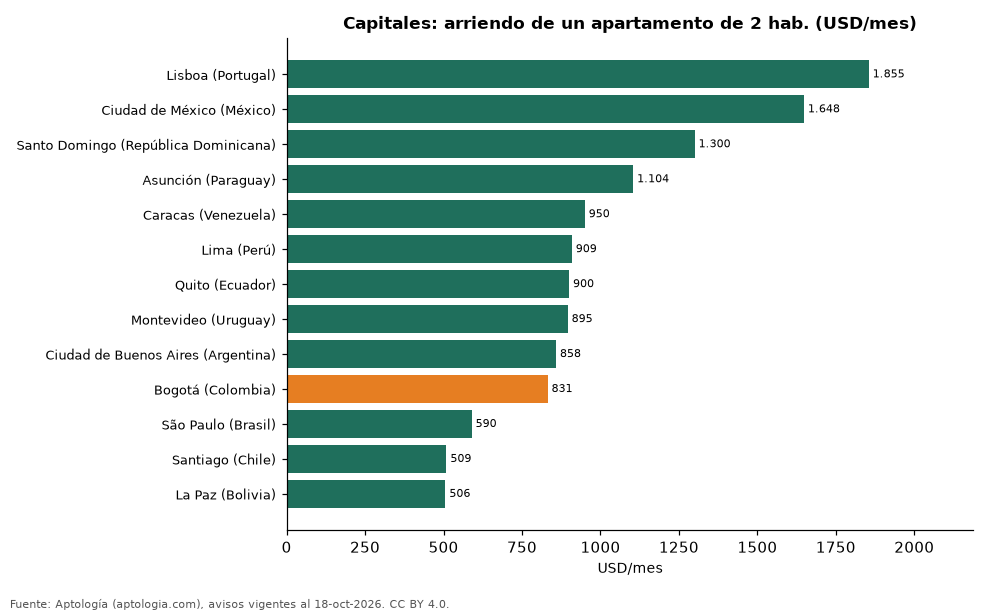

# Precio de la vivienda en las capitales de Latinoamérica (y São Paulo y Lisboa): m² en venta, arriendo y rentabilidad (octubre 2026)

**Entre las capitales de la región, el metro cuadrado en venta más caro es el de Lisboa (USD 8.383/m²) y el más barato el de Quito (USD 1.000/m²).** Bogotá marca USD 2.282/m² en venta y USD 831 al mes por un apartamento de 2 habitaciones; la capital donde ese arriendo es más barato es La Paz (USD 506).

*Resumen: comparamos 141.821 apartamentos con área en 13 ciudades capitales o principales.*

**Actualizado:** 18 de octubre de 2026 (datos del 18 de octubre de 2026) · **Próxima actualización:** mensual.

## Resumen

| Indicador | Valor |
|---|---|
| Venta más cara | Lisboa: USD 8.383/m² |
| Venta más barata | Quito: USD 1.000/m² |
| Bogotá (venta) | USD 2.282/m² |
| Bogotá (2 hab. en arriendo) | USD 831/mes |

## Capitales comparadas

| Ciudad | Venta USD/m² | Arriendo USD/m²/mes | Arriendo 2 hab. USD/mes | Rentabilidad bruta |
|---|---|---|---|---|
| Lisboa (Portugal) | 8.383 | 25,8 | 1.855 | 3,7 % |
| Santiago (Chile) | 3.189 | 10,6 | 509 | 4,0 % |
| Montevideo (Uruguay) | 3.040 | 15,3 | 895 | 6,1 % |
| Ciudad de México (México) | 2.894 | 18,1 | 1.648 | 7,5 % |
| Ciudad de Buenos Aires (Argentina) | 2.558 | 13,5 | 858 | 6,3 % |
| Bogotá (Colombia) | 2.282 | 15,2 | 831 | 8,0 % |
| Lima (Perú) | 2.185 | 10,0 | 909 | 5,5 % |
| Asunción (Paraguay) | 1.843 | 12,9 | 1.104 | 8,4 % |
| Santo Domingo (República Dominicana) | 1.769 | 11,7 | 1.300 | 7,9 % |
| Caracas (Venezuela) | 1.400 | 12,1 | 950 | 10,4 % |
| La Paz (Bolivia) | 1.099 | 5,6 | 506 | 6,1 % |
| Quito (Ecuador) | 1.000 | 7,2 | 900 | 8,7 % |
| São Paulo (Brasil) | — | 12,4 | 590 | s. d. % |

São Paulo (la mayor ciudad de Brasil) aparece en lugar de Brasilia, y solo con arriendo. Lisboa se incluye como referencia europea.

## Preguntas frecuentes

**¿Cuál es la capital más cara de Latinoamérica para comprar vivienda?**
Lisboa, con USD 8.383 por m² en la mediana de apartamentos en venta (Aptología, octubre de 2026).

**¿Es Bogotá cara frente a otras capitales?**
Bogotá cuesta USD 2.282 por m² en venta; ver la tabla para su posición frente a Lima, Ciudad de México, Santiago o Buenos Aires.

## Metodología

- **Fuente:** exportes nocturnos de la base de datos de Aptología (aptologia.com) del 18 de octubre de 2026: avisos vigentes de vivienda en portales inmobiliarios de 13 países, recogidos por Aptología y vistos en línea entre el 11 y el 18 de octubre de 2026. Corte: 18 de octubre de 2026.
- **Depuración:** se eliminan duplicados exactos (misma ciudad, zona, tipo, precio, moneda, área, habitaciones y baños) y los precios fuera del percentil 1–99 de cada país, operación, moneda y tipo; el precio por m² usa solo avisos con área declarada entre 12 y 2.000 m² y también se recorta al P1–P99.
- **Qué se mide:** precios pedidos (publicados), no precios de cierre. En arriendo, el canon mensual sin administración, gastos comunes ni condominio.
- **Muestra mínima:** cada cifra publicada se apoya en al menos 30 avisos; las celdas con menos se omiten.
- **Monedas:** nunca se mezclan avisos de monedas distintas sin convertirlos. Conversión a dólares con la tasa de mercado de ExchangeRate-API (open.er-api.com, actualización del 18 Oct 2026): 1 USD = 3.182,80 COP, 1 USD = 18,47 M.N, 1 USD = 5,09 BRL, 1 USD = 3,44 PEN, 1 USD = 982,44 CLP, 1 USD = 1.514,57 ARS, 1 USD = 40,20 UYU, 1 USD = 5.705,37 PYG, 1 USD = 61,27 DOP, 1 USD = 0,89 EUR, 1 USD = 11,72 BOB; la UF chilena a 41.178,64 CLP (mindicador,cl. 18-oct-2026). Los avisos publicados en dólares se usan tal cual.
- **Limitaciones:** la cobertura depende de los portales que recorre Aptología en cada país y es mayor en las ciudades grandes y en los segmentos medio-alto y alto; el área es la que declara el aviso, sin verificar; los nombres de zona vienen de los portales.
- **Privacidad:** solo se publican agregados; no se publica ningún dato personal, enlace a avisos ni nombre de anunciante.
- **Datos abiertos:** [datos.csv](datos.csv), licencia CC BY 4.0.

## Cómo citar

Pinzón Pineda, D. M. (2026). *Precio de la vivienda en las capitales de Latinoamérica (y São Paulo y Lisboa): m² en venta, arriendo y rentabilidad (octubre 2026)*. Aptología (aptologia.com). https://github.com/elbroker/aptologia-datos/tree/main/estudios/precio-vivienda-capitales-latinoamerica-2026. Datos: datos.csv, licencia CC BY 4.0.
