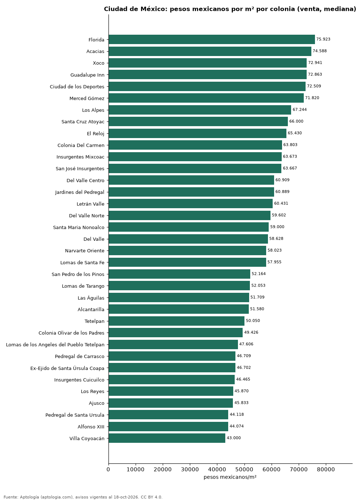

# Precio de la vivienda por colonia en Ciudad de México: venta y arriendo en 70 colonias (octubre 2026)

**La colonia con el metro cuadrado más caro de Ciudad de México es Florida, con 75.923 pesos mexicanos (USD 4.112) en la mediana de apartamentos en venta; la más barata de la muestra es Villa Coyoacán, con 43.000 pesos mexicanos (USD 2.329).** En arriendo, el canon mediano más alto se pide en Polanco III Sección (83.000 pesos mexicanos (USD 4.495) al mes) y el más bajo en Doctores (18.750 pesos mexicanos (USD 1.015)).

*Resumen: analizamos 9.023 avisos de apartamentos en 70 colonias de Ciudad de México con 30 avisos o más.*

**Actualizado:** 18 de octubre de 2026 (datos del 18 de octubre de 2026) · **Próxima actualización:** mensual.

## Resumen

| Indicador | Valor |
|---|---|
| Más cara (venta por m²) | Florida: 75.923 pesos mexicanos (USD 4.112) |
| Más barata (venta por m²) | Villa Coyoacán: 43.000 pesos mexicanos (USD 2.329) |
| Ciudad de México (venta por m², mediana) | 53.447 pesos mexicanos (USD 2.894) |
| Arriendo más alto | Polanco III Sección: 83.000 pesos mexicanos (USD 4.495) |
| Colonias | 70 |

## Colonias de Ciudad de México

| Colonia | Venta: pesos mexicanos por m² | Arriendo: pesos mexicanos al mes | Avisos (venta / arriendo) |
|---|---|---|---|
| Florida | 75.923 | — | 36 / s. d. |
| Acacias | 74.588 | — | 85 / s. d. |
| Xoco | 72.941 | 34.499 | 111 / 46 |
| Guadalupe Inn | 72.863 | — | 88 / s. d. |
| Ciudad de los Deportes | 72.509 | — | 50 / s. d. |
| Merced Gómez | 71.820 | — | 91 / s. d. |
| Los Alpes | 67.244 | 28.000 | 361 / 46 |
| Santa Cruz Atoyac | 66.000 | — | 113 / s. d. |
| El Reloj | 65.430 | — | 58 / s. d. |
| Colonia Del Carmen | 63.803 | — | 36 / s. d. |
| Insurgentes Mixcoac | 63.673 | — | 53 / s. d. |
| San José Insurgentes | 63.667 | — | 56 / s. d. |
| Del Valle Centro | 60.909 | 30.000 | 457 / 92 |
| Jardines del Pedregal | 60.889 | — | 112 / s. d. |
| Letrán Valle | 60.431 | — | 52 / s. d. |
| Del Valle Norte | 59.602 | — | 85 / s. d. |
| Santa Maria Nonoalco | 59.000 | — | 37 / s. d. |
| Del Valle | 58.628 | — | 49 / s. d. |
| Narvarte Oriente | 58.023 | — | 81 / s. d. |
| Lomas de Santa Fe | 57.955 | 32.000 | 116 / 35 |
| Tizapan | 56.923 | — | 103 / s. d. |
| Del Valle Sur | 56.674 | — | 111 / s. d. |
| Mixcoac | 56.618 | — | 43 / s. d. |
| Narvarte Poniente | 56.333 | 29.000 | 261 / 42 |
| Santa Fe | 56.206 | 32.000 | 382 / 98 |
| Portales Sur | 56.000 | — | 113 / s. d. |
| Piedad Narvarte | 55.595 | — | 35 / s. d. |
| Ampliación Estado de Hidalgo | 55.139 | 26.004 | 268 / 88 |
| Portales Oriente | 54.359 | — | 70 / s. d. |
| Santa Fe La Loma | 54.286 | — | 57 / s. d. |
| Portales Norte | 53.180 | — | 129 / s. d. |
| Nápoles | 52.850 | 28.000 | 854 / 117 |
| Progreso Tizapan | 52.627 | — | 34 / s. d. |
| Alamos | 52.625 | — | 79 / s. d. |
| Carola | 52.500 | — | 47 / s. d. |
| San Pedro de los Pinos | 52.164 | 21.000 | 188 / 63 |
| Lomas de Tarango | 52.053 | — | 66 / s. d. |
| Las Águilas | 51.709 | — | 76 / s. d. |
| Alcantarilla | 51.580 | — | 30 / s. d. |
| Tetelpan | 50.050 | — | 200 / s. d. |
| Colonia Olivar de los Padres | 49.426 | — | 205 / s. d. |
| Lomas de los Angeles del Pueblo Tetelpan | 47.606 | — | 40 / s. d. |
| Pedregal de Carrasco | 46.709 | — | 49 / s. d. |
| Ex-Ejido de Santa Úrsula Coapa | 46.702 | — | 49 / s. d. |
| Insurgentes Cuicuilco | 46.465 | — | 33 / s. d. |
| Los Reyes | 45.870 | — | 56 / s. d. |
| Ajusco | 45.833 | — | 47 / s. d. |
| Pedregal de Santa Ursula | 44.118 | — | 55 / s. d. |
| Alfonso XIII | 44.074 | — | 31 / s. d. |
| Villa Coyoacán | 43.000 | — | 153 / s. d. |
| Ahuehuetes Anahuac | — | 29.999 | s. d. / 35 |
| Ampliación Granada | — | 45.000 | s. d. / 166 |
| Anáhuac I Sección | — | 32.500 | s. d. / 48 |
| Colonia Cuauhtémoc | — | 27.500 | s. d. / 203 |
| Condesa | — | 39.500 | s. d. / 103 |
| Doctores | — | 18.750 | s. d. / 30 |
| Granada | — | 45.000 | s. d. / 124 |
| Hipódromo Condesa | — | 39.500 | s. d. / 84 |
| Juárez | — | 32.750 | s. d. / 208 |
| Lomas de Chapultepec | — | 60.000 | s. d. / 81 |
| Periodista | — | 22.017 | s. d. / 36 |
| Polanco I Sección | — | 41.500 | s. d. / 309 |
| Polanco III Sección | — | 83.000 | s. d. / 97 |
| Polanco IV Sección | — | 78.000 | s. d. / 313 |
| Polanco V Sección | — | 75.000 | s. d. / 118 |
| Roma Norte | — | 36.000 | s. d. / 210 |
| Roma Sur | — | 30.000 | s. d. / 98 |
| San Rafael | — | 24.900 | s. d. / 48 |
| Santa María la Ribera | — | 22.000 | s. d. / 34 |
| Tabacalera | — | 33.650 | s. d. / 60 |

Medianas de apartamentos; — indica menos de 30 avisos. El canon es el mensual sin gastos comunes, condominio ni administración.

## Preguntas frecuentes

**¿Cuál es la colonia más cara de Ciudad de México?**
Florida, con 75.923 pesos mexicanos (USD 4.112) por m² en apartamentos en venta (octubre de 2026).

**¿Dónde es más barato comprar apartamento en Ciudad de México?**
Entre los colonias con 30 avisos o más, en Villa Coyoacán: 43.000 pesos mexicanos (USD 2.329) por m².

**¿Dónde es más caro arrendar en Ciudad de México?**
En Polanco III Sección, con un canon mediano de 83.000 pesos mexicanos (USD 4.495) al mes.

## Metodología

- **Fuente:** exportes nocturnos de la base de datos de Aptología (aptologia.com) del 18 de octubre de 2026: avisos vigentes de vivienda en portales inmobiliarios de 13 países, recogidos por Aptología y vistos en línea entre el 11 y el 18 de octubre de 2026. Corte: 18 de octubre de 2026.
- **Depuración:** se eliminan duplicados exactos (misma ciudad, zona, tipo, precio, moneda, área, habitaciones y baños) y los precios fuera del percentil 1–99 de cada país, operación, moneda y tipo; el precio por m² usa solo avisos con área declarada entre 12 y 2.000 m² y también se recorta al P1–P99.
- **Qué se mide:** precios pedidos (publicados), no precios de cierre. En arriendo, el canon mensual sin administración, gastos comunes ni condominio.
- **Muestra mínima:** cada cifra publicada se apoya en al menos 30 avisos; las celdas con menos se omiten.
- **Monedas:** nunca se mezclan avisos de monedas distintas sin convertirlos. Conversión a dólares con la tasa de mercado de ExchangeRate-API (open.er-api.com, actualización del 18 Oct 2026): 1 USD = 3.182,80 COP, 1 USD = 18,47 M.N, 1 USD = 5,09 BRL, 1 USD = 3,44 PEN, 1 USD = 982,44 CLP, 1 USD = 1.514,57 ARS, 1 USD = 40,20 UYU, 1 USD = 5.705,37 PYG, 1 USD = 61,27 DOP, 1 USD = 0,89 EUR, 1 USD = 11,72 BOB; la UF chilena a 41.178,64 CLP (mindicador,cl. 18-oct-2026). Los avisos publicados en dólares se usan tal cual.
- **Monedas:** Venta en pesos mexicanos y arriendo en pesos mexicanos, la moneda en que se publica la mayoría de los avisos de cada operación; los avisos en otra moneda se excluyen. Las equivalencias en dólares entre paréntesis usan la tasa citada.
- **Limitaciones:** la cobertura depende de los portales que recorre Aptología en cada país y es mayor en las ciudades grandes y en los segmentos medio-alto y alto; el área es la que declara el aviso, sin verificar; los nombres de zona vienen de los portales.
- **Privacidad:** solo se publican agregados; no se publica ningún dato personal, enlace a avisos ni nombre de anunciante.
- **Datos abiertos:** [datos.csv](datos.csv), licencia CC BY 4.0.

## Cómo citar

Pinzón Pineda, D. M. (2026). *Precio de la vivienda por colonia en Ciudad de México: venta y arriendo en 70 colonias (octubre 2026)*. Aptología (aptologia.com). https://github.com/elbroker/aptologia-datos/tree/main/estudios/precio-vivienda-ciudad-de-mexico-por-colonia-2026. Datos: datos.csv, licencia CC BY 4.0.
