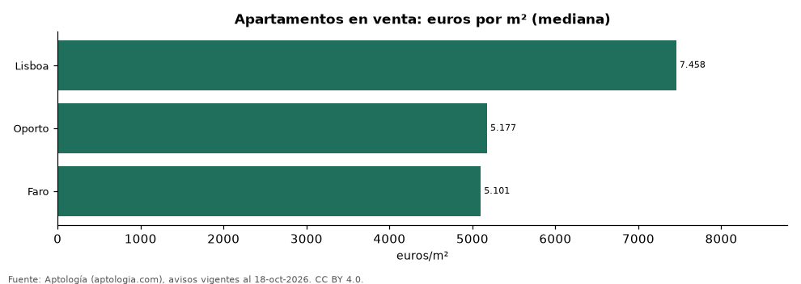

# Precio de la vivienda en Portugal: Lisboa, Oporto y otras ciudades en euros (octubre 2026)

**El metro cuadrado de apartamento más caro se pide en Lisboa, con 7.458 euros (USD 8.383) en la mediana, y el más barato en Faro, con 5.101 euros (USD 5.735).**

*Resumen: comparamos 2.817 avisos de apartamentos en 3 ciudades.*

**Actualizado:** 18 de octubre de 2026 (datos del 18 de octubre de 2026) · **Próxima actualización:** mensual.

## Resumen

| Indicador | Valor |
|---|---|
| Venta más cara | Lisboa: 7.458 euros (USD 8.383) |
| Venta más barata | Faro: 5.101 euros (USD 5.735) |
| Ciudades | 3 |
| Avisos | 2.817 |
| Mayor rentabilidad bruta | Oporto: 3,9 % |

## Ciudades

| Ciudad | Venta: euros por m² | Arriendo 2 hab.: euros al mes | Arriendo: euros por m² al mes | Rentabilidad bruta |
|---|---|---|---|---|
| Lisboa | 7.458 | 1.650 | 22,9 | 3,7 % |
| Oporto | 5.177 | — | 17,0 | 3,9 % |
| Faro | 5.101 | — | — | s. d. % |

Medianas; — indica menos de 30 avisos. La rentabilidad bruta es arriendo por m² × 12 ÷ venta por m², solo cuando ambas operaciones se publican en la misma moneda.

## Preguntas frecuentes

**¿Cuál es la ciudad más cara para comprar vivienda en Portugal?**
Lisboa: 7.458 euros (USD 8.383) por m² en la mediana (octubre de 2026).

**¿Dónde es más barato?**
En Faro: 5.101 euros (USD 5.735) por m².

## Metodología

- **Fuente:** exportes nocturnos de la base de datos de Aptología (aptologia.com) del 18 de octubre de 2026: avisos vigentes de vivienda en portales inmobiliarios de 13 países, recogidos por Aptología y vistos en línea entre el 11 y el 18 de octubre de 2026. Corte: 18 de octubre de 2026.
- **Depuración:** se eliminan duplicados exactos (misma ciudad, zona, tipo, precio, moneda, área, habitaciones y baños) y los precios fuera del percentil 1–99 de cada país, operación, moneda y tipo; el precio por m² usa solo avisos con área declarada entre 12 y 2.000 m² y también se recorta al P1–P99.
- **Qué se mide:** precios pedidos (publicados), no precios de cierre. En arriendo, el canon mensual sin administración, gastos comunes ni condominio.
- **Muestra mínima:** cada cifra publicada se apoya en al menos 30 avisos; las celdas con menos se omiten.
- **Monedas:** nunca se mezclan avisos de monedas distintas sin convertirlos. Conversión a dólares con la tasa de mercado de ExchangeRate-API (open.er-api.com, actualización del 18 Oct 2026): 1 USD = 3.182,80 COP, 1 USD = 18,47 M.N, 1 USD = 5,09 BRL, 1 USD = 3,44 PEN, 1 USD = 982,44 CLP, 1 USD = 1.514,57 ARS, 1 USD = 40,20 UYU, 1 USD = 5.705,37 PYG, 1 USD = 61,27 DOP, 1 USD = 0,89 EUR, 1 USD = 11,72 BOB; la UF chilena a 41.178,64 CLP (mindicador,cl. 18-oct-2026). Los avisos publicados en dólares se usan tal cual.
- **Monedas:** venta en euros y arriendo en euros, la moneda mayoritaria de cada operación; los avisos en otra moneda se excluyen.
- **Limitaciones:** la cobertura depende de los portales que recorre Aptología en cada país y es mayor en las ciudades grandes y en los segmentos medio-alto y alto; el área es la que declara el aviso, sin verificar; los nombres de zona vienen de los portales.
- **Privacidad:** solo se publican agregados; no se publica ningún dato personal, enlace a avisos ni nombre de anunciante.
- **Datos abiertos:** [datos.csv](datos.csv), licencia CC BY 4.0.

## Cómo citar

Pinzón Pineda, D. M. (2026). *Precio de la vivienda en Portugal: Lisboa, Oporto y otras ciudades en euros (octubre 2026)*. Aptología (aptologia.com). https://github.com/elbroker/aptologia-datos/tree/main/estudios/precio-vivienda-ciudades-portugal-2026. Datos: datos.csv, licencia CC BY 4.0.
