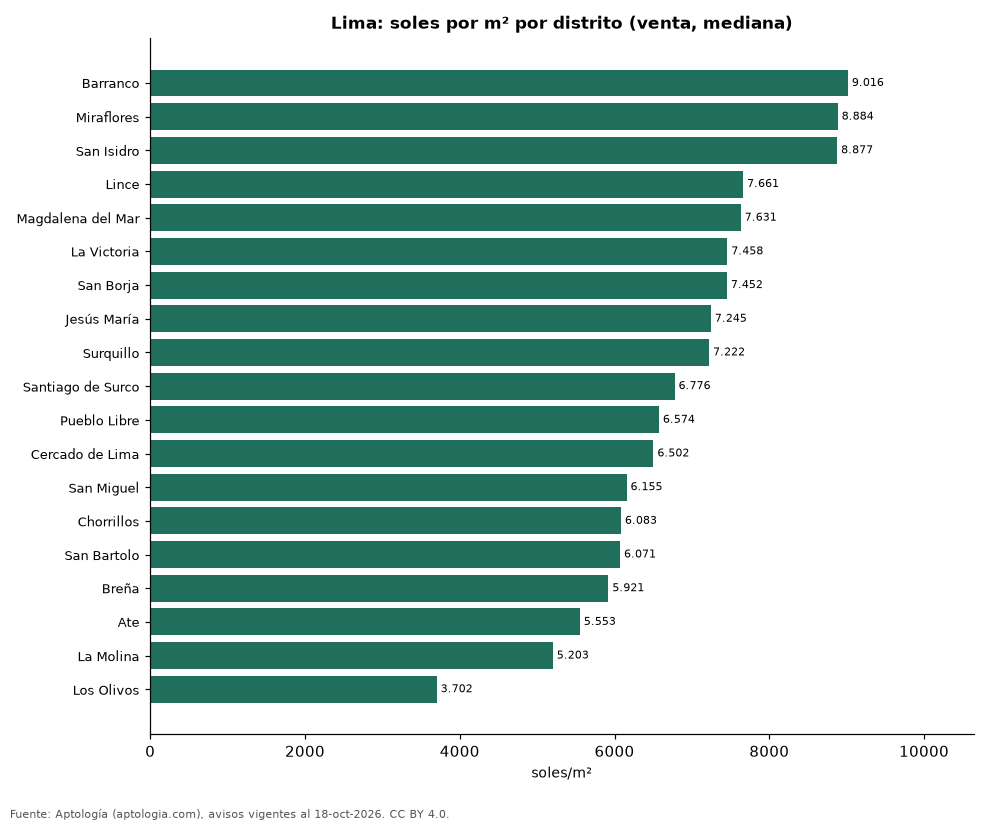

# Precio de la vivienda por distrito en Lima: venta y arriendo en 20 distritos (octubre 2026)

**El distrito con el metro cuadrado más caro de Lima es Barranco, con 9.016 soles (USD 2.624) en la mediana de apartamentos en venta; el más barato de la muestra es Los Olivos, con 3.702 soles (USD 1.078).** En arriendo, el canon mediano más alto se pide en San Isidro (4.810 soles (USD 1.400) al mes) y el más bajo en San Martín de Porres (1.175 soles (USD 342)).

*Resumen: analizamos 8.864 avisos de apartamentos en 20 distritos de Lima con 30 avisos o más.*

**Actualizado:** 18 de octubre de 2026 (datos del 18 de octubre de 2026) · **Próxima actualización:** mensual.

## Resumen

| Indicador | Valor |
|---|---|
| Más caro (venta por m²) | Barranco: 9.016 soles (USD 2.624) |
| Más barato (venta por m²) | Los Olivos: 3.702 soles (USD 1.078) |
| Lima (venta por m², mediana) | 7.343 soles (USD 2.137) |
| Arriendo más alto | San Isidro: 4.810 soles (USD 1.400) |
| Distritos | 20 |

## Distritos de Lima

| Distrito | Venta: soles por m² | Arriendo: soles al mes | Avisos (venta / arriendo) |
|---|---|---|---|
| Barranco | 9.016 | 2.800 | 180 / 161 |
| Miraflores | 8.884 | 3.750 | 1.114 / 935 |
| San Isidro | 8.877 | 4.810 | 685 / 475 |
| Lince | 7.661 | 2.475 | 211 / 72 |
| Magdalena del Mar | 7.631 | 2.500 | 286 / 95 |
| La Victoria | 7.458 | — | 168 / s. d. |
| San Borja | 7.452 | 3.145 | 268 / 95 |
| Jesús María | 7.245 | 2.600 | 272 / 90 |
| Surquillo | 7.222 | 2.200 | 346 / 87 |
| Santiago de Surco | 6.776 | 3.500 | 1.039 / 408 |
| Pueblo Libre | 6.574 | 2.250 | 214 / 58 |
| Cercado de Lima | 6.502 | 2.100 | 315 / 34 |
| San Miguel | 6.155 | 2.000 | 399 / 142 |
| Chorrillos | 6.083 | 1.825 | 242 / 46 |
| San Bartolo | 6.071 | — | 73 / s. d. |
| Breña | 5.921 | — | 76 / s. d. |
| Ate | 5.553 | 1.600 | 50 / 30 |
| La Molina | 5.203 | 2.500 | 69 / 63 |
| Los Olivos | 3.702 | — | 36 / s. d. |
| San Martín de Porres | — | 1.175 | s. d. / 30 |

Medianas de apartamentos; — indica menos de 30 avisos. El canon es el mensual sin gastos comunes, condominio ni administración.

## Preguntas frecuentes

**¿Cuál es el distrito más caro de Lima?**
Barranco, con 9.016 soles (USD 2.624) por m² en apartamentos en venta (octubre de 2026).

**¿Dónde es más barato comprar apartamento en Lima?**
Entre los distritos con 30 avisos o más, en Los Olivos: 3.702 soles (USD 1.078) por m².

**¿Dónde es más caro arrendar en Lima?**
En San Isidro, con un canon mediano de 4.810 soles (USD 1.400) al mes.

## Metodología

- **Fuente:** exportes nocturnos de la base de datos de Aptología (aptologia.com) del 18 de octubre de 2026: avisos vigentes de vivienda en portales inmobiliarios de 13 países, recogidos por Aptología y vistos en línea entre el 11 y el 18 de octubre de 2026. Corte: 18 de octubre de 2026.
- **Depuración:** se eliminan duplicados exactos (misma ciudad, zona, tipo, precio, moneda, área, habitaciones y baños) y los precios fuera del percentil 1–99 de cada país, operación, moneda y tipo; el precio por m² usa solo avisos con área declarada entre 12 y 2.000 m² y también se recorta al P1–P99.
- **Qué se mide:** precios pedidos (publicados), no precios de cierre. En arriendo, el canon mensual sin administración, gastos comunes ni condominio.
- **Muestra mínima:** cada cifra publicada se apoya en al menos 30 avisos; las celdas con menos se omiten.
- **Monedas:** nunca se mezclan avisos de monedas distintas sin convertirlos. Conversión a dólares con la tasa de mercado de ExchangeRate-API (open.er-api.com, actualización del 18 Oct 2026): 1 USD = 3.182,80 COP, 1 USD = 18,47 M.N, 1 USD = 5,09 BRL, 1 USD = 3,44 PEN, 1 USD = 982,44 CLP, 1 USD = 1.514,57 ARS, 1 USD = 40,20 UYU, 1 USD = 5.705,37 PYG, 1 USD = 61,27 DOP, 1 USD = 0,89 EUR, 1 USD = 11,72 BOB; la UF chilena a 41.178,64 CLP (mindicador,cl. 18-oct-2026). Los avisos publicados en dólares se usan tal cual.
- **Monedas:** Venta en soles y arriendo en soles, la moneda en que se publica la mayoría de los avisos de cada operación; los avisos en otra moneda se excluyen. Las equivalencias en dólares entre paréntesis usan la tasa citada.
- **Limitaciones:** la cobertura depende de los portales que recorre Aptología en cada país y es mayor en las ciudades grandes y en los segmentos medio-alto y alto; el área es la que declara el aviso, sin verificar; los nombres de zona vienen de los portales.
- **Privacidad:** solo se publican agregados; no se publica ningún dato personal, enlace a avisos ni nombre de anunciante.
- **Datos abiertos:** [datos.csv](datos.csv), licencia CC BY 4.0.

## Cómo citar

Pinzón Pineda, D. M. (2026). *Precio de la vivienda por distrito en Lima: venta y arriendo en 20 distritos (octubre 2026)*. Aptología (aptologia.com). https://github.com/elbroker/aptologia-datos/tree/main/estudios/precio-vivienda-lima-por-distrito-2026. Datos: datos.csv, licencia CC BY 4.0.
