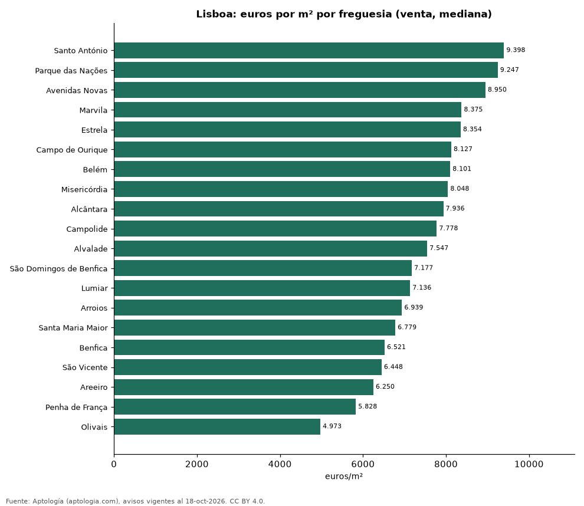

# Precio de la vivienda por freguesia en Lisboa: venta y arriendo en 20 freguesias (octubre 2026)

**La freguesia con el metro cuadrado más caro de Lisboa es Santo António, con 9.398 euros (USD 10.565) en la mediana de apartamentos en venta; la más barata de la muestra es Olivais, con 4.973 euros (USD 5.590).** En arriendo, el canon mediano más alto se pide en Santo António (3.188 euros (USD 3.583) al mes) y el más bajo en Lumiar (1.700 euros (USD 1.911)).

*Resumen: analizamos 1.724 avisos de apartamentos en 20 freguesias de Lisboa con 30 avisos o más.*

**Actualizado:** 18 de octubre de 2026 (datos del 18 de octubre de 2026) · **Próxima actualización:** mensual.

## Resumen

| Indicador | Valor |
|---|---|
| Más cara (venta por m²) | Santo António: 9.398 euros (USD 10.565) |
| Más barata (venta por m²) | Olivais: 4.973 euros (USD 5.590) |
| Lisboa (venta por m², mediana) | 7.458 euros (USD 8.383) |
| Arriendo más alto | Santo António: 3.188 euros (USD 3.583) |
| Freguesias | 20 |

## Freguesias de Lisboa

| Freguesia | Venta: euros por m² | Arriendo: euros al mes | Avisos (venta / arriendo) |
|---|---|---|---|
| Santo António | 9.398 | 3.188 | 126 / 30 |
| Parque das Nações | 9.247 | — | 57 / s. d. |
| Avenidas Novas | 8.950 | 2.300 | 116 / 57 |
| Marvila | 8.375 | — | 56 / s. d. |
| Estrela | 8.354 | — | 112 / s. d. |
| Campo de Ourique | 8.127 | — | 46 / s. d. |
| Belém | 8.101 | — | 41 / s. d. |
| Misericórdia | 8.048 | — | 111 / s. d. |
| Alcântara | 7.936 | — | 50 / s. d. |
| Campolide | 7.778 | — | 45 / s. d. |
| Alvalade | 7.547 | 1.900 | 54 / 38 |
| São Domingos de Benfica | 7.177 | 1.750 | 37 / 31 |
| Lumiar | 7.136 | 1.700 | 157 / 36 |
| Arroios | 6.939 | 1.800 | 121 / 45 |
| Santa Maria Maior | 6.779 | — | 120 / s. d. |
| Benfica | 6.521 | — | 43 / s. d. |
| São Vicente | 6.448 | — | 55 / s. d. |
| Areeiro | 6.250 | — | 41 / s. d. |
| Penha de França | 5.828 | — | 54 / s. d. |
| Olivais | 4.973 | — | 45 / s. d. |

Medianas de apartamentos; — indica menos de 30 avisos. El canon es el mensual sin gastos comunes, condominio ni administración.

## Preguntas frecuentes

**¿Cuál es la freguesia más cara de Lisboa?**
Santo António, con 9.398 euros (USD 10.565) por m² en apartamentos en venta (octubre de 2026).

**¿Dónde es más barato comprar apartamento en Lisboa?**
Entre los freguesias con 30 avisos o más, en Olivais: 4.973 euros (USD 5.590) por m².

**¿Dónde es más caro arrendar en Lisboa?**
En Santo António, con un canon mediano de 3.188 euros (USD 3.583) al mes.

## Metodología

- **Fuente:** exportes nocturnos de la base de datos de Aptología (aptologia.com) del 18 de octubre de 2026: avisos vigentes de vivienda en portales inmobiliarios de 13 países, recogidos por Aptología y vistos en línea entre el 11 y el 18 de octubre de 2026. Corte: 18 de octubre de 2026.
- **Depuración:** se eliminan duplicados exactos (misma ciudad, zona, tipo, precio, moneda, área, habitaciones y baños) y los precios fuera del percentil 1–99 de cada país, operación, moneda y tipo; el precio por m² usa solo avisos con área declarada entre 12 y 2.000 m² y también se recorta al P1–P99.
- **Qué se mide:** precios pedidos (publicados), no precios de cierre. En arriendo, el canon mensual sin administración, gastos comunes ni condominio.
- **Muestra mínima:** cada cifra publicada se apoya en al menos 30 avisos; las celdas con menos se omiten.
- **Monedas:** nunca se mezclan avisos de monedas distintas sin convertirlos. Conversión a dólares con la tasa de mercado de ExchangeRate-API (open.er-api.com, actualización del 18 Oct 2026): 1 USD = 3.182,80 COP, 1 USD = 18,47 M.N, 1 USD = 5,09 BRL, 1 USD = 3,44 PEN, 1 USD = 982,44 CLP, 1 USD = 1.514,57 ARS, 1 USD = 40,20 UYU, 1 USD = 5.705,37 PYG, 1 USD = 61,27 DOP, 1 USD = 0,89 EUR, 1 USD = 11,72 BOB; la UF chilena a 41.178,64 CLP (mindicador,cl. 18-oct-2026). Los avisos publicados en dólares se usan tal cual.
- **Monedas:** Venta en euros y arriendo en euros, la moneda en que se publica la mayoría de los avisos de cada operación; los avisos en otra moneda se excluyen. Las equivalencias en dólares entre paréntesis usan la tasa citada.
- **Limitaciones:** la cobertura depende de los portales que recorre Aptología en cada país y es mayor en las ciudades grandes y en los segmentos medio-alto y alto; el área es la que declara el aviso, sin verificar; los nombres de zona vienen de los portales.
- **Privacidad:** solo se publican agregados; no se publica ningún dato personal, enlace a avisos ni nombre de anunciante.
- **Datos abiertos:** [datos.csv](datos.csv), licencia CC BY 4.0.

## Cómo citar

Pinzón Pineda, D. M. (2026). *Precio de la vivienda por freguesia en Lisboa: venta y arriendo en 20 freguesias (octubre 2026)*. Aptología (aptologia.com). https://github.com/elbroker/aptologia-datos/tree/main/estudios/precio-vivienda-lisboa-por-freguesia-2026. Datos: datos.csv, licencia CC BY 4.0.
