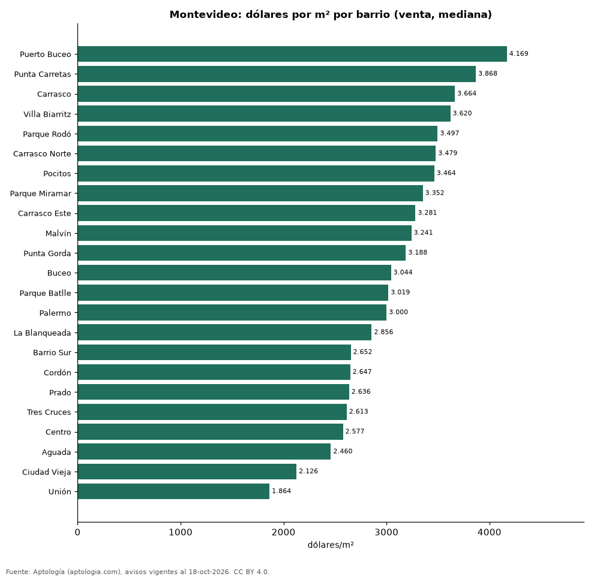

# Precio de la vivienda por barrio en Montevideo: venta y arriendo en 25 barrios (octubre 2026)

**El barrio con el metro cuadrado más caro de Montevideo es Puerto Buceo, con USD 4.169 en la mediana de apartamentos en venta; el más barato de la muestra es Unión, con USD 1.864.** En arriendo, el canon mediano más alto se pide en Punta Carretas (38.500 pesos uruguayos (USD 958) al mes) y el más bajo en Unión (25.000 pesos uruguayos (USD 622)).

*Resumen: analizamos 6.809 avisos de apartamentos en 25 barrios de Montevideo con 30 avisos o más.*

**Actualizado:** 18 de octubre de 2026 (datos del 18 de octubre de 2026) · **Próxima actualización:** mensual.

## Resumen

| Indicador | Valor |
|---|---|
| Más caro (venta por m²) | Puerto Buceo: USD 4.169 |
| Más barato (venta por m²) | Unión: USD 1.864 |
| Montevideo (venta por m², mediana) | USD 3.040 |
| Arriendo más alto | Punta Carretas: 38.500 pesos uruguayos (USD 958) |
| Barrios | 25 |

## Barrios de Montevideo

| Barrio | Venta: dólares por m² | Arriendo: pesos uruguayos al mes | Avisos (venta / arriendo) |
|---|---|---|---|
| Puerto Buceo | 4.169 | — | 38 / s. d. |
| Punta Carretas | 3.868 | 38.500 | 290 / 128 |
| Carrasco | 3.664 | — | 251 / s. d. |
| Villa Biarritz | 3.620 | — | 36 / s. d. |
| Parque Rodó | 3.497 | 33.000 | 98 / 79 |
| Carrasco Norte | 3.479 | — | 124 / s. d. |
| Pocitos | 3.464 | 36.000 | 614 / 352 |
| Parque Miramar | 3.352 | — | 70 / s. d. |
| Carrasco Este | 3.281 | — | 41 / s. d. |
| Malvín | 3.241 | 35.250 | 370 / 172 |
| Punta Gorda | 3.188 | — | 40 / s. d. |
| Buceo | 3.044 | 30.900 | 190 / 93 |
| Parque Batlle | 3.019 | 29.950 | 133 / 102 |
| Palermo | 3.000 | 29.200 | 93 / 78 |
| La Blanqueada | 2.856 | 29.900 | 353 / 247 |
| Barrio Sur | 2.652 | 29.900 | 105 / 74 |
| Cordón | 2.647 | 29.650 | 557 / 388 |
| Prado | 2.636 | 28.003 | 103 / 57 |
| Tres Cruces | 2.613 | 30.500 | 232 / 217 |
| Centro | 2.577 | 29.000 | 274 / 302 |
| Aguada | 2.460 | 26.000 | 88 / 88 |
| Ciudad Vieja | 2.126 | 28.000 | 48 / 103 |
| Unión | 1.864 | 25.000 | 33 / 78 |
| Jacinto Vera | — | 30.800 | s. d. / 36 |
| Larrañaga | — | 28.500 | s. d. / 34 |

Medianas de apartamentos; — indica menos de 30 avisos. El canon es el mensual sin gastos comunes, condominio ni administración.

## Preguntas frecuentes

**¿Cuál es el barrio más caro de Montevideo?**
Puerto Buceo, con USD 4.169 por m² en apartamentos en venta (octubre de 2026).

**¿Dónde es más barato comprar apartamento en Montevideo?**
Entre los barrios con 30 avisos o más, en Unión: USD 1.864 por m².

**¿Dónde es más caro arrendar en Montevideo?**
En Punta Carretas, con un canon mediano de 38.500 pesos uruguayos (USD 958) al mes.

## Metodología

- **Fuente:** exportes nocturnos de la base de datos de Aptología (aptologia.com) del 18 de octubre de 2026: avisos vigentes de vivienda en portales inmobiliarios de 13 países, recogidos por Aptología y vistos en línea entre el 11 y el 18 de octubre de 2026. Corte: 18 de octubre de 2026.
- **Depuración:** se eliminan duplicados exactos (misma ciudad, zona, tipo, precio, moneda, área, habitaciones y baños) y los precios fuera del percentil 1–99 de cada país, operación, moneda y tipo; el precio por m² usa solo avisos con área declarada entre 12 y 2.000 m² y también se recorta al P1–P99.
- **Qué se mide:** precios pedidos (publicados), no precios de cierre. En arriendo, el canon mensual sin administración, gastos comunes ni condominio.
- **Muestra mínima:** cada cifra publicada se apoya en al menos 30 avisos; las celdas con menos se omiten.
- **Monedas:** nunca se mezclan avisos de monedas distintas sin convertirlos. Conversión a dólares con la tasa de mercado de ExchangeRate-API (open.er-api.com, actualización del 18 Oct 2026): 1 USD = 3.182,80 COP, 1 USD = 18,47 M.N, 1 USD = 5,09 BRL, 1 USD = 3,44 PEN, 1 USD = 982,44 CLP, 1 USD = 1.514,57 ARS, 1 USD = 40,20 UYU, 1 USD = 5.705,37 PYG, 1 USD = 61,27 DOP, 1 USD = 0,89 EUR, 1 USD = 11,72 BOB; la UF chilena a 41.178,64 CLP (mindicador,cl. 18-oct-2026). Los avisos publicados en dólares se usan tal cual.
- **Monedas:** Venta en dólares y arriendo en pesos uruguayos, la moneda en que se publica la mayoría de los avisos de cada operación; los avisos en otra moneda se excluyen. Las equivalencias en dólares entre paréntesis usan la tasa citada.
- **Limitaciones:** la cobertura depende de los portales que recorre Aptología en cada país y es mayor en las ciudades grandes y en los segmentos medio-alto y alto; el área es la que declara el aviso, sin verificar; los nombres de zona vienen de los portales.
- **Privacidad:** solo se publican agregados; no se publica ningún dato personal, enlace a avisos ni nombre de anunciante.
- **Datos abiertos:** [datos.csv](datos.csv), licencia CC BY 4.0.

## Cómo citar

Pinzón Pineda, D. M. (2026). *Precio de la vivienda por barrio en Montevideo: venta y arriendo en 25 barrios (octubre 2026)*. Aptología (aptologia.com). https://github.com/elbroker/aptologia-datos/tree/main/estudios/precio-vivienda-montevideo-por-barrio-2026. Datos: datos.csv, licencia CC BY 4.0.
