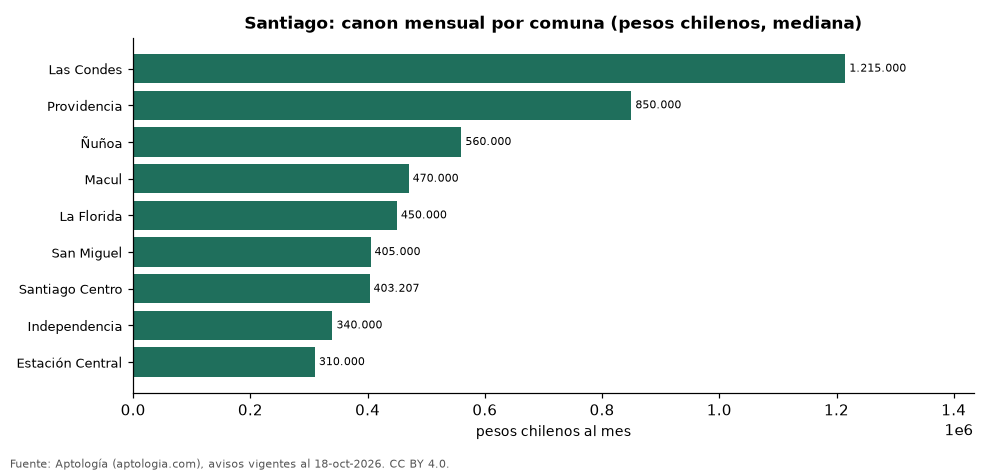

# Precio de la vivienda por comuna en Santiago: arriendo en 9 comunas (octubre 2026)

**Arrendar un apartamento en Santiago cuesta más en Las Condes, con un canon mediano de 1.215.000 pesos chilenos (USD 1.237) al mes, y menos en Estación Central, con 310.000 pesos chilenos (USD 316).** La mediana de la ciudad es 450.000 pesos chilenos (USD 458) al mes; por metro cuadrado, el comuna más caro es Las Condes (16.333,3 pesos chilenos (USD 16,6) por m² al mes).

*Resumen: analizamos 10.367 avisos de apartamentos en 9 comunas de Santiago con 30 avisos o más.*

**Actualizado:** 18 de octubre de 2026 (datos del 18 de octubre de 2026) · **Próxima actualización:** mensual.

## Resumen

| Indicador | Valor |
|---|---|
| Arriendo más alto | Las Condes: 1.215.000 pesos chilenos (USD 1.237) |
| Arriendo más bajo | Estación Central: 310.000 pesos chilenos (USD 316) |
| Santiago (mediana) | 450.000 pesos chilenos (USD 458) |
| Comunas | 9 |

## Comunas de Santiago

| Comuna | Arriendo: pesos chilenos al mes | Avisos |
|---|---|---|
| Las Condes | 1.215.000 | 309 |
| Providencia | 850.000 | 356 |
| Ñuñoa | 560.000 | 520 |
| Macul | 470.000 | 314 |
| La Florida | 450.000 | 493 |
| San Miguel | 405.000 | 459 |
| Santiago Centro | 403.207 | 1.476 |
| Independencia | 340.000 | 344 |
| Estación Central | 310.000 | 381 |

Medianas de apartamentos; — indica menos de 30 avisos. El canon es el mensual sin gastos comunes, condominio ni administración.

## Preguntas frecuentes

**¿Cuál es el comuna más caro para arrendar en Santiago?**
Las Condes, con 1.215.000 pesos chilenos (USD 1.237) al mes en la mediana.

**¿Dónde es más barato arrendar en Santiago?**
En Estación Central: 310.000 pesos chilenos (USD 316) al mes.

## Metodología

- **Fuente:** exportes nocturnos de la base de datos de Aptología (aptologia.com) del 18 de octubre de 2026: avisos vigentes de vivienda en portales inmobiliarios de 13 países, recogidos por Aptología y vistos en línea entre el 11 y el 18 de octubre de 2026. Corte: 18 de octubre de 2026.
- **Depuración:** se eliminan duplicados exactos (misma ciudad, zona, tipo, precio, moneda, área, habitaciones y baños) y los precios fuera del percentil 1–99 de cada país, operación, moneda y tipo; el precio por m² usa solo avisos con área declarada entre 12 y 2.000 m² y también se recorta al P1–P99.
- **Qué se mide:** precios pedidos (publicados), no precios de cierre. En arriendo, el canon mensual sin administración, gastos comunes ni condominio.
- **Muestra mínima:** cada cifra publicada se apoya en al menos 30 avisos; las celdas con menos se omiten.
- **Monedas:** nunca se mezclan avisos de monedas distintas sin convertirlos. Conversión a dólares con la tasa de mercado de ExchangeRate-API (open.er-api.com, actualización del 18 Oct 2026): 1 USD = 3.182,80 COP, 1 USD = 18,47 M.N, 1 USD = 5,09 BRL, 1 USD = 3,44 PEN, 1 USD = 982,44 CLP, 1 USD = 1.514,57 ARS, 1 USD = 40,20 UYU, 1 USD = 5.705,37 PYG, 1 USD = 61,27 DOP, 1 USD = 0,89 EUR, 1 USD = 11,72 BOB; la UF chilena a 41.178,64 CLP (mindicador,cl. 18-oct-2026). Los avisos publicados en dólares se usan tal cual.
- **Monedas:** Arriendo en pesos chilenos; los avisos en otra moneda se excluyen.
- **Limitaciones:** la cobertura depende de los portales que recorre Aptología en cada país y es mayor en las ciudades grandes y en los segmentos medio-alto y alto; el área es la que declara el aviso, sin verificar; los nombres de zona vienen de los portales.
- **Privacidad:** solo se publican agregados; no se publica ningún dato personal, enlace a avisos ni nombre de anunciante.
- **Datos abiertos:** [datos.csv](datos.csv), licencia CC BY 4.0.

## Cómo citar

Pinzón Pineda, D. M. (2026). *Precio de la vivienda por comuna en Santiago: arriendo en 9 comunas (octubre 2026)*. Aptología (aptologia.com). https://github.com/elbroker/aptologia-datos/tree/main/estudios/precio-vivienda-santiago-de-chile-por-comuna-2026. Datos: datos.csv, licencia CC BY 4.0.
