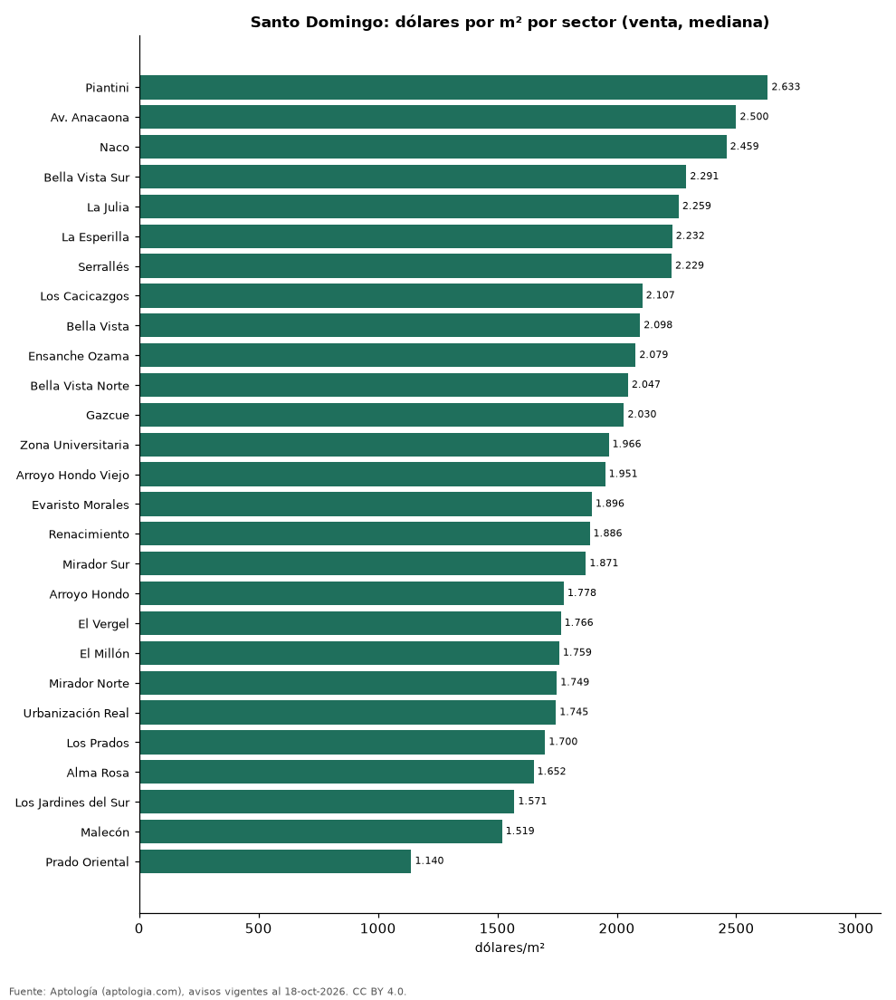

# Precio de la vivienda por sector en Santo Domingo: venta y arriendo en 27 sectores (octubre 2026)

**El sector con el metro cuadrado más caro de Santo Domingo es Piantini, con USD 2.633 en la mediana de apartamentos en venta; el más barato de la muestra es Prado Oriental, con USD 1.140.** En arriendo, el canon mediano más alto se pide en Av. Anacaona (USD 4.000 al mes) y el más bajo en El Vergel (USD 950).

*Resumen: analizamos 6.814 avisos de apartamentos en 27 sectores de Santo Domingo con 30 avisos o más.*

**Actualizado:** 18 de octubre de 2026 (datos del 18 de octubre de 2026) · **Próxima actualización:** mensual.

## Resumen

| Indicador | Valor |
|---|---|
| Más caro (venta por m²) | Piantini: USD 2.633 |
| Más barato (venta por m²) | Prado Oriental: USD 1.140 |
| Santo Domingo (venta por m², mediana) | USD 1.975 |
| Arriendo más alto | Av. Anacaona: USD 4.000 |
| Sectores | 27 |

## Sectores de Santo Domingo

| Sector | Venta: dólares por m² | Arriendo: dólares al mes | Avisos (venta / arriendo) |
|---|---|---|---|
| Piantini | 2.633 | 1.600 | 587 / 583 |
| Av. Anacaona | 2.500 | 4.000 | 67 / 37 |
| Naco | 2.459 | 1.400 | 817 / 394 |
| Bella Vista Sur | 2.291 | 1.500 | 98 / 90 |
| La Julia | 2.259 | 1.200 | 72 / 32 |
| La Esperilla | 2.232 | 1.600 | 220 / 73 |
| Serrallés | 2.229 | 1.200 | 86 / 54 |
| Los Cacicazgos | 2.107 | 1.550 | 112 / 59 |
| Bella Vista | 2.098 | 1.400 | 400 / 317 |
| Ensanche Ozama | 2.079 | — | 89 / s. d. |
| Bella Vista Norte | 2.047 | — | 47 / s. d. |
| Gazcue | 2.030 | 1.000 | 111 / 85 |
| Zona Universitaria | 1.966 | — | 50 / s. d. |
| Arroyo Hondo Viejo | 1.951 | 1.262 | 62 / 36 |
| Evaristo Morales | 1.896 | 1.150 | 348 / 192 |
| Renacimiento | 1.886 | 1.200 | 309 / 96 |
| Mirador Sur | 1.871 | 1.300 | 87 / 53 |
| Arroyo Hondo | 1.778 | 1.298 | 136 / 39 |
| El Vergel | 1.766 | 950 | 36 / 37 |
| El Millón | 1.759 | 1.100 | 234 / 86 |
| Mirador Norte | 1.749 | 1.050 | 100 / 39 |
| Urbanización Real | 1.745 | 1.300 | 51 / 33 |
| Los Prados | 1.700 | — | 65 / s. d. |
| Alma Rosa | 1.652 | — | 108 / s. d. |
| Los Jardines del Sur | 1.571 | — | 41 / s. d. |
| Malecón | 1.519 | 2.000 | 61 / 38 |
| Prado Oriental | 1.140 | — | 47 / s. d. |

Medianas de apartamentos; — indica menos de 30 avisos. El canon es el mensual sin gastos comunes, condominio ni administración.

## Preguntas frecuentes

**¿Cuál es el sector más caro de Santo Domingo?**
Piantini, con USD 2.633 por m² en apartamentos en venta (octubre de 2026).

**¿Dónde es más barato comprar apartamento en Santo Domingo?**
Entre los sectores con 30 avisos o más, en Prado Oriental: USD 1.140 por m².

**¿Dónde es más caro arrendar en Santo Domingo?**
En Av. Anacaona, con un canon mediano de USD 4.000 al mes.

## Metodología

- **Fuente:** exportes nocturnos de la base de datos de Aptología (aptologia.com) del 18 de octubre de 2026: avisos vigentes de vivienda en portales inmobiliarios de 13 países, recogidos por Aptología y vistos en línea entre el 11 y el 18 de octubre de 2026. Corte: 18 de octubre de 2026.
- **Depuración:** se eliminan duplicados exactos (misma ciudad, zona, tipo, precio, moneda, área, habitaciones y baños) y los precios fuera del percentil 1–99 de cada país, operación, moneda y tipo; el precio por m² usa solo avisos con área declarada entre 12 y 2.000 m² y también se recorta al P1–P99.
- **Qué se mide:** precios pedidos (publicados), no precios de cierre. En arriendo, el canon mensual sin administración, gastos comunes ni condominio.
- **Muestra mínima:** cada cifra publicada se apoya en al menos 30 avisos; las celdas con menos se omiten.
- **Monedas:** nunca se mezclan avisos de monedas distintas sin convertirlos. Conversión a dólares con la tasa de mercado de ExchangeRate-API (open.er-api.com, actualización del 18 Oct 2026): 1 USD = 3.182,80 COP, 1 USD = 18,47 M.N, 1 USD = 5,09 BRL, 1 USD = 3,44 PEN, 1 USD = 982,44 CLP, 1 USD = 1.514,57 ARS, 1 USD = 40,20 UYU, 1 USD = 5.705,37 PYG, 1 USD = 61,27 DOP, 1 USD = 0,89 EUR, 1 USD = 11,72 BOB; la UF chilena a 41.178,64 CLP (mindicador,cl. 18-oct-2026). Los avisos publicados en dólares se usan tal cual.
- **Monedas:** Venta en dólares y arriendo en dólares, la moneda en que se publica la mayoría de los avisos de cada operación; los avisos en otra moneda se excluyen. Las equivalencias en dólares entre paréntesis usan la tasa citada.
- **Limitaciones:** la cobertura depende de los portales que recorre Aptología en cada país y es mayor en las ciudades grandes y en los segmentos medio-alto y alto; el área es la que declara el aviso, sin verificar; los nombres de zona vienen de los portales.
- **Privacidad:** solo se publican agregados; no se publica ningún dato personal, enlace a avisos ni nombre de anunciante.
- **Datos abiertos:** [datos.csv](datos.csv), licencia CC BY 4.0.

## Cómo citar

Pinzón Pineda, D. M. (2026). *Precio de la vivienda por sector en Santo Domingo: venta y arriendo en 27 sectores (octubre 2026)*. Aptología (aptologia.com). https://github.com/elbroker/aptologia-datos/tree/main/estudios/precio-vivienda-santo-domingo-por-sector-2026. Datos: datos.csv, licencia CC BY 4.0.
