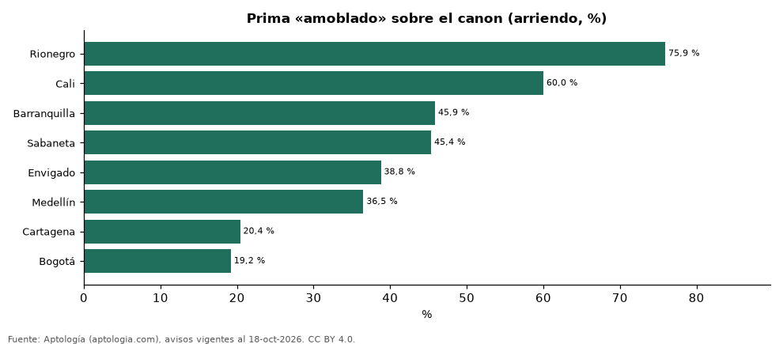

# Cuánto más cuesta arrendar amoblado en Colombia, ciudad por ciudad y por estrato (octubre 2026)

**Frente a apartamentos comparables de la misma ciudad, estrato, habitaciones y tamaño, la característica «amoblado» cambia el canon +31,8 % en promedio en Colombia. La prima más alta está en Rionegro (+75,9 %) y la más baja en Bogotá (+19,2 %).**

*Resumen: comparamos 32.909 apartamentos en arriendo con y sin la característica en 68 celdas de ciudad × estrato × habitaciones × tamaño, con 30 avisos o más de cada lado.*

**Actualizado:** 18 de octubre de 2026 (datos del 18 de octubre de 2026) · **Próxima actualización:** mensual.

## Resumen

| Indicador | Valor |
|---|---|
| Prima promedio | +31,8 % |
| Más alta | Rionegro: +75,9 % |
| Más baja | Bogotá: +19,2 % |
| Ciudades | 8 |

## Prima por ciudad

| Ciudad | Diferencia en el canon | Celdas comparadas | Avisos con / sin |
|---|---|---|---|
| Rionegro | +75,9 % | 1 | 38 / 67 |
| Cali | +60,0 % | 1 | 31 / 232 |
| Barranquilla | +45,9 % | 8 | 328 / 1.275 |
| Sabaneta | +45,4 % | 3 | 117 / 1.849 |
| Envigado | +38,8 % | 4 | 227 / 2.759 |
| Medellín | +36,5 % | 26 | 2.986 / 13.850 |
| Cartagena | +20,4 % | 7 | 298 / 500 |
| Bogotá | +19,2 % | 18 | 1.665 / 6.687 |

Promedio de las diferencias de mediana en celdas comparables, ponderado por los avisos con la característica.

## Prima por estrato (todas las ciudades)

| Estrato | Diferencia en el canon | Celdas comparadas | Avisos con / sin |
|---|---|---|---|
| 3 | +29,1 % | 4 | 246 / 1.833 |
| 4 | +36,4 % | 13 | 734 / 5.254 |
| 5 | +34,9 % | 24 | 1.375 / 8.247 |
| 6 | +29,7 % | 27 | 3.335 / 11.885 |

## Preguntas frecuentes

**¿Cuánto más cuesta arrendar amoblado en Colombia?**
+31,8 % en el canon frente a apartamentos comparables (octubre de 2026).

**¿En qué ciudad pesa más?**
En Rionegro: +75,9 %.

## Metodología

- **Fuente:** exportes nocturnos de la base de datos de Aptología (aptologia.com) del 18 de octubre de 2026: avisos vigentes de vivienda en portales inmobiliarios de 13 países, recogidos por Aptología y vistos en línea entre el 11 y el 18 de octubre de 2026. Corte: 18 de octubre de 2026.
- **Depuración:** se eliminan duplicados exactos (misma ciudad, zona, tipo, precio, moneda, área, habitaciones y baños) y los precios fuera del percentil 1–99 de cada país, operación, moneda y tipo; el precio por m² usa solo avisos con área declarada entre 12 y 2.000 m² y también se recorta al P1–P99.
- **Qué se mide:** precios pedidos (publicados), no precios de cierre. En arriendo, el canon mensual sin administración, gastos comunes ni condominio.
- **Muestra mínima:** cada cifra publicada se apoya en al menos 30 avisos; las celdas con menos se omiten.
- **Colombia:** Precios en pesos colombianos, sin conversión de moneda.
- **Comparación emparejada:** dentro de cada celda de ciudad × estrato × habitaciones × rango de área se comparan las medianas del canon con y sin la característica; solo celdas con 30 avisos o más de cada lado; los promedios se ponderan por los avisos con la característica. Para no confundir el efecto con el tamaño, las celdas también se separan por rango de área declarada (<50, 50–70, 70–90, 90–120, 120–160 y más de 160 m²); solo entran avisos con área.
- **Limitaciones:** la cobertura depende de los portales que recorre Aptología en cada país y es mayor en las ciudades grandes y en los segmentos medio-alto y alto; el área es la que declara el aviso, sin verificar; los nombres de zona vienen de los portales.
- **Privacidad:** solo se publican agregados; no se publica ningún dato personal, enlace a avisos ni nombre de anunciante.
- **Datos abiertos:** [datos.csv](datos.csv), licencia CC BY 4.0.

## Cómo citar

Pinzón Pineda, D. M. (2026). *Cuánto más cuesta arrendar amoblado en Colombia, ciudad por ciudad y por estrato (octubre 2026)*. Aptología (aptologia.com). https://github.com/elbroker/aptologia-datos/tree/main/estudios/prima-amoblado-arriendo-por-ciudad-y-estrato-colombia-2026. Datos: datos.csv, licencia CC BY 4.0.
