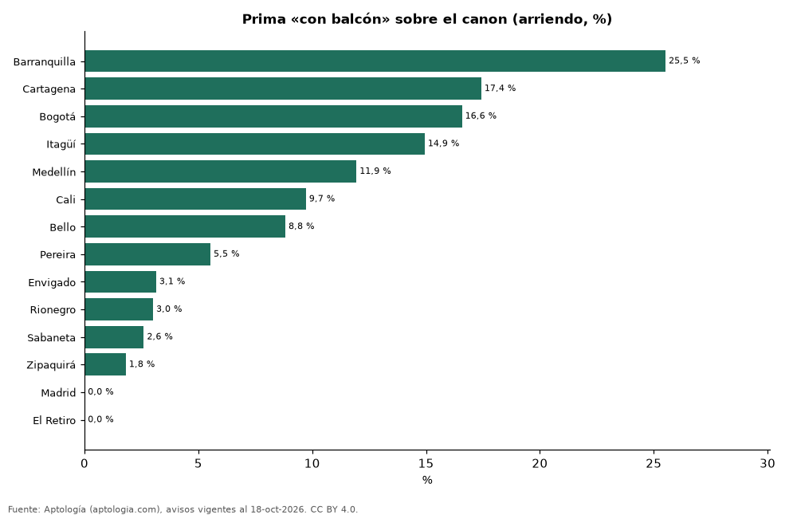

# Cuánto más cuesta arrendar un apartamento con balcón en Colombia, ciudad por ciudad y por estrato (octubre 2026)

**Frente a apartamentos comparables de la misma ciudad, estrato, habitaciones y tamaño, la característica «con balcón» cambia el canon +11,0 % en promedio en Colombia. La prima más alta está en Barranquilla (+25,5 %) y la más baja en El Retiro (-8,3 %).**

*Resumen: comparamos 45.854 apartamentos en arriendo con y sin la característica en 127 celdas de ciudad × estrato × habitaciones × tamaño, con 30 avisos o más de cada lado.*

**Actualizado:** 18 de octubre de 2026 (datos del 18 de octubre de 2026) · **Próxima actualización:** mensual.

## Resumen

| Indicador | Valor |
|---|---|
| Prima promedio | +11,0 % |
| Más alta | Barranquilla: +25,5 % |
| Más baja | El Retiro: -8,3 % |
| Ciudades | 14 |

## Prima por ciudad

| Ciudad | Diferencia en el canon | Celdas comparadas | Avisos con / sin |
|---|---|---|---|
| Barranquilla | +25,5 % | 16 | 1.783 / 960 |
| Cartagena | +17,4 % | 1 | 84 / 31 |
| Bogotá | +16,6 % | 35 | 6.083 / 5.987 |
| Itagüí | +14,9 % | 1 | 110 / 32 |
| Medellín | +11,9 % | 34 | 14.556 / 4.395 |
| Cali | +9,7 % | 3 | 333 / 138 |
| Bello | +8,8 % | 1 | 242 / 48 |
| Pereira | +5,5 % | 5 | 398 / 227 |
| Envigado | +3,1 % | 11 | 4.805 / 495 |
| Rionegro | +3,0 % | 9 | 1.568 / 492 |
| Sabaneta | +2,6 % | 7 | 2.305 / 430 |
| Zipaquirá | +1,8 % | 1 | 41 / 37 |
| Madrid | -2,1 % | 2 | 119 / 62 |
| El Retiro | -8,3 % | 1 | 59 / 34 |

Promedio de las diferencias de mediana en celdas comparables, ponderado por los avisos con la característica.

## Prima por estrato (todas las ciudades)

| Estrato | Diferencia en el canon | Celdas comparadas | Avisos con / sin |
|---|---|---|---|
| 2 | +9,1 % | 1 | 31 / 125 |
| 3 | +9,2 % | 23 | 2.407 / 3.162 |
| 4 | +8,0 % | 36 | 7.687 / 3.698 |
| 5 | +9,5 % | 36 | 10.138 / 2.758 |
| 6 | +14,4 % | 31 | 12.223 / 3.625 |

## Preguntas frecuentes

**¿Cuánto más cuesta arrendar un apartamento con balcón en Colombia?**
+11,0 % en el canon frente a apartamentos comparables (octubre de 2026).

**¿En qué ciudad pesa más?**
En Barranquilla: +25,5 %.

## Metodología

- **Fuente:** exportes nocturnos de la base de datos de Aptología (aptologia.com) del 18 de octubre de 2026: avisos vigentes de vivienda en portales inmobiliarios de 13 países, recogidos por Aptología y vistos en línea entre el 11 y el 18 de octubre de 2026. Corte: 18 de octubre de 2026.
- **Depuración:** se eliminan duplicados exactos (misma ciudad, zona, tipo, precio, moneda, área, habitaciones y baños) y los precios fuera del percentil 1–99 de cada país, operación, moneda y tipo; el precio por m² usa solo avisos con área declarada entre 12 y 2.000 m² y también se recorta al P1–P99.
- **Qué se mide:** precios pedidos (publicados), no precios de cierre. En arriendo, el canon mensual sin administración, gastos comunes ni condominio.
- **Muestra mínima:** cada cifra publicada se apoya en al menos 30 avisos; las celdas con menos se omiten.
- **Colombia:** Precios en pesos colombianos, sin conversión de moneda.
- **Comparación emparejada:** dentro de cada celda de ciudad × estrato × habitaciones × rango de área se comparan las medianas del canon con y sin la característica; solo celdas con 30 avisos o más de cada lado; los promedios se ponderan por los avisos con la característica. Para no confundir el efecto con el tamaño, las celdas también se separan por rango de área declarada (<50, 50–70, 70–90, 90–120, 120–160 y más de 160 m²); solo entran avisos con área.
- **Limitaciones:** la cobertura depende de los portales que recorre Aptología en cada país y es mayor en las ciudades grandes y en los segmentos medio-alto y alto; el área es la que declara el aviso, sin verificar; los nombres de zona vienen de los portales.
- **Privacidad:** solo se publican agregados; no se publica ningún dato personal, enlace a avisos ni nombre de anunciante.
- **Datos abiertos:** [datos.csv](datos.csv), licencia CC BY 4.0.

## Cómo citar

Pinzón Pineda, D. M. (2026). *Cuánto más cuesta arrendar un apartamento con balcón en Colombia, ciudad por ciudad y por estrato (octubre 2026)*. Aptología (aptologia.com). https://github.com/elbroker/aptologia-datos/tree/main/estudios/prima-balcon-arriendo-por-ciudad-y-estrato-colombia-2026. Datos: datos.csv, licencia CC BY 4.0.
